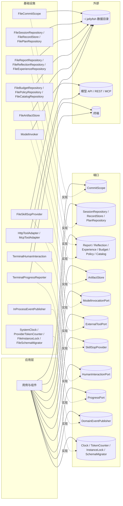
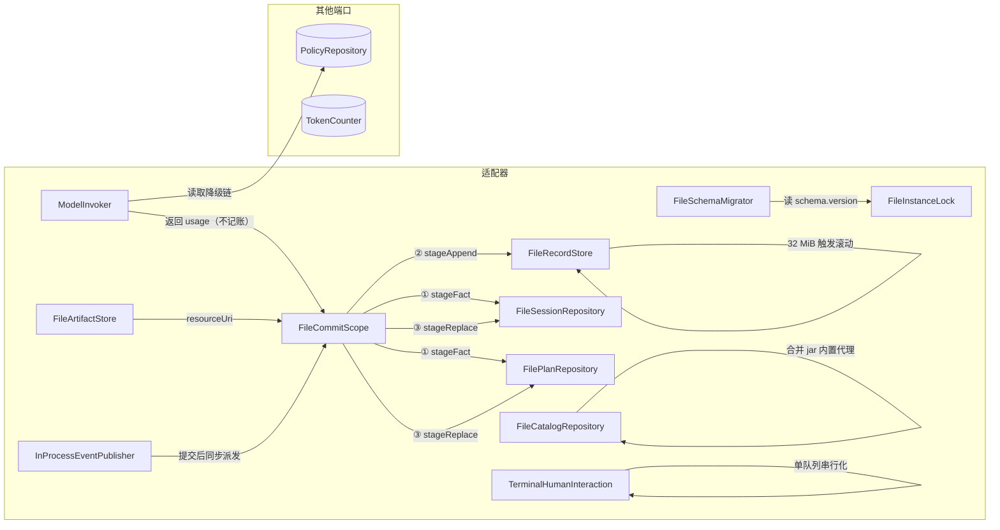
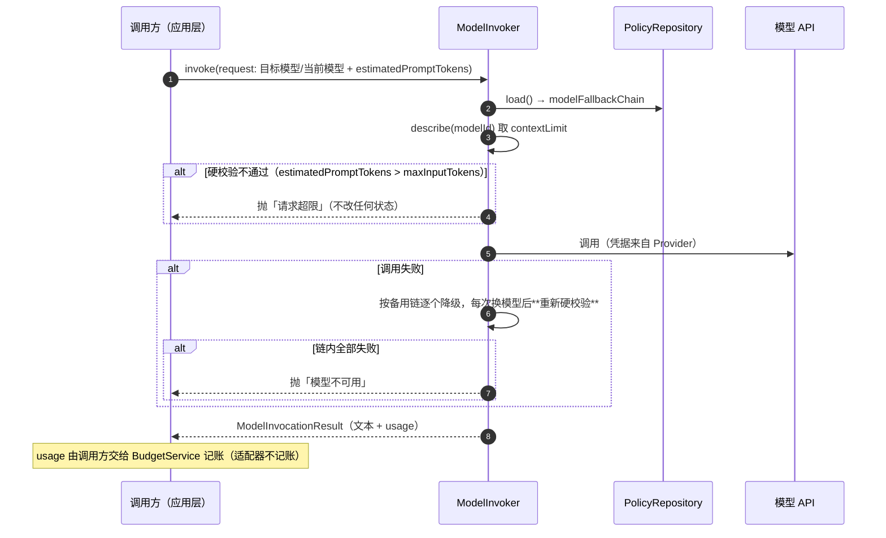

# 【基础设施层】

> 基础设施层回答一个问题：**端口背后到底是什么** —— 文件、模型、终端、时钟。
> 它只做两件事：**实现端口**、**承载技术细节**（格式、原子性、并发、迁移、日志）。
> 它**不含业务规则**，也**不决定顺序**（顺序由应用层的 `CommitScope` 契约约束，这里只负责忠实执行）。

## 模块边界

| 方向 | 内容 |
|---|---|
| 本层对象 | 22 个适配器（实现 21 个端口，部分端口有多个实现） |
| 本层依赖 | 只依赖**端口接口**与 JDK；**不依赖应用层与领域层的具体类**（值以 JSON 传递） |
| 谁依赖本层 | 启动装配（组装端口实现并注入应用层） |
| 本层**不**负责 | 业务判断、状态机、事务的"决定"（只执行既定的提交顺序） |

> **三条纪律**
> ① 适配器之间只通过**端口**协作，不直接引用彼此的实现类；
> ② 一切写入落地都要经过**原子写协议**（`.tmp` → fsync → rename → fsync 目录）；
> ③ 本层不认识聚合——它只认"路径 + JSON 文本"和"记录行"。

---

## 1. 适配器总览图



---

## 2. 对象操作图



---

## 3. 适配器清单

| 端口 | 适配器 | 落点 | 要点 |
|---|---|---|---|
| `CommitScope` | `FileCommitScope` | 各目标目录 | **固定顺序执行**：事实 → 追加 → 替换；每条走原子写；`commit()` 结束时统一 fsync |
| `SessionRepository` | `FileSessionRepository` | `sessions/<rootId>/meta.json`、`sessions/<rootId>/sub/<childId>/meta.json` | 原子替换；`archive` = 整族移动到 `archive/`；`delete` = 整族递归删除（含 `sub/`） |
| `RecordStore` | `FileRecordStore` | `sessions/<…>/records-NNNN.jsonl`（含 `sub/`） | 追加 + fsync；**超过 32 MiB 滚动**；`range` 基于 `seq` |
| `PlanRepository` | `FilePlanRepository` | `sessions/<id>/plans/<planId>.json` | 原子替换；`findRunning` 扫目录（对账用） |
| `VerificationReportRepository` | `FileReportRepository` | `sessions/<id>/reports/<id>.json` | **只新建，不覆盖** |
| `ReflectionRepository` | `FileReflectionRepository` | `sessions/<id>/reflections/<id>.json` | 只新建，不覆盖 |
| `ExperienceRepository` | `FileExperienceRepository` | `experience/<id>.json` | 只新建；合并 = 新版本 + 归档旧文件 |
| `BudgetRepository` | `FileBudgetRepository` | `sessions/<rootId>/budget.json` | 原子替换（高频小文件） |
| `PolicyRepository` | `FilePolicyRepository` | `settings.json` | 原子替换；不存在时写默认值 |
| `CatalogRepository` | `FileCatalogRepository` | `agents/*.md`、`skills/*/SKILL.md`、`tools|providers|models/*.json` | **合并两个来源**：jar 内内置代理 + 磁盘用户代理；内置 id 前缀 `builtin.` 保留 |
| `ArtifactStore` | `FileArtifactStore` | `sessions/<…>/artifacts/<recordId>.<ext>` | 只新建；删除会话族时随目录删除 |
| `ModelInvocationPort` | `ModelInvoker` | —（网络） | 选模型 → 硬校验 → 调用 → **降级链**；**只返回 usage，不记账** |
| `ExternalToolPort` | `HttpToolAdapter` / `McpToolAdapter` | —（网络） | 工具自带超时；结果原样返回给应用层截断 |
| `SkillSopProvider` | `FileSkillSopProvider` | `skills/<skillId>/SKILL.md` | 解析 front-matter + 正文；缺失或非 active 返回"不可用" |
| `HumanInteractionPort` | `TerminalHumanInteraction` | —（终端） | **单队列**：所有来源排队、逐个呈现、标注来源；`cancel` 可唤醒 |
| `ProgressPort` | `TerminalProgressReporter` | —（终端） | 单向推送；丢弃不影响业务 |
| `DomainEventPublisher` | `InProcessEventPublisher` | —（内存） | 提交后同步派发；订阅方必须短、幂等、不阻塞 |
| `Clock` | `SystemClock` | — | 便于测试替换 |
| `TokenCounter` | `CompositeTokenCounter`（策略链：jtokkit → 可选 count API → 估算兜底） | —（本地分词器） | 事前估算（决定折叠）；台账仍用厂商 usage，偏差由 `UsageCalibrator` 收敛 |
| `InstanceLock` | `FileInstanceLock` | `locks/jellyfish.lock` | **`FileChannel.tryLock`**（进程退出由 OS 自动释放），附带写入启动时间用于诊断 |
| `SchemaMigrator` | `FileSchemaMigrator` | `schema.version` | 顺序执行内置迁移；**不自动建表/改结构** |

---

### 3.1 本层的内部辅助类（不单独建模，但规则在这里落地）

| 类 | 承担的契约 |
|---|---|
| `DataDirectory` | 数据目录布局；路径拼装只在这一点 |
| `AtomicFiles` | 原子写与追加（`.tmp → fsync → rename → fsync 目录`），同一路径写入串行化 |
| `SessionDirs` | `sessionId → 目录`：先看顶层，再扫 `sub/`（深度 ≤ 2） |
| `PlanOwnerIndex` | `planId → sessionId`：报告/反思落盘需要知道计划所属会话 |
| `JsonCodec` / `IdJsonModule` / `*Dto` | 序列化配置与"聚合 ↔ 文件"的映射（`Id` 在 JSON 里是字符串） |
| `ToolCatalog` / `AgentCatalog` / `ProviderCatalog` / `ModelCatalog` / `SkillCatalog` | 五类目录的"jar 内置 + 磁盘"合并 |
| `BuiltinAssets` / `FrontMatter` | jar 内资产清单读取、人写资产的 front-matter 解析 |
| `ModelResponseFormatException` | 模型响应无法解析（不可重试的技术异常） |
| `MaskingLayout` | 日志 Layout：key 命中敏感词的值统一替换为 `***`（D14-2、D18-3） |
| `Log4jTechnicalLog` | 把 `TechnicalLog` 声明的事件落到 Log4j 的 key=value 行 |
| `ModelCallLog` | 模型侧技术事件：重试 / 降级 / 不可用（不记对话正文） |

## 4. 目录布局与文件形态

```
~/.jellyfish/
├── schema.version                    # 迁移版本（单行文本）
├── settings.json                     # RuntimePolicy
├── agents/<agentId>.md               # 人写：代理定义（markdown + YAML front-matter）
├── skills/<skillId>/SKILL.md         # 人写：技能 SOP（单文件，front-matter + 正文）
├── tools/<toolId>.json               # 系统管
├── providers/<providerId>.json       # 系统管（凭据只存引用）
├── models/<modelId>.json             # 系统管
├── sessions/<rootId>/                # 主会话
│   ├── meta.json                     #   parentId = null
│   ├── records-0001.jsonl            #   超过 32 MiB 滚到 0002…
│   ├── plans/<planId>.json
│   ├── reports/<reportId>.json       #   不可变
│   ├── reflections/<reflectionId>.json
│   ├── artifacts/<recordId>.<ext>
│   ├── budget.json                   #   会话族台账（只有主会话有）
│   └── sub/<childId>/                # 子代理会话（与主会话同构，无 budget.json）
│       ├── meta.json                 #   parentId = <rootId>
│       ├── records-0001.jsonl
│       └── plans/ reports/ reflections/ artifacts/
├── experience/<experienceId>.json    # 全局资产
├── archive/<sessionId>/              # 归档：明文、只读、不可 resume
├── logs/                             # 运行日志（按天滚动）
└── locks/jellyfish.lock
```

`cache`（会话路径索引、流水索引、经验索引、分词缓存）在 `$TMPDIR/jellyfish/`，**可整目录删除并重建**。

- 子会话路径无法由 `childId` 直接拼出（要先知道 `rootId`），因此维护 `cache/index/sessions.json`：`sessionId → 相对路径`；
- 索引缺失时按 `sessions/*/meta.json` 与 `sessions/*/sub/*/meta.json` 重建（深度 ≤ 2，代价可忽略）；
- **领域模型只认 `sessionId`**，路径解析完全属于本层。

### 文件形态三分

| 类别 | 谁写 | 形态 |
|---|---|---|
| **人写资产** | 用户 / 仓库 | markdown + YAML front-matter（`agents/*.md`、`skills/*/SKILL.md`） |
| **系统配置** | 界面 / 平台初始化 | 纯 JSON（`settings.json`、`tools|providers|models`） |
| **内部状态** | 应用 | 紧凑单行 JSON / JSONL |

`agents/reviewer.md` 示例：

```markdown
---
name: 代码审查员
description: 只读代码并给出结构化评审意见
tools: [read_file, grep, git_diff]
skills: [code-review]
status: active
---
你是资深代码审查员。优先指出正确性问题，其次可维护性。
```

> 内置代理（`builtin.reflect` / `builtin.judge` / `builtin.retrieve` / `builtin.distill`）**不落盘**，作为 jar 内资源随发布走；`agents/` 只放用户自建，且 id 不得以 `builtin.` 开头。

---

## 5. 原子写与 fsync 协议

```
write(path):
    tmp = path + ".tmp"
    writeAll(tmp, bytes)        # 同目录，保证同一文件系统
    fsync(tmp)
    rename(tmp, path)           # 原子替换
    fsync(parentDir)
```

`append(path, line)`：

```
open(path, APPEND)
write(line + "\n")
fsync(path)                     # 单写者保证不交错
```

同一路径的写入按目标路径串行化：子代理并行改同一个 `budget.json`、或在同一 `sub/` 下建目录时，
不会互相覆盖临时文件或撞"目录已存在"。

`FileCommitScope.commit()` 的固定顺序：

```
① 所有 stageFact  → 原子写（只新建，若已存在则跳过，幂等）
② 所有 stageAppend → 追加 + fsync
③ 所有 stageReplace → 原子替换
④ fsync 涉及的目录
```

---

## 6. 启动技术清理（与业务对账分工）

> 应用层的 `StartupReconciler` 管**业务语义**（报告与状态不一致等 5 条）；本节只管**文件层面的残留**，两者不重叠。

| 残留 | 处理 |
|---|---|
| `*.tmp` | 直接删除（rename 未完成 ⇒ 旧文件仍有效） |
| `records-NNNN.jsonl` 末尾半行（无换行） | 截断到最后一条完整行 |
| `locks/jellyfish.lock` 存在但无人持锁 | 由 `FileChannel.tryLock` 判定（进程退出由 OS 释放），可直接重新获取 |
| `archive/<id>/` 存在但 `sessions/<id>/` 仍存在 | 删除 `sessions/<id>/`（归档已完成，含其 `sub/`） |
| `sub/` 下出现第二层 `sub/` | 违反"子代理不得再开子代理"，告警并忽略该目录 |
| `cache/` 目录 | 启动时视为不可信，必要时整目录清空重建 |

---

## 7. 并发与锁

| 点 | 机制 |
|---|---|
| 多实例 | `InstanceLock`：`locks/jellyfish.lock` 上 `FileChannel.tryLock`（进程级互斥，进程退出由 OS 释放）；获取失败则拒绝启动并提示，档内附 `startedAt` 便于诊断 |
| 写并发 | **每个会话一个写者**：主循环写主会话目录，子代理各自写 `sub/<childId>/`；同一会话内由 `CommitScope` 串行 |
| 读并发 | 读操作无锁（依赖 rename 的原子性：读到的要么是旧版本、要么是新版本） |
| 终端输入 | `TerminalHumanInteraction` 由独立读取线程收输入，提问队列串行呈现 |

---

## 8. 日志与可观测

| 通道 | 内容 | 实现 |
|---|---|---|
| `logs/` | 运行日志（按天滚动，保留 N 天） | 本地文件；只记技术事件，不记领域事实（领域事实在 `records`/`reports`） |
| `ProgressPort` | 面向用户的进度：压缩中、子代理并行、步骤推进、模型降级 | 终端渲染，可丢弃 |
| `DomainEventPublisher` | 领域事件（提交后） | 进程内同步派发，订阅方只做通知类动作 |

> 三者语义不同，**不可合并**：日志是排障、进度是给人看、领域事件是业务事实。

---

## 9. 迁移

- `schema.version` 存单个整数；
- 启动顺序：取锁 → 读 `schema.version` → 顺序执行内置迁移 → 写回版本号；
- 迁移只做**向前**（不提供回滚），失败即中止启动并保留原目录；
- **不引入自动 DDL 式迁移**（本地应用最怕"自动改结构"），每一步迁移都显式写在代码里。

---

## 10. `ModelInvoker` 的实现要点（唯一有技术策略的适配器）



两点约定：

1. **适配器不记账**：`ModelInvoker` 只返回 `usage`，由调用方（`ReActLoop` / `ContextWindowService` / `SessionTitleGenerator`）交给 `BudgetService` —— 否则会出现"基础设施 → 应用层"的反向依赖。
2. **降级要重新硬校验**：备用链里可能是小上下文模型，`maxInputTokens` 必须按**实际要用的模型**重新比较。
3. **线协议由 `Provider.protocol` 选择**：`ModelInvoker` 按协议查实现（`ChatProtocol` → `ChatCompletionsProtocol` 等），共享同一个 OkHttp 客户端（D16-5、M14）；本期只实现 `OPENAI_CHAT`，新增协议只加一个实现类与一个枚举常量。映射细则（技术决策 D16）：`request.systemPrompt` → 首条 `role=system` 消息；`ChatMessage` → `messages`；`ToolCall` → `tool_calls`；`usage.prompt_tokens / completion_tokens` → `ModelUsage`；`servedModelId` 回填实际模型（降级后与目标不同）。
4. **不碰聚合**：`ModelInvoker` 只回填 `servedModelId`，`switchModel` 由调用方在收到结果后执行（见《模块-行动》§8.2）。

---

## 11. 与其他文档的对应

| 关注点 | 唯一出处 |
|---|---|
| 领域规则、聚合不变量 | 四份模块文档 + `模型图.md` |
| 用例编排、事务顺序、端口契约、并发模型、错误语义 | 《模块-应用层》 |
| 目录布局、文件形态、原子写、启动清理、锁、迁移、适配器实现 | **本文档** |
