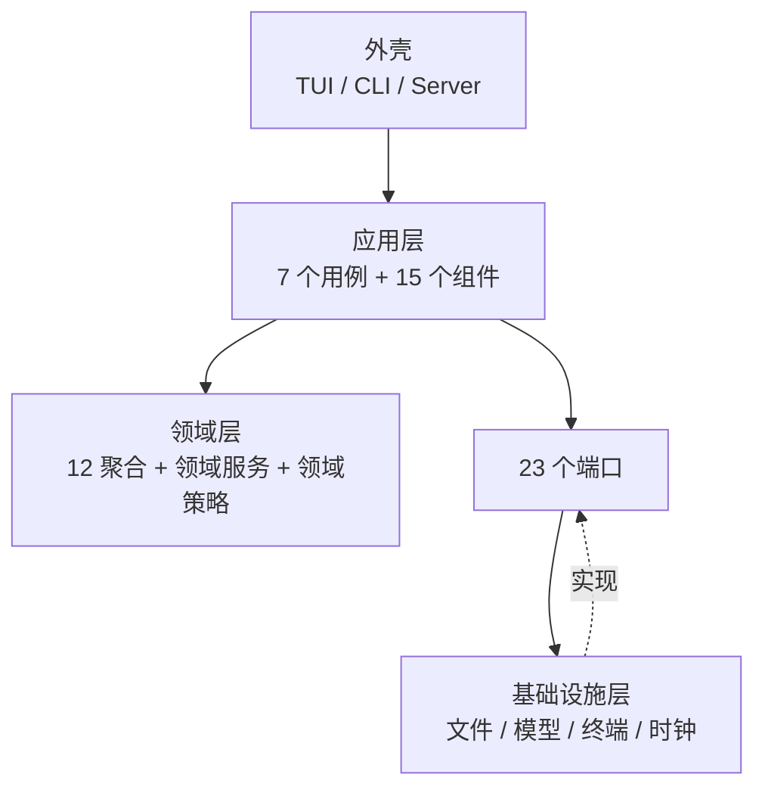
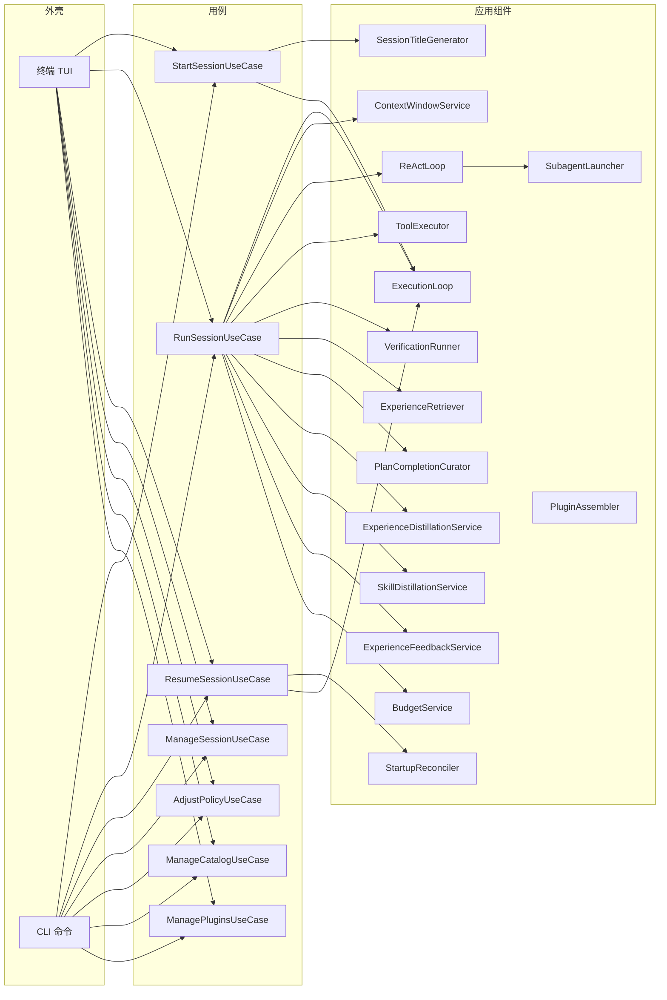
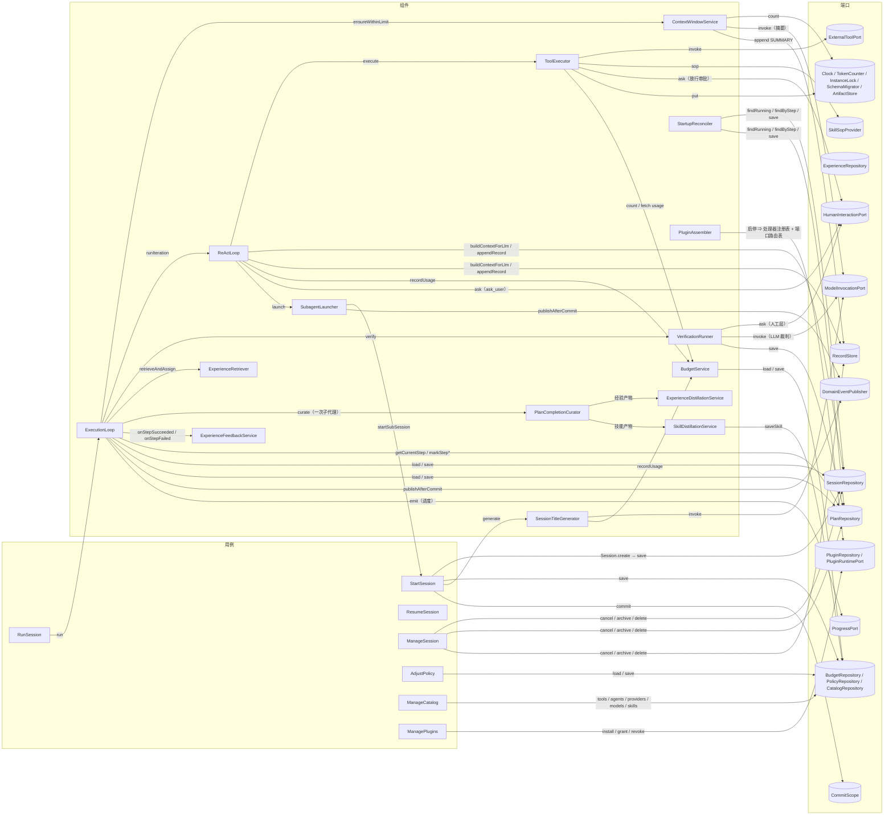
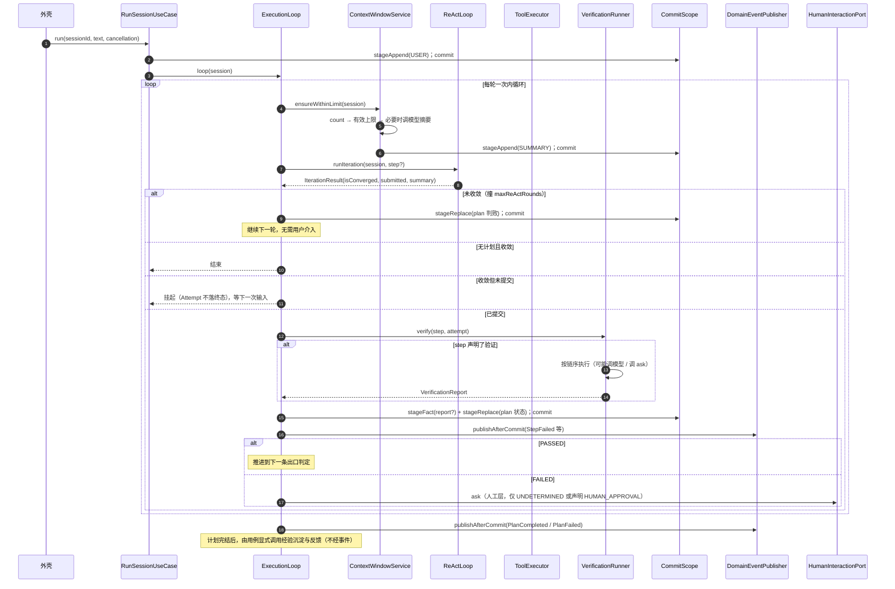
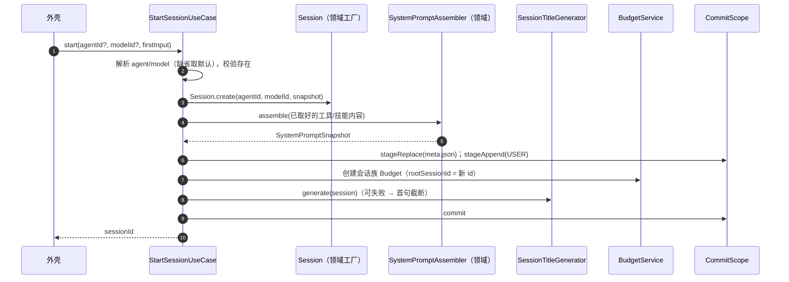
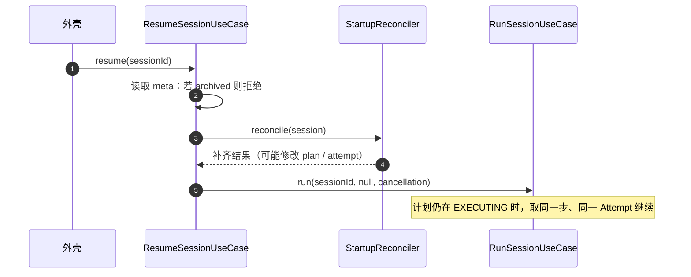
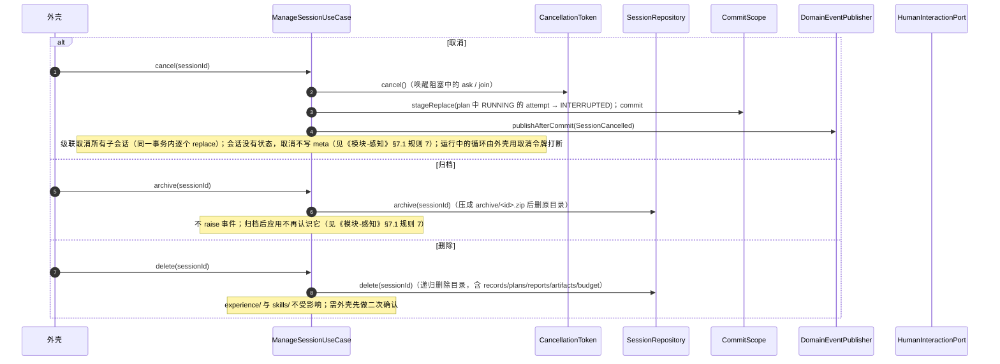
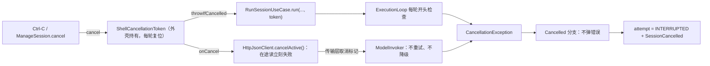
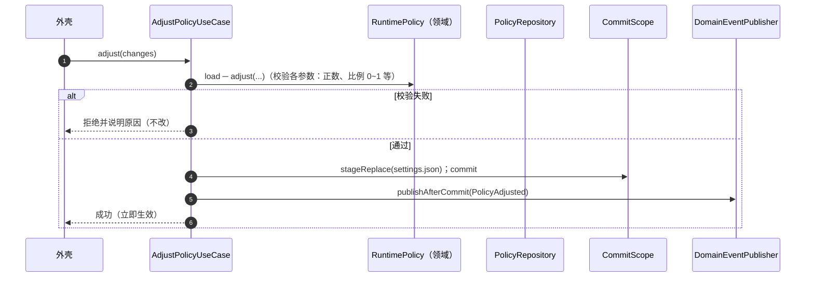
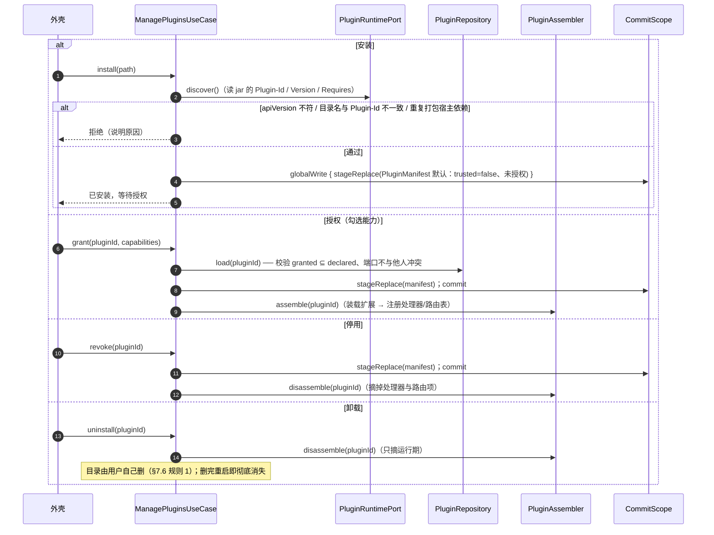

# 【应用层】

> 应用层回答一个问题：**一次用例，按什么顺序、在什么事务里、通过哪些端口，把领域对象推动起来**。
> 它**不含业务规则**（规则在领域层）、**不含技术细节**（文件、网络、终端都在基础设施层）。
> 一句话：**领域层只决定，应用层只执行。**

## 模块边界

| 方向 | 内容 |
|---|---|
| 本层对象 | 7 个用例服务 + 15 个应用内组件 |
| 本层依赖 | 领域层（聚合方法、领域服务、领域策略）——只读调用，不实现规则；23 个端口（只认接口） |
| 谁依赖本层 | 外壳（本期只做 TUI；端口契约不变）只调用例服务 |
| 本层**不**负责 | 状态机与不变量（领域层）、文件与网络与终端（基础设施层）、业务阈值判定（阈值读取在此，但语义由领域/策略定义） |

> **三条纪律**
> ① 用例服务里不写业务判断——凡是"算不算完成""该不该淘汰""哪些层要验证"，都问领域对象；
> ② 绝不跨 IO 持事务——模型调用、工具执行、`ask` 阻塞、子代理 join 全在提交之外；
> ③ 本层不出现 `File`、`Path`、`HttpClient`、`System.out`——一切经端口。

---

## 1. 分层视图



**依赖方向**：外壳 → 应用层 → 领域层 / 端口 ← 基础设施层。
**反向不存在**：领域层不认识应用层；基础设施层只实现端口。

---

## 2. 用例总览图



---

## 3. 对象操作图



---

## 4. 用例清单

| 用例 | 触发 | 输入 | 输出 | 事务数 | 主要失败分支 |
|---|---|---|---|---|---|
| `StartSessionUseCase` | 用户开新对话 / 主会话派出子代理 | `agentId?`、`modelId?`、首条输入 | `sessionId` | 1 | Agent/模型不存在；标题生成失败（降级为首句截断，不失败） |
| `RunSessionUseCase` | 用户发一条消息 | `sessionId`、文本、`CancellationToken` | 本轮是否收敛 + 会话状态 | 0..N（由迭代数决定） | 模型不可用（返回、不推进状态、补记中止事实）；请求超限（折叠一次后重试）；用户中断（落 `INTERRUPTED`） |
| `ResumeSessionUseCase` | 程序重启后用户选择续跑 | `sessionId` | 续跑结果 | 1 + N | 会话已归档；计划不可恢复 |
| `ManageSessionUseCase` | 用户取消 / 归档 / 删除 | `sessionId`、动作 | 无 | 1 | 会话不存在的幂等处理 |
| `SwitchModelUseCase` | 用户在会话内显式切换模型（含跨厂商） | `sessionId`、`modelId` | 无 | 1 | 模型不存在/不可调用；**工具轮未闭合**（存在无结果的 `TOOL_REQUEST`）时拒绝 |
| `AdjustPolicyUseCase` | 用户改设置 | 新参数 | 无 | 1 | 校验失败（拒绝，不改） |
| `ManageCatalogUseCase` | 用户增删改工具/代理/供应商/模型/技能 | 目标实体 + 变更 | 无 | 1 | 内置代理不可改；id 冲突（`builtin.` 前缀保留） |
| `ManagePluginsUseCase` | 用户安装 / 授权 / 停用 / 卸载插件 | `pluginId`、动作、勾选的能力 | 插件清单 | 1 | `apiVersion` 不符或依赖重复打包 ⇒ 拒绝安装；端口冲突 ⇒ 拒绝启用；目录名与 `Plugin-Id` 不一致 ⇒ 拒绝 |

> **没有 `AnswerUserUseCase`**：人机交互是**阻塞端口**（`HumanInteractionPort.ask`），答案在调用栈里直接返回，不构成一个用例（与《模块-应用层》问题 5 的裁决一致）。

---

## 5. 应用内组件清单

**核心组件（15 个）**

| 组件 | 职责 | 关键协作 |
|---|---|---|
| `ExecutionLoop` | 外循环 do-while：算上下文 → 取 step → 跑一次内循环 → 三条出口（继续 / 结束 / 挂起）。**唯一有权推进计划状态机的地方** | `ContextWindowService`、`ReActLoop`、`VerificationRunner`、经验三件套、`CommitScope` |
| `ReActLoop` | 内循环：组装上下文 → 调模型（可流式，chunk 交给外壳）→ 执行工具 → 落流水 → 判定收敛与提交 | `ToolExecutor`、`BudgetService`、`HumanInteractionPort`、`SubagentLauncher` |
| `ContextWindowService` | 计量（`TokenCounter`）→ 算有效上限 → 超限则折叠（调模型生成摘要）→ 追加 `SUMMARY` | `ModelInvocationPort`、`RecordStore`、`TokenCounter` |
| `ToolExecutor` | 工具执行唯一入口：合法性校验 → 放行审批 → 按来源分发 → 截断归档 | `ExternalToolPort`、`SkillSopProvider`、`HumanInteractionPort`、`ArtifactStore` |
| `VerificationRunner` | 执行 `VerificationChain` 给出的有序层：确定性规则、外部反馈、LLM 裁判、人工审批 | `VerificationChain`（领域）、`ModelInvocationPort`、`HumanInteractionPort` |
| `SubagentLauncher` | 并行发起子会话（`spawn_subagents`）：各自独立超时、join-all、预算归集 | `StartSessionUseCase`、`BudgetService`、`ProgressPort` |
| `ExperienceRetriever` | 计划诞生/重划时：全库 `ACTIVE` → 语义筛选子代理 → 返回 `Map<StepId, List<ExperienceId>>` | `ExperienceRepository`、`ReActLoop`（借子代理） |
| `PlanCompletionCurator` | **计划完结的唯一归纳入口**：调内置代理（`builtin.distill` prompt）一次，产出「经验? / 技能?」（至多一个），按"同一件事只进一边"分派 | `ModelInvocationPort`、`ExperienceDistillationService`、`SkillDistillationService`、`RecordStore`、`BudgetService` |
| `ExperienceDistillationService` | **只做写入**：接收经验产物 → 与库内经验去重（合并 + 提置信度）或新建 | `ExperienceRepository`、`CommitScope` |
| `SkillDistillationService` | 接收技能产物：校验四件套 → `CREATE / MERGE` 判定（`mutable`、`ACTIVE`、容量）→ `create` / `revise` → 写 `SKILL.md` | `SkillDefinition`、`CatalogRepository`、`RuntimePolicy`、`CommitScope` |
| `ExperienceFeedbackService` | step 结束后回写奖惩（规则在 `Experience` 聚合内，本组件只负责读-改-存） | `ExperienceRepository` |
| `SessionTitleGenerator` | 首条输入 → 标题（失败降级首句截断） | `ModelInvocationPort`、`BudgetService` |
| `BudgetService` | 把会话族内任意消耗归集到根 `Budget`，越过阈值 raise `BudgetWarning` | `BudgetRepository`、`PolicyRepository` |
| `StartupReconciler` | 启动时按 5 条规则补齐崩溃残留（见第 9 节） | 各仓储、`CommitScope` |
| `PluginAssembler` | 插件启停的唯一落点：装载/卸载 jar，把扩展对象注册进处理器注册表与端口路由表（**只换实现，不动声明**） | `PluginRuntimePort`、`PluginRepository`、端口路由表 |

**内置工具处理器与验证钩子（5 个）**（统一注册在 `InternalToolHandlers`，由 `ToolExecutor` / `VerificationRunner` 分发）

| 组件 | 职责 | 关键协作 |
|---|---|---|
| `GeneratePlanHandler` | `generate_plan` 的处理器：草案校验通过才建计划，失败转工具错误结果 | `PlanFactory`、`PlanRepository`、`CommitScope` |
| `SpawnSubagentsHandler` | `spawn_subagents` 的处理器：**拒绝子会话再开子代理**，解析请求后交给启动器 | `SubagentLauncher` |
| `LoadSkillHandler` | `load_skill` 的处理器：取 SOP 文本；注入为 `SYSTEM` 记录是内循环的职责 | `SkillSopProvider` |
| `EnvironmentFeedbackVerifier` | 验证第二层（`ENV_FEEDBACK`）的钩子：校验外部系统返回；未配置时返回 `UNDETERMINED` | `VerificationRunner` |
| `InternalToolHandlers` | 内置工具处理器注册表（按工具 id 索引），由 `ToolExecutor` 分发 | `InternalToolHandler` |

> 数字口径：**7 个用例 + 15 个核心组件 + 13 个工具处理器/钩子**（早期增 `PlanCompletionCurator` / `SkillDistillationService`；增 `PluginAssembler`；M45 增 8 个本地能力处理器）。后 13 个是被分发的处理单元（处理器 / 注册表 / 验证钩子），按职责单列一组，不改变用例编排。

### 5.1 应用层的内部实现类（同样受"一个类在模型里都有出处"约束）

| 类 | 职责 |
|---|---|
| `InternalToolHandler` | 内置工具处理器接口：`handle(Session, Map) → ToolExecOutcome` |
| `RunSessionResult` | `RunSession` 的返回值：`CONVERGED / SUSPENDED / ROUNDS_EXHAUSTED / CANCELLED`（**挂起与取消都不是错误**） |
| `PlanCreationException` | `generate_plan` 草案不合法时抛出（携带 `P_INVALID_PLAN`），由处理器转成工具错误结果 |
| `ModelInvocationException` | 端口失败时抛出，携带上下文自己的 `DomainError`（`M_*`） |
| `Json` / `JsonText` | 应用层自带的极简 JSON 解析与转义：**不引 JSON 库**（模块边界见《模块-应用层》「模块边界」） |
| `Approvals` | 人工审批的判定：**先看否定再看肯定**（"不同意"里含着"同意"），工具放行与结果验收共用 |
| `TechnicalLog` | 技术事件出口（事件名 + 耗时 + key=value 字段），实现由基础设施注入；应用层不引日志库 |
| `PortRoutes` | 端口路由表：`能力名 → 当前启用者`，并发安全、可原子替换（插件实现**实时生效**，见《模块-行动》§7.6） |
| `SessionTranscript` | 会话回放的只读视图：会话头（标题 / 模型 / 创建时间）+ 最近若干条记录 + "是否还有更早" |
| `RunSessionProvider` | 延迟取 `RunSessionUseCase`：子代理启动器 → 用例 → 外循环 → 内循环 → 工具执行 → 启动器 是构造环，用"取的时候才要"打断它（应用层不引容器类型） |
| `CommandParsing` | `run_command` 的**浅结构解析**（纯字符串、不碰文件与进程）：引号消解后得到每段的 `程序 / 参数 / 操作数 / 重定向` 与段间拓扑；`sh -c` / `eval` 的实参递归解析（深度上限 2）。**解析失败要能被上层区分出来**——fail-closed 的前提（行动 §7.1 规则 10） |
| `CommandRules` | 绊线判定项（结构化谓词，不是正则）与结论三态：`放行 / 需审批(原因) / 无法解析` |

> `ProgressEvent` 是 `ProgressPort` 的入参值对象（`Kind` + `message`），面向界面、可丢弃，不属于领域事实。
>
> `Kind` 共 12 种，按用途分三类：**阶段类**（`SUMMARIZING` / `SUMMARY_DONE` / `RETRY_SCHEDULED` / `MODEL_SWITCHED` / `SUBAGENTS_RUNNING`）、**计划类**（`PLAN_CREATED` / `STEP_STARTED` / `STEP_FINISHED`）、**工具类**（`TOOL_STARTED` / `TOOL_FINISHED`），外加用量类 `USAGE` 与上下文类 `CONTEXT_USAGE`。约定：
>
> - 计划类事件的 `message` 必须带进度：`计划：<goal>（N 步）`、`第 3/5 步：<描述>`、`第 3/5 步 完成/失败（原因）`；
> - 工具类事件的 `message` 必须带工具名与结果：`read_file（参数摘要）`、`read_file 成功 12ms` / `read_file 失败：原因`；`ask_user` 不重复发（问题本身已呈现）；
> - `USAGE` 的 `message` 带本轮与累计用量：`+1.2k / 累计 3.1k / 上限 1.0M`；
> - `CONTEXT_USAGE` 的 `message` 带"当前上下文占用 / 模型输入上限"：`上下文 12.3k / 50k`（每轮组装上下文后发一次，供界面常驻展示）；
> - 外壳按 `Kind` 决定呈现方式（状态行 or 常驻行），**应用层不关心排版**。

---

## 6. 端口清单（23 个）

| 端口 | 职责 | 关键方法 | 实现方 |
|---|---|---|---|
| `CommitScope` | 一次状态转移的写入作用域，**固定按「事实 → 追加 → 替换」执行并 fsync**；另提供**全局资产写段**（`skills/`、`experience/`），进程内串行以保证容量判定原子 | `stageFact` / `stageAppend` / `stageReplace` / `commit` / **`globalWrite`** | 基础设施 |
| `SessionRepository` | 会话头与存放策略（会话无状态，见《模块-感知》§7.1 规则 7）；`list` 返回 `SessionSummary`（id / 父 id / 标题 / 模型 / 创建时间） | `load` / `save` / `list` / `archive` / `delete` / `cleanupArchiveResidue` | 基础设施 |
| `RecordStore` | 流水追加与读取 | `append` / `last(n)` / `range(startSeq, endSeq)` | 基础设施 |
| `PlanRepository` | 计划聚合 | `load` / `save` / `findRunning(sessionId)` | 基础设施 |
| `VerificationReportRepository` | 不可变报告 | `save` / `get` / `findByStep` | 基础设施 |
| `ReflectionRepository` | 不可变反思 | `save` / `get` | 基础设施 |
| `ExperienceRepository` | 经验库 | `findActive` / `find(id)` / `save` / `archive` / `count`（`find` 供上下文注入） | 基础设施 |
| `BudgetRepository` | 会话族台账 | `load(rootSessionId)` / `save` | 基础设施 |
| `PolicyRepository` | 单例策略 | `load` / `save` | 基础设施 |
| `CatalogRepository` | 工具/代理/供应商/模型/技能 | `tools` / `agents` / `providers` / `models` / `skills` / `save` / **`saveSkill`（技能写入的唯一落点，原子重写 `SKILL.md`）** / **`countActiveSkills`** | 基础设施 |
| `ArtifactStore` | 工具结果全文 | `put` / `deleteSession` | 基础设施 |
| **`PluginRepository`** | 插件授权意图（`plugins/<id>/plugin.json`） | `list` / `load` / `save` | 基础设施 |
| **`PluginRuntimePort`** | 插件的发现与装载（PF4J） | `discover` / `toolsOf` / `start` / `stop` / `unload` / `extension` / **`conflictsOf`（重复打包的宿主依赖，供安装校验）** | 基础设施 |
| `ModelInvocationPort` | 选模型、降级、调用、计量（流式与非流式双方法）；**取消时由传输层标记终止重试**（§8.4.1） | `invoke` / `invokeStreaming(request, ChunkSink)` / `describe` | 基础设施 |
| `ExternalToolPort` | REST / MCP 出站调用（**`NATIVE` 不在其中**：本地能力是处理器，不是出站调用） | `invoke(tool, args)` | 基础设施 |
| `SkillSopProvider` | 按 id 读并渲染 SOP | `sop(skillId)` | 基础设施 |
| `HumanInteractionPort` | **阻塞式**提问（单队列、标来源、可取消） | `ask(question) → answer` | 外壳（TUI）；CLI / Server 各自实现 |
| `ProgressPort` | 非领域进度：压缩、子代理并行、计划与步骤推进、工具调用开始/结束、模型降级、用量 | `emit(event)` | 外壳（TUI） |
| `DomainEventPublisher` | 领域事件，**提交后同步派发**（只通知） | `publishAfterCommit(events)` | 基础设施 |
| `Clock` | 时间（便于测试与审计） | `now` | 基础设施 |
| `TokenCounter` | token 计量（与真实计费一致） | `count(messages, modelId)` | 基础设施 |
| `InstanceLock` | 单写者锁 | `acquire` / `release` | 基础设施 |
| `SchemaMigrator` | 读 `schema.version` 并顺序迁移 | `migrate` | 基础设施 |

> 流式回调 `ChunkSink` 是 `application.shared` 下的一个小接口（外壳实现，把 chunk 转给 `ProgressPort`），不作为端口登记。
>
> `NATIVE` 工具不进任何端口：它们由基础设施实现 `InternalToolHandler` 并注册进同一张处理器注册表（行动 §8.1）。路径能否落地由基础设施的 `Workspace` 保证，判定"要不要审批"由本层的 `CommandParsing` / `CommandRules` 负责——**这是应用层唯一出现 shell 语义的地方**。
>
> 相对领域文档的两处收缩：**取消 `SubagentRunnerPort`**（检索与归纳已在本层，直接调内置代理 prompt）、**`InternalToolHandler` 收窄为 `SkillSopProvider`**（其余四个内置工具的处理器就在本层，不需要端口）。

---

## 7. 事务与提交顺序

### 7.1 文件系统没有跨文件原子性，所以用「顺序 + 幂等 + 对账」代替

`CommitScope` 的契约：应用层只管 **stage** 要写什么，**执行顺序由基础设施强制**：

```
① 不可变事实（reports / reflections / experience 新文件）
② 追加流水（records-NNNN.jsonl 追加一行）
③ 替换聚合（meta.json / plans/*.json / budget.json / settings.json）
```

这样任何崩溃点都只落在「**事实已存在、状态未推进**」，永远不会出现「状态推进了、事实不存在」。恢复方向因此是单向补齐，而不是猜测。

### 7.2 一次 `RunSession` 里的事务清单

| # | 事务 | 写入 | 事务外先完成的 IO |
|---|---|---|---|
| T1 | 追加用户输入 | `RecordStore` +1 条 | — |
| T2 | 上下文折叠 | 追加 `SUMMARY` | 调模型生成摘要 |
| T3 | 记录工具请求 | 追加 `TOOL_REQUEST` | — |
| T4 | 记录工具结果 | 追加 `TOOL_RESULT` | 工具执行（含超时） |
| T5 | token 记账 | `budget.json` 累加 | — |
| T6 | 步骤结案 | `VerificationReport` + `plan.json` | 跑验证链（模型 / 人工） |
| T7 | 尝试判败 / 中断 | `plan.json` | — |
| T8 | 经验分配 | `plan.json`（`assignedExperienceIds`） | 内置检索代理（`ModelInvocationPort`） |
| T9 | 计划重划 | `plan.json`（代次+1、`SUPERSEDED`） | 调模型生成新计划 |
| T10 | 经验反馈 | `experience/*.json` | — |
| T11 | 经验沉淀 | `experience/*.json`（新建/合并） | 读轨迹 + 内置归纳代理（`ModelInvocationPort`） |
| T12 | 会话状态 | `meta.json`（归档/取消/`ModelSwitched`） | — |
| T13 | 技能沉淀 | `skills/<id>/SKILL.md`（新建） | 内置归纳代理（`ModelInvocationPort`） |
| T14 | 技能改进 | `skills/<id>/SKILL.md`（原子重写） | 内置归纳代理（`ModelInvocationPort`） |
| T15 | 安装插件 | `plugins/<id>/plugin.json` | 校验 jar（`apiVersion` / 依赖） |
| T16 | 授权 / 停用 | `plugins/<id>/plugin.json`（`grantedCapabilities`） | 装载或卸载扩展 |

> T11 / T13 / T14 都在 `CommitScope` 的**全局资产写段**内执行：并行子会话可能同时沉淀，容量“读—判—写”必须在该段内完成。一次计划完结中，T11 与 T13/T14 **至多发生一个**（同一件事只进一边）。
>
> **环境故障时的 T4**：本轮已发出、还没拿到结果的工具调用，由 `ReActLoop` 在异常上抛前补一条 `TOOL_RESULT`（内容为“本轮中止：…”）；它是流水事实，不是状态推进，因此不占用 T7，也不消耗重试。
>
> **T12（会话状态）也承接模型切换**：`SwitchModelUseCase` 只改 `meta.json` 里的 `activeModelId` 并派发 `ModelSwitched`；它**不动流水**——旧模型的 reasoning 靠 `producerModelId` 在回放时自动失效。

### 7.3 三条纪律

1. **绝不跨 IO 持事务**——模型、工具、`ask`、子代理 join 全在 `commit()` 之外。
2. **事件在提交后发**，且**不得驱动任何 IO 长任务**；沉淀/检索由 `ExecutionLoop` 显式调用。
3. **一个事务只服务一个用例的一次状态转移**，不为了"少提交一次"而合并不相关的写。

---

## 8. 用例时序图

### 8.1 `RunSessionUseCase.run(sessionId, text, cancellation)`



**关键点**

- `RunSession` 自己不判断"完成"——它只按 `ExecutionLoop` 的三条出口返回；
- `ask` 是**阻塞**的：`cancellation` 触发时返回 `CANCELLED`，本次 attempt 落 `INTERRUPTED`；
- 事件派发全部在 `commit` 之后，订阅方只做通知类动作。

### 8.2 `StartSessionUseCase.start(agentId?, modelId?, firstInput)`



### 8.3 `ResumeSessionUseCase.resume(sessionId)`



### 8.4 `ManageSessionUseCase`（取消 / 归档 / 删除）



#### 取消令牌怎么到阻塞点

外壳创建并持有唯一实现（本期 `ShellCancellationToken`，每轮开始复位）；`ManageSessionUseCase.cancel` 与 Ctrl-C 都调它的 `cancel()`。令牌只下传到**轮次边界**：`RunSessionUseCase.run(..., token)` → `ExecutionLoop` 每轮开头检查，命中即抛 `CancellationException`，走 §8.4 的 `Cancelled` 分支。

重试的终止**不靠令牌**，而靠**传输层的取消标记**：`Call.cancel()` 之后 `HttpJsonClient` 记下"本次调用被用户取消"，`ModelInvoker` 见到这个标记直接抛 `CancellationException`（不重试、不降级）。这样令牌不必穿进 `ContextWindowService`、`VerificationRunner`、`ExperienceRetriever`、`ExperienceDistillationService`——它们都在轮次内，在途请求同样被立刻打断，只是"不再重试"由传输层保证。轮次外的调用（`SessionTitleGenerator`、测试复跑）拿不到令牌，用"永不取消"的 `CancellationToken.never()`。

取消是终态：**不进重试、不降级、不弹错误**（取消不是错误，见《模块-应用层》§9）。会话没有状态，取消只把 plan 里 RUNNING 的 attempt 置 `INTERRUPTED`（见《模块-感知》§7.1 规则 7）。



#### 查看 / 回放（`transcript(sessionId, limit)`）

`ManageSessionUseCase.transcript(sessionId, limit)` 是**只读**分支：会话头 + 最近 `limit` 条记录（多取一条判断"还有更早的"），返回 `SessionTranscript`。外壳用它实现"打开历史会话时把以前的对话显示出来"；它不参与上下文组装（模型侧窗口由 `ContextWindowService` 推导），也不改任何状态。

回放口径由外壳决定：只展示用户与助手正文，工具调用压成一行、摘要一行、`SYSTEM` 注入与 `reasoning` 不展示（`reasoning` 是模型私有状态，只回放给产者）。

### 8.5 `AdjustPolicyUseCase.adjust(changes)`



### 8.6 `ManagePluginsUseCase`（安装 / 授权 / 停用 / 卸载）



**要点**

1. **"安装"与"授权"分开**：装只落自己的 `plugin.json`（`trusted=false`、`granted=∅`），插件此时**还没有任何效果**；授权才让它进入世界。
2. **信任只发生在安装**：`trusted` 一旦为真不再变（要收回就卸载重装），这是"安装时一次同意"的落点。
3. **冲突在授权时判**，不在安装时判：两个插件可以都声明 `Clock`，但只有一个能被授权。
4. **真实生效靠 `PluginAssembler`**：用例只改"意图"，装载/卸载与路由表切换在装配层完成——所以插件**崩溃或加载失败不会污染授权意图**。

---

## 9. 错误与恢复策略

| 情形 | 语义 | 应用层动作 | 聚合落点 |
|---|---|---|---|
| **工具自身失败**（超时/异常/半截） | 一种工具结果 | 回灌模型，ReAct 继续 | 只追加 `TOOL_RESULT` |
| **模型不可用**（备用链全挂） | 环境故障 | `RunSession` 立即返回；不触发反思/重划/重试；**把本轮未闭合的工具调用补记为中止 `TOOL_RESULT`** | **不推进 `plan` / `budget`**；`Attempt` 不落终态；流水多一条中止事实 |
| **请求超限** | 业务预算问题 | 调 `ContextWindowService` 强制折叠一次后重试；仍失败按模型不可用处理 | 追加 `SUMMARY`，不动 `plan` |
| **用户中断** | 用户主动 | `ask` 返回 `CANCELLED`；当前 attempt 收尾 | `Attempt.outcome = INTERRUPTED`（不耗重试） |
| **切换模型被拒**（工具轮未闭合） | 用户操作与回合边界冲突 | 返回 `S_TOOL_ROUND_OPEN`，不改任何状态；提示等本轮收尾后再切 | 无 |
| **崩溃残留** | 进程非正常退出 | `StartupReconciler` 按下列 5 条补齐 | 视规则而定 |

### `StartupReconciler` 的 5 条规则（业务侧，与基础设施的"技术残留清理"分工）

| # | 现场 | 补齐动作 |
|---|---|---|
| 1 | 有 `PASSED` 报告，但 step 仍 `RUNNING` / `VERIFYING` | 按报告里的 `attemptNo` 补 `markStepSucceeded` |
| 2 | 有 `FAILED` 报告，但 step 仍 `RUNNING` | 补 `markStepFailed` |
| 3 | 流水末尾有 `TOOL_REQUEST` 无 `TOOL_RESULT` | 该 attempt 判失败（计一次重试）；**环境故障已在 `ReActLoop` 内补记中止结果，不会落到这条**，这里只接崩溃/强杀残留。该半截请求无法回放，**本期不做回放自愈**：会话需人工清理（重建） |
| 4 | 归档中间态（`.zip.tmp` 残留 / 包已完整但原目录还在） | 丢弃半截包；包完整则补删原目录（幂等，见《模块-感知》§7.1 规则 7） |
| 5 | `budget.json` 缺失或损坏 | 重建为 0 并写告警（预算不精确可接受） |

> 技术残留（`*.tmp`、写了一半的行、未释放的锁）由基础设施层的启动清理处理，不在这里重复。
>
> 错误码、`Result` 与用户文案的组织方式见《模块-应用层》§9：应用层返回 `Result<T, UseCaseError>`，`Cancel` 是独立分支，文案由外壳按 `code` 查表。

---

## 10. 并发模型

| 并发点 | 机制 | 约束 |
|---|---|---|
| 用例执行 | 外壳（TUI）单线程调用；同一 `sessionId` 同时只有一个 `RunSession` | 应用层用 `sessionId` 做互斥（内存锁），不依赖文件锁 |
| 内循环与工具 | **工具严格串行**（一次响应里多个工具调用逐个执行、各自成败） | 无并发工具调用 |
| 子代理 | `SubagentLauncher` 内部并行；各自独立超时（从实际开始运行计时）；join-all | 子代理不得再开子代理 |
| 人机交互 | `HumanInteractionPort` 单队列：所有来源（主会话/子代理/验收/审批/预算）排队，逐个呈现 | 必须显示来源；`cancellation` 可唤醒 |
| 持久化 | 单写者（`InstanceLock`）；`CommitScope` 串行执行 | 同一时刻只有一个实例写数据目录 |
| 全局资产 | `skills/`、`experience/` 的写入走**全局资产写段**（进程内串行） | 并行子会话会同时沉淀，容量判定与写入必须原子；这里不是"一个会话一个写者" |
| 端口路由表 | 插件启停改的是**共享可变表**，必须原子替换（`AtomicReference` / `ConcurrentHashMap`），且与"每会话一个写者"无关 | 插件实现**实时生效**，所以路由不能缓存 `final` 引用 |
| UI 更新 | `ProgressPort` 单向推送，不阻塞主流程 | 丢弃进度不影响业务 |

---

## 11. 与其他文档的对应

| 关注点 | 唯一出处 |
|---|---|
| 领域规则、聚合不变量、状态机 | 四份模块文档 + `模型图.md` |
| 用例编排、事务与提交顺序、端口契约、并发 | **本文档** |
| 目录布局、文件形态、原子写、启动清理、迁移 | 《模块-基础设施层》 |
