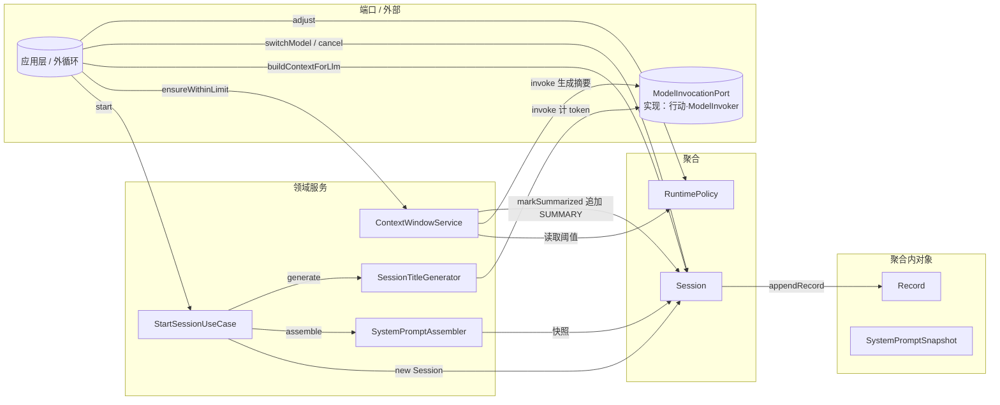
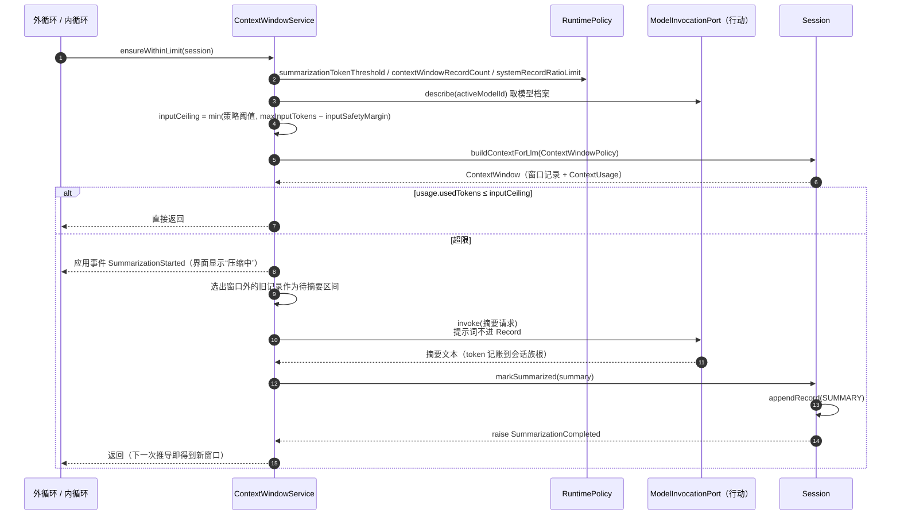
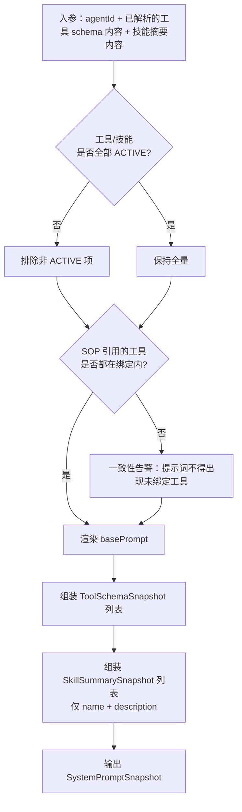
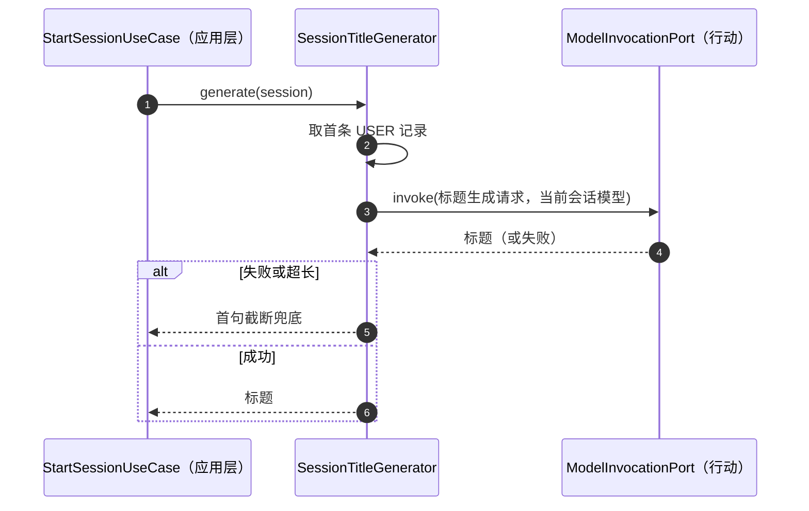
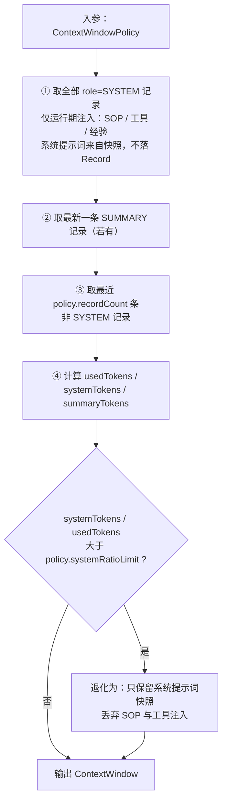

# 【感知】模块

> 感知模块回答一个问题：**模型此刻能看到什么**。
> 它把「外部输入」（用户、工具结果、模型输出、SOP 注入）与「运行环境」（全局策略、模型能力、可用工具/技能清单）变成一条可追溯的上下文流水，并在必要时把它折叠。
> 它**不判断对错**（规划）、**不执行动作**（行动）、**不积累长期知识**（记忆）。

## 模块边界

| 方向 | 内容 |
|---|---|
| 本模块聚合 | `Session`、`RuntimePolicy` |
| 本模块声明的端口（由外部实现） | `ModelInvocationPort`（由【基础设施层】`ModelInvoker` 实现：选模型 / 降级 / 调用 / 计量 / 提供模型档案） |
| 本模块对象所在的层 | **领域层**：`Session`、`RuntimePolicy`、`SystemPromptAssembler`；**应用层**：`ContextWindowService`、`SessionTitleGenerator`、`StartSessionUseCase`（见《模块-应用层》） |
| 被本模块引用的外部 ID（仅 ID） | `AgentId`、`ModelId`、`ToolId`、`SkillId` |
| 被外部引用的本模块对象 | `Session`（被规划持有 `sessionId`、被行动持有 `rootSessionId`）、`RuntimePolicy`（被规划/行动/记忆只读） |

> **依赖纪律**：`SystemPromptAssembler` 不自己去查工具/技能定义 —— 内容由调用方（外循环/应用层）取好作为入参传入；模型调用一律走 `ModelInvocationPort`。这样感知模块**不依赖任何其它模块的具体实现**。

---

## 1. 模块总览图

```mermaid
classDiagram
    namespace 会话聚合 {
        class Session {
            <<AggregateRoot>>
            -SessionId id
            -SessionId parentSessionId
            -AgentId agentId
            -ModelId activeModelId
            -String title
            -Date createdDate
            -List~Record~ records
            -SystemPromptSnapshot systemPromptSnapshot
            +appendRecord(RecordRole, String, ToolResultPayload) Record
            +buildContextForLlm(ContextWindowPolicy) ContextWindow
            +markSummarized(String summary)
            +switchModel(ModelId)
            +cancel()
        }
        class Record {
            <<Entity>>
            -RecordId id
            -RecordRole role
            -String content
            -ToolResultPayload toolPayload
            -Date date
            -int sequence
        }
        class ToolResultPayload {
            <<ValueObject>>
            -boolean isTruncated
            -String resourceUri
        }
        class SystemPromptSnapshot {
            <<ValueObject>>
            -String renderedPrompt
            -List~ToolSchemaSnapshot~ toolList
            -List~SkillSummarySnapshot~ skillList
        }
        class ToolSchemaSnapshot {
            <<ValueObject>>
            -String name
            -String description
            -String parametersJsonSchema
            -String outputDescription
        }
        class SkillSummarySnapshot {
            <<ValueObject>>
            -String name
            -String description
        }
        class ContextWindow {
            <<ValueObject>>
            -List~Record~ records
            -ContextUsage usage
        }
        class ContextUsage {
            <<ValueObject>>
            -int usedTokens
            -int inputCeiling
            -int systemTokens
            -int summaryTokens
            -int windowRecordCount
        }
        class ContextWindowPolicy {
            <<ValueObject>>
            -int recordCount
            -double systemRatioLimit
        }
        class RecordRole {
            <<Enumeration>>
            SYSTEM
            USER
            ASSISTANT
            TOOL_REQUEST
            TOOL_RESULT
            SUMMARY
        }
    }

    namespace 策略配置 {
        class RuntimePolicy {
            <<AggregateRoot>>
            +int maxRetries
            +int reflectionThreshold
            +int maxReplanGeneration
            +int maxReActRounds
            +int summarizationTokenThreshold
            +int inputSafetyMargin
            +int contextWindowRecordCount
            +double systemRecordRatioLimit
            +int toolResultTruncateLength
            +int subagentExecutionTimeoutMillis
            +int experienceCapacity
            +int experienceTopN
            +int experiencePerPlan
            +double experienceInitialConfidence
            +double experienceConfidenceStep
            +double experienceRetireThreshold
            +double budgetWarnRatio
            +List~ModelId~ modelFallbackChain
            +List~ToolId~ trustedToolIds
            +isToolTrusted(ToolId) boolean
            +needsReflection(int) boolean
            +adjust(...)
        }
    }

    namespace 领域服务 {
        class StartSessionUseCase {
            <<ApplicationService>>
            +start(AgentId, ModelId, String) Session
            +startSubSession(SessionId, AgentId, ModelId, String) Session
        }
        class SessionTitleGenerator {
            <<ApplicationService>>
            +generate(Session) String
        }
        class SystemPromptAssembler {
            <<DomainService>>
            +assemble(AgentSnapshotInput) SystemPromptSnapshot
        }
        class ContextWindowService {
            <<ApplicationService>>
            +ensureWithinLimit(Session) void
            +forceCollapse(Session) void
        }
    }

    namespace 端口 {
        class ModelInvocationPort {
            <<Port>>
            +invoke(ModelInvocationRequest) ModelInvocationResult
            +describe(ModelId) ModelProfile
        }
        class ModelProfile {
            <<ValueObject>>
            -int maxInputTokens
            -int maxOutputTokens
        }
    }

    namespace 领域事件 {
        class SessionCancelled
        class ModelSwitched
        class SummarizationCompleted
        class PolicyAdjusted
    }

    namespace 应用事件 {
        class SummarizationStarted
    }

    Session "1" *-- "0..*" Record : append-only
    Session "1" *-- "1" SystemPromptSnapshot : 会话开启时冻结
    Record *-- ToolResultPayload
    SystemPromptSnapshot *-- ToolSchemaSnapshot
    SystemPromptSnapshot *-- SkillSummarySnapshot
    Record --> RecordRole
    Session "0..1" --> "0..*" Session : parentSessionId
    Session ..> ContextWindow : buildContextForLlm 产出（推导，不落库）
    ContextWindow *-- ContextUsage
    ContextWindow ..> ContextWindowPolicy : 计算依据

    StartSessionUseCase ..> Session
    StartSessionUseCase ..> SessionTitleGenerator
    SessionTitleGenerator ..> ModelInvocationPort
    SystemPromptAssembler ..> SystemPromptSnapshot
    ContextWindowService ..> Session
    ContextWindowService ..> RuntimePolicy
    ContextWindowService ..> ModelInvocationPort

    Session ..> SessionCancelled : raises
    Session ..> ModelSwitched : raises
    Session ..> SummarizationCompleted : raises
    RuntimePolicy ..> PolicyAdjusted : raises
```

---

## 2. 对象操作图

---

## 3. 聚合清单

| 聚合 | 简介 | 不变量                                                                                                                                                              |
|---|---|------------------------------------------------------------------------------------------------------------------------------------------------------------------|
| `Session` | 一次会话（可嵌套）的全部上下文事实：记录流水、系统提示词快照、窗口与摘要。由 `parentSessionId` 组成会话树 | ① `Record` 只追加，**被 `Attempt.recordRange` 引用的记录永不删除/改写**；② 快照在会话开启时冻结，运行中不再变；③ Agent 不可切换，Model 可切换；④ 父子会话一致（父取消会级联）；⑤ **没有状态**：会话是持久化容器，存在即可用（D22） |
| `RuntimePolicy` | 全局唯一的运行环境策略，只有用户能改，立即生效 | ① 全局唯一；② 不进会话冻结快照；③ 参数只能由用户调整                                                                                                                                    |

### 3.1 `Session`

| 项 | 内容 |
|---|---|
| 简介 | 会话族的一个节点。承载"模型能看到的世界"：`SystemPromptSnapshot` + `Record` 序列；**窗口与用量由 `buildContextForLlm()` 推导产出，不落库** |
| 不变量 | 见上表 |
| 关联 | `agentId`、`activeModelId`（行动）、`parentSessionId`（自身）、`Record`（内部） |

### 3.2 `RuntimePolicy`

| 项 | 内容 |
|---|---|
| 简介 | 单例聚合，装全部"用户可调"的全局参数；规划/行动/记忆**只读**它 |
| 不变量 | 见上表 |

| 参数组 | 参数 | 主要消费者 |
|---|---|---|
| 重试与反思 | `maxRetries`、`reflectionThreshold`、`maxReplanGeneration`、`maxReActRounds` | 规划 |
| 上下文 | `summarizationTokenThreshold`、`inputSafetyMargin`、`contextWindowRecordCount`、`systemRecordRatioLimit`、`toolResultTruncateLength` | 感知（本模块） |
| 经验 | `experienceCapacity`、`experienceTopN`、`experiencePerPlan`、`experienceInitialConfidence`、`experienceConfidenceStep`、`experienceRetireThreshold` | 记忆 |
| 预算与执行 | `budgetWarnRatio`、`budgetLimitTokens`、`subagentExecutionTimeoutMillis`、`modelFallbackChain`、`trustedToolIds` | 行动 |

---

## 4. 领域服务清单

| 服务 | 层 | 简介 | 跨模块依赖 |
|---|---|---|---|
| `Session.create(...)` | 领域 | 会话的**领域工厂方法**：造聚合、定初始状态、挂已冻结的快照；不做持久化、不调模型 | 无 |
| `SystemPromptAssembler` | 领域 | 纯组装：入参是已取好的工具 schema 内容与技能摘要内容，输出 `SystemPromptSnapshot` | 无（不查任何定义） |
| `StartSessionUseCase` | 应用 | 会话的**唯一创建入口**：解析 agent/model → `Session.create` → 建会话族 `Budget` → 持久化提交；也是子代理会话的唯一创建者 | `Budget`（行动）、`CommitScope`、`SessionTitleGenerator` |
| `SessionTitleGenerator` | 应用 | 用当前会话模型依据首次输入意图生成标题，失败降级为首句截断 | `ModelInvocationPort` |
| `ContextWindowService` | 应用 | 上下文计量与折叠：`ensureWithinLimit(Session)` 经端口取模型档案 → 算有效上限 → 量测窗口 → 超限则触发摘要并追加 `SUMMARY`；另有 `forceCollapse(Session)` 承接「请求超限」后的**强制折叠一次** | `ModelInvocationPort`、`TokenCounter`、`RuntimePolicy` |

---

## 5. 其他实体 / 值对象清单

| 对象 | 类型 | 简介 |
|---|---|---|
| `Record` | Entity（`Session` 内） | 上下文流水的一条：`role` 决定它在窗口里的地位；`sequence` 保证全序 |
| `RecordRole` | Enum | `SYSTEM / USER / ASSISTANT / TOOL_REQUEST / TOOL_RESULT / SUMMARY` |
| `ToolResultPayload` | VO | 工具结果的附属信息：是否被截断、完整内容的本地归档位置 |
| `SystemPromptSnapshot` | VO | 会话开启时冻结的内容快照：渲染后的提示词 + 工具 schema 列表 + 技能摘要列表 |
| `ToolSchemaSnapshot` | VO | 工具 schema 的内容快照（不是 ID 引用） |
| `SkillSummarySnapshot` | VO | 技能的 `name + description`（渐进披露的浅层；SOP 正文靠 `load_skill` 注入） |
| `ContextWindow` | VO | `buildContextForLlm()` 的产物：真正发给模型的那批记录（已排序）+ 用量 |
| `ContextUsage` | VO | 只读投影：`usedTokens / inputCeiling / systemTokens / summaryTokens / windowRecordCount` |
| `ContextWindowPolicy` | VO | 组装策略入参（来自 `RuntimePolicy` 的两个值）：窗口条数、SYSTEM 占比上限 |
| `AgentSnapshotInput` | VO | `SystemPromptAssembler` 的入参：`agentId`、`basePrompt`、`promptVariables`、**已过滤 `ACTIVE`** 的 `activeTools` / `activeSkills`、`sopReferencedToolNames`（一致性告警用，本期恒空） |
| `ModelProfile` | VO | 端口返回的模型档案：`maxInputTokens / maxOutputTokens`（感知据此算有效上限，**不直接引用 `Model` 聚合**） |
| `ModelInvocationPort` | Port | 模型调用的唯一出口（选模型、降级、调用、计 token）；由【行动】`ModelInvoker` 实现 |

---

## 6. 领域事件清单

| 事件 | raise by | 发生时机 | 订阅方 |
|---|---|---|---|
| `SessionCancelled` | `Session` | 用户取消会话 | 级联取消子会话 |
| `ModelSwitched` | `Session` | 模型故障、降级策略命中 | 审计 / 界面 |
| `SummarizationCompleted` | `Session` | `markSummarized()` 完成（`SUMMARY` 已追加，窗口将在下次推导时生效） | 界面 / 审计 |
| `PolicyAdjusted` | `RuntimePolicy` | 用户修改策略成功后 | 行动（备用模型链 / 信任清单缓存）、记忆（容量参数）、规划（阈值） |

> 应用事件 `SummarizationStarted`（压缩过程开始，无聚合状态转换）不属领域事件：用户可据此看到"压缩中"。

---

## 7. 聚合生命周期与规则

### 7.1 `Session`

| 诞生 | 变更 | 终结 | 重建 |
|---|---|---|---|
| **会话开启**（用户发起对话）/ **子代理派遣**（`spawn_subagents`） | **步骤/迭代中不断追加 Record**；**上下文折叠**；**模型降级**；**取消** | **归档**（压成包移走，应用不再可见，D22）/ **会话销毁**（物理删除） | **会话续跑**（按 `sessionId` 加载，`StartupReconciler` 先对账） |

**规则清单**

1. **唯一创建入口**：只有应用层 `StartSessionUseCase` 能创建会话；两个触发点——用户发起对话、主会话发起子代理。
2. **创建时必须指定** `agentId` 与 `modelId`（缺省取默认）；**Agent 在会话内不可切换**，Model 可切换（仅降级）。
3. **标题**：由 LLM 依据首次输入的意图生成；失败则用首句截断兜底。
4. **快照冻结**：`SystemPromptSnapshot` 在会话开启时生成并冻结（**内容**快照）；运行中工具/技能定义变更**不影响**进行中的会话。
5. **流水只追加**：`Record` 不得修改；被 `Attempt.recordRange` 引用的区间**永不删除、永不改写**（本地应用的磁盘控制只能靠归档/导出）。
6. **会话树**：`parentSessionId` 组树；**父会话取消 ⇒ 级联取消所有子会话**；**子代理不得再开子代理**（深度恒为 1）。
7. **没有状态**：`sessions/<id>/` 存在即可用，不存在即不可用（含已归档，D22）。"在跑"是进程内事实，不落盘；归档 = 压成包移走，此后应用不再认识它。删除 = 物理消失。
8. **销毁**：物理删除该会话族的 `Record`、`Plan`、`Budget`；**已沉淀的 `Experience` 保留**（记忆模块全局资产）。
9. **上下文组装**（`buildContextForLlm(policy) → ContextWindow`）为**三步推导 + 一次降级**：
   ① 取全部 `role = SYSTEM` 的记录（**运行期注入**：SOP 注入 + 工具注入 + 经验注入）；经验注入由外循环在**步骤启动前**写一条带 `step=<id>` 标记的 SYSTEM 记录，正文来自 `ExperienceRepository.find(id)`，同一步只注入一次；系统提示词来自 `SystemPromptSnapshot`，**不落 `Record`**，由调用方作为 `systemPrompt` 单独传给模型；
   ② 取最新一条 `SUMMARY` 记录（若有）；
   ③ 取最近 `policy.recordCount` 条**非 SYSTEM** 记录；
   ④ 降级：若 `systemTokens / usedTokens > policy.systemRatioLimit` ⇒ **只保留系统提示词快照**，丢弃 SOP 与工具注入。
10. **SYSTEM 类不参与淘汰**：`role = SYSTEM` 的记录不被第 ③ 步的"最近 n 条"挤出，只能被第 ④ 步**整体**裁剪。
11. **可推导状态不落库**：窗口边界与用量都是推导结果，不持久化；会话续跑时重新推导。
12. **聚合不依赖配置聚合**：策略以 `ContextWindowPolicy` **值对象入参**传入，`Session` 不引用 `RuntimePolicy`，也不读取任何阈值。
13. **系统提示词与流水分离**：基础提示词只存在于 `SystemPromptSnapshot`（会话开启时冻结），`SYSTEM` 记录只承载运行期注入（`load_skill` 的 SOP、工具/经验注入）；发给模型时前者走 `systemPrompt`、后者并入同一 `system` 字段，二者都不进 `messages`。第 ④ 步降级只保留快照，即丢弃全部注入。

### 7.2 `RuntimePolicy`

| 诞生 | 变更 | 终结 | 重建 |
|---|---|---|---|
| **平台初始化**（应用启动载入默认值） | **策略调整**（用户修改，立即生效） | 无（应用生命周期内常驻） | **平台初始化** |

**规则清单**

1. **全局唯一**，只有用户能调整；任何 Agent 都不能覆盖。
2. **立即生效、不进会话快照**：与"工具/技能定义、系统提示词在会话开启时冻结"形成对照。
3. **反思阈值与最大重试独立配置**：`reflectionThreshold > maxRetries` ⇒ **永不反思**。
4. **唯一硬闸** `maxReActRounds`：按"自上次用户输入以来的连续轮数"计，用户介入即重置。
5. **信任清单**：工具级粒度，语义 = 免审批，**可覆盖不可逆工具**；未命中且工具非只读 ⇒ 执行前放行审批。
6. **预算参数**：单位 token、只预警不中断、同一会话族只报一次。
7. **变更即通知**：`adjust()` 成功后 raise `PolicyAdjusted`，避免其它模块各自缓存常量快照。
8. **聚合不变量不依赖自身取值**：策略只改变"外循环选择哪条迁移"，不改变任何聚合的合法状态迁移（见《模块-规划》7.1）。

---

## 8. 领域服务的具体操作

### 8.1 `Session.create(...)`（领域工厂）

> 会话开启的**端到端时序见《模块-应用层》8.2 `StartSessionUseCase.start(...)`**，此处不重复。
> 感知模块只负责其中的两件事：

- `Session.create(agentId, modelId, snapshot)`：领域工厂方法——造聚合、挂已冻结的快照；
- `SystemPromptAssembler.assemble(...)`：内容快照的纯组装（见 8.3）。

> 预算创建、标题生成、持久化与提交都在应用层；`startSubSession` 由应用层 `SubagentLauncher` 调用，**不自建 `Budget`**（沿 `parentSessionId` 上溯到根）。

### 8.2 `ContextWindowService.ensureWithinLimit(session)`（应用层）

**职责**：阻塞式地保证本次模型调用前上下文不超限；必要时折叠。

**要点**

1. **压缩阻塞**：期间不发起新的模型调用（摘要那一次除外）。
2. **摘要提示词用户不可见**、且**不进 `Record`**；用户只能看到压缩状态与压缩结果（`SUMMARY` 记录）。
3. 摘要由**当前会话模型**生成，token 记到**会话族根**。
4. **不存在“滑窗”这个动作**：窗口由 `buildContextForLlm()` 每次推导，追加 `SUMMARY` 后自然生效；SYSTEM 占比在推导的第 ④ 步处理。
5. **有效上限** = `min(summarizationTokenThreshold, maxInputTokens − inputSafetyMargin)`（`inputSafetyMargin` 默认 **10000**）。语义是“**安全余量**”（抵御估算偏差、系统提示临时插入），**不是输出预留** —— 输入与输出是两个独立上限（`maxOutputTokens` 单独生效）。
6. **计量口径唯一**：本服务不自己实现 tokenizer，一律经 `ModelInvocationPort` 计量，保证与真实计费一致。
7. **用量随请求传下去**：推导出的 `ContextUsage.usedTokens` 由调用方填入 `ModelInvocationRequest.estimatedPromptTokens`，供行动侧硬校验；**行动不得反向回查 `Session`**。
8. **承接“请求超限”的补充折叠**：行动 `ModelInvoker` 抛「请求超限」时，外循环调本服务**强制折叠一次**再重试；**不消耗重试名额**；仍超限则同“模型不可用”返回并提示。

### 8.3 `SystemPromptAssembler.assemble(AgentSnapshotInput)`（领域）

**要点**：只做**组装**，不查任何定义 —— 这样感知模块对行动/记忆零实现依赖；非 `ACTIVE` 的工具/技能不进入快照（**过滤由调用方完成**，入参即已过滤的清单）。

### 8.4 `SessionTitleGenerator.generate(session)`（应用层）

---

### 8.5 `Session.buildContextForLlm(policy) → ContextWindow`（领域）

**职责**：把"记录流水"推导为"本次发给模型的窗口 + 用量"。它是**纯函数式的推导行为**：不改状态、不落库、不读配置聚合。

> **与折叠的分工**：`buildContextForLlm` 只负责"算"；`ContextWindowService` 负责"决定要不要折"；`Session.markSummarized()` 负责"把摘要写进流水"。三者的边界不能混。

---

## 附录：生命周期节点词表（四份文档统一）

| 节点 | 含义 |
|---|---|
| **平台初始化** | 应用启动：载入 `RuntimePolicy`，播种内置 Agent / 内置工具 / 内置技能 |
| **策略调整** | 用户修改 `RuntimePolicy`，立即生效 |
| **会话开启** | 创建 `Session` + `Budget`（会话族根）+ 冻结提示词快照 + 生成标题 |
| **会话续跑** | 程序重启后 resume：加载 `Session` / `Plan` / `Budget`；半截工具调用视为失败 |
| **子代理派遣** | `spawn_subagents` 内部创建完整子会话 |
| **计划诞生** | `PlanFactory` 创建 `Plan` |
| **步骤启动** | 取当前 step，创建 `Attempt`（开区间） |
| **步骤提交验收** | `submit_step` → 触发验证 / 或免验证直接完成 |
| **步骤固化 / 判败 / 中断** | step 的三种结束：`SUCCEEDED` / `FAILED` / `INTERRUPTED` |
| **步骤重试** | 失败后新建 `Attempt`；达阈值则产生 `Reflection` |
| **计划重划** | `replanGeneration + 1`，未执行 step 置 `SUPERSEDED` 并重分配经验 |
| **计划完结** | `COMPLETED` / `FAILED`，触发经验沉淀 |
| **上下文折叠** | token 超阈值 → 生成 `SUMMARY` → 滑窗 |
| **模型降级** | 故障命中备用模型链 |
| **归档 / 会话销毁** | 归档（压缩移走，应用不再可见，D22）/ 物理删除（连带 `Record`/`Plan`/`Budget`，经验保留） |
