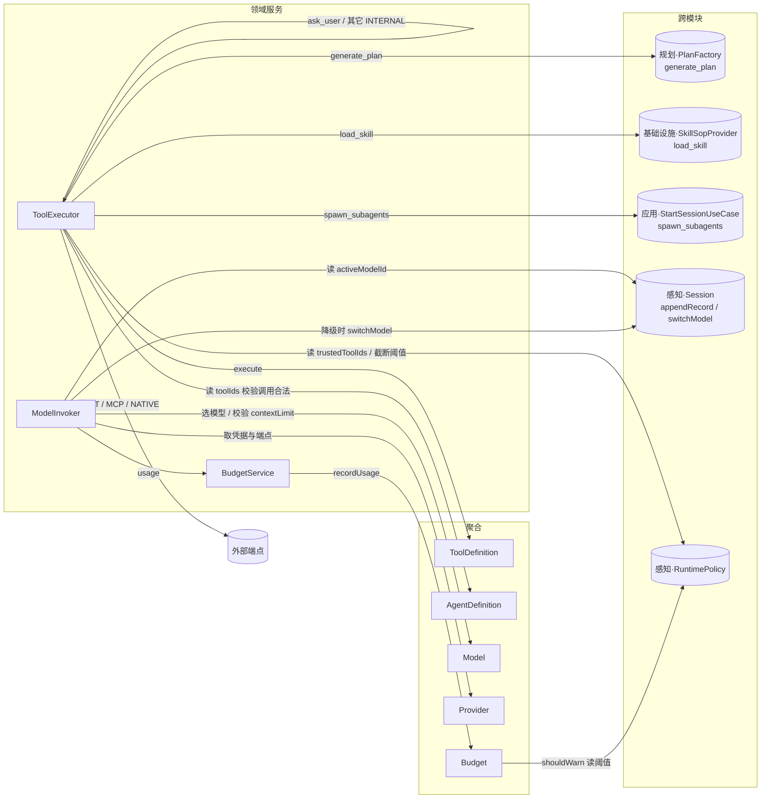
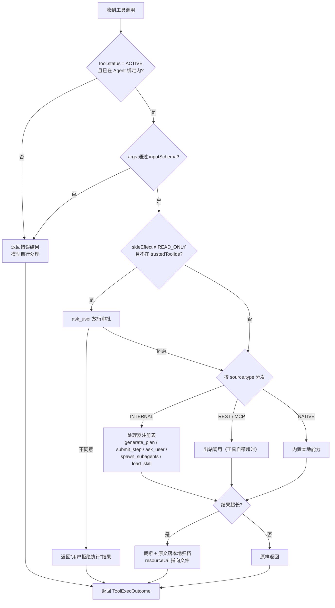
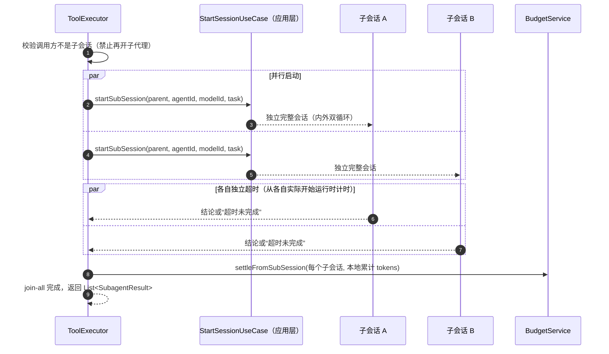
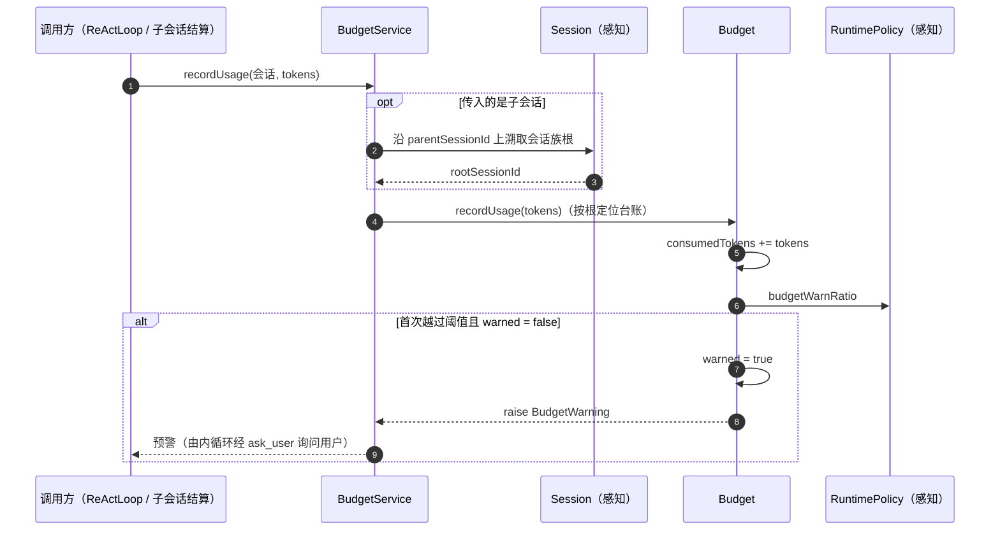

# 【行动】模块

> 行动模块回答三个问题：**能做什么（工具）→ 用什么做（模型/供应商）→ 谁在做、花多少钱（代理/预算）**。
> 它是唯一有权"对外部世界产生副作用"的模块（调工具、调模型、扣 token）；也是唯一持有凭据的模块。
> 它**不组装上下文**（感知）、**不决定下一步**（规划）、**不沉淀知识**（记忆）。

## 模块边界

| 方向 | 内容 |
|---|---|
| 本模块聚合 | `ToolDefinition`、`Provider`、`Model`、`AgentDefinition`、`Budget` |
| 被本模块引用的外部 ID（仅 ID） | `SessionId`（感知，`Budget.sessionFamilyRootId`、子会话创建）、`SkillId`（记忆，仅作为绑定 ID） |
| 被外部引用的本模块对象 | `RuntimePolicy` 的读取者（感知持有）、`ToolId`/`ModelId`/`AgentId` 被各模块引用 |
| 本模块对象所在的层 | **领域层**：5 个聚合、`Provider`/`Model`/`AgentDefinition` 的规则；**应用层**：`ToolExecutor`、`BudgetService`；**基础设施层**：`ModelInvoker`、`SkillSopProvider` |

> **依赖纪律**：本模块**不自行实现任何端口**。`ModelInvocationPort` 由基础设施 `ModelInvoker` 实现；`load_skill` 的 SOP 读取由基础设施 `SkillSopProvider` 实现；其余四个内置工具的处理器本来就在应用层（见《模块-应用层》）。行动模块因此对"文件、网络、终端"零依赖。

---

## 1. 模块总览图

```mermaid
classDiagram
    namespace 工具聚合 {
        class ToolDefinition {
            <<AggregateRoot>>
            +ToolId id
            +String name
            +String description
            +ToolSchema inputSchema
            +ToolSchema outputSchema
            +ToolSource source
            +SideEffectLevel sideEffect
            +int timeoutMillis
            +ToolStatus status
            +updateMetadata(String, ToolSchema)
            +activate()
            +deprecate()
            +validateArgs(Map) void
        }
        class ToolSchema {
            <<ValueObject>>
            +String jsonSchemaString
        }
        class ToolSource {
            <<ValueObject>>
            +SourceType type
            +String endpointOrIdentifier
        }
        class SourceType {
            <<Enumeration>>
            INTERNAL
            NATIVE
            REST
            MCP
        }
        class SideEffectLevel {
            <<Enumeration>>
            READ_ONLY
            REPEATABLE
            IRREVERSIBLE
        }
        class ToolStatus {
            <<Enumeration>>
            DRAFT
            ACTIVE
            DEPRECATED
        }
    }

    namespace 模型聚合 {
        class Provider {
            <<AggregateRoot>>
            +ProviderId id
            +String name
            +String apiEndpoint
            +ChatProtocol protocol
            +ApiCredential credential
            +ProviderStatus status
            +updateCredential(ApiCredential)
            +activate()
            +deprecate()
        }
        class Model {
            <<AggregateRoot>>
            +ModelId id
            +ProviderId providerId
            +String modelName
            +ModelStatus status
            +ContextLimit contextLimit
            +List~ModelCapability~ capabilities
            +hasCapability(ModelCapability) boolean
            +activate()
            +deprecate()
        }
        class ApiCredential {
            <<ValueObject>>
            +String apiKeyRef
        }
        class ContextLimit {
            <<ValueObject>>
            +int maxInputTokens
            +int maxOutputTokens
        }
        class ModelCapability {
            <<ValueObject>>
            +String capabilityName
        }
        class ProviderStatus {
            <<Enumeration>>
            ACTIVE
            DEPRECATED
        }
        class ChatProtocol {
            <<Enumeration>>
            OPENAI_CHAT
            ANTHROPIC_MESSAGES
            GEMINI
        }
        class ModelStatus {
            <<Enumeration>>
            ACTIVE
            DEPRECATED
        }
    }

    namespace 代理聚合 {
        class AgentDefinition {
            <<AggregateRoot>>
            +AgentId id
            +String name
            +AgentSource source
            +PromptTemplate basePrompt
            +AgentStatus status
            +List~ToolId~ toolIds
            +List~SkillId~ skillIds
            +listBoundToolIds() List~ToolId~
            +listBoundSkillIds() List~SkillId~
            +bindTool(ToolId)
            +unbindTool(ToolId)
            +bindSkill(SkillId)
            +updatePrompt(PromptTemplate)
            +activate()
            +deprecate()
        }
        class PromptTemplate {
            <<ValueObject>>
            +String templateText
            +List~String~ variables
            +render(Map) String
        }
        class AgentSource {
            <<Enumeration>>
            USER_DEFINED
            BUILT_IN
        }
        class AgentStatus {
            <<Enumeration>>
            DRAFT
            ACTIVE
            DEPRECATED
        }
    }

    namespace 预算 {
        class Budget {
            <<AggregateRoot>>
            +BudgetId id
            +SessionId sessionFamilyRootId
            +long consumedTokens
            +boolean warned
            +recordUsage(long tokens)
            +shouldWarn(RuntimePolicy) boolean
        }
    }

    namespace 领域服务 {
        class ToolExecutor {
            <<ApplicationService>>
            +execute(Session, ToolDefinition, Map) ToolExecOutcome
        }
        class ModelInvoker {
            <<InfrastructureAdapter>>
            +invoke(ModelInvocationRequest) ModelInvocationResult
        }
        class BudgetService {
            <<ApplicationService>>
            +recordUsage(SessionId rootId, long tokens)
            +settleFromSubSession(SessionId subId, long tokens)
        }
        class ToolExecOutcome {
            <<ValueObject>>
            +String content
            +boolean isTruncated
            +String resourceUri
        }
    }

    namespace 模型调用值对象 {
        class ModelInvocationRequest {
            <<ValueObject>>
            +ModelId targetModelId
            +String systemPrompt
            +List~ChatMessage~ messages
            +int estimatedPromptTokens
            +ModelCapability requiredCapability
        }
        class ModelInvocationResult {
            <<ValueObject>>
            +String text
            +List~ToolCall~ toolCalls
            +ModelUsage usage
            +ModelId servedModelId
        }
        class ChatMessage {
            <<ValueObject>>
            +RecordRole role
            +String content
            +List~ToolCall~ toolCalls
            +String toolCallId
        }
        class ToolCall {
            <<ValueObject>>
            +String callId
            +String name
            +String argumentsJson
        }
        class ModelUsage {
            <<ValueObject>>
            +long inputTokens
            +long outputTokens
        }
    }

    namespace 端口 {
        class ModelInvocationPort {
            <<Port>>
            +invoke(ModelInvocationRequest) ModelInvocationResult
            +describe(ModelId) ModelProfile
        }
        class ModelProfile {
            <<ValueObject>>
            +int maxInputTokens
            +int maxOutputTokens
        }
    }

    namespace 领域事件 {
        class ToolDefinitionUpdatedEvent
        class BudgetWarning
    }

    ToolDefinition *-- ToolSchema
    ToolDefinition *-- ToolSource
    ToolDefinition --> SideEffectLevel
    ToolDefinition --> ToolStatus
    ToolSource --> SourceType

    Provider *-- ApiCredential
    Provider --> ProviderStatus
    Provider --> ChatProtocol
    Model *-- ContextLimit
    Model *-- ModelCapability
    Model --> ModelStatus
    Model ..> Provider : providerId

    AgentDefinition *-- PromptTemplate
    AgentDefinition --> AgentSource
    AgentDefinition --> AgentStatus
    AgentDefinition ..> ToolDefinition : toolIds
    AgentDefinition ..> SkillDefinition : skillIds（记忆）

    ChatMessage ..> RecordRole : role（感知模块，复用流水角色）
    ToolExecutor ..> ToolDefinition
    ToolExecutor ..> BudgetService
    ModelInvoker ..> Model
    ModelInvoker ..> Provider
    ModelInvoker ..> BudgetService
    ModelInvocationPort <|.. ModelInvoker : 实现
    BudgetService ..> Budget

    ToolDefinition ..> ToolDefinitionUpdatedEvent : raises
    Budget ..> BudgetWarning : raises
```

---

## 2. 对象操作图

---

## 3. 聚合清单

| 聚合 | 简介 | 不变量 |
|---|---|---|
| `ToolDefinition` | 一个可被模型调用的动作定义：schema、来源、副作用等级、自带超时 | ① 入参必须能通过 `inputSchema` 校验；② `INTERNAL` 工具只能指向内部处理器；③ 元数据/状态变更后 raise `ToolDefinitionUpdatedEvent`（运行中会话不订阅，因快照已冻结） |
| `Provider` | 模型供应商：端点与**凭据**的唯一持有者 | ① 凭据只存在于 Provider；② 一个 Provider 可对应多个 `Model` |
| `Model` | 可调用的具体模型：上下文上限、能力标签、状态 | ① `status = ACTIVE` 才能被调用；② 能力标签用于 `spawn_subagents` 时的模型匹配；③ 不承载价格（金额概念已在 v2 删除） |
| `AgentDefinition` | 代理身份与能力边界：基础 prompt + 绑定工具 + 绑定技能 | ① 内置代理的 prompt 不可编辑；② 业务代理的工具/技能**全部由用户绑定**，不强制；③ 会话内 Agent 不可切换 |
| `Budget` | 会话族的 token 台账与一次性预警标记 | ① 一个会话族一个 `Budget`，以根 `sessionId` 标识；② 只累加、不预留、不分配额度、不中断；③ `warned` 一旦置真不再预警 |

### 3.1 `ToolDefinition`

| 简介 | 模型可以调用的一个动作；`source` 决定谁来执行 |
| 关联 | `AgentDefinition.toolIds` 决定"本代理能用哪些"；`RuntimePolicy.trustedToolIds` 决定"哪些免审批" |

| 内置工具 | 入参 | 出参 | 领域后果 | 处理器归属 |
|---|---|---|---|---|
| `generate_plan` | 计划草案（steps + 每步声明的验证类型） | "计划已创建"或失败原因 | `PlanFactory` 创建 `Plan`，raise `PlanCreated` | 规划 |
| `submit_step` | `summary`（必填）、`artifacts?` | "已登记" | 内循环据此置 `submitted`，交外循环验收 | 规划（由内循环识别） |
| `ask_user` | 问题文本 | 用户回答 | 阻塞同一 ReAct 循环；记 `TOOL_REQUEST` + `TOOL_RESULT` | 行动 |
| `spawn_subagents` | `List<SubagentRequest{agentId, modelId, task}>` | `List<SubagentResult{sessionId, conclusion}>` | 并行创建子会话、join-all、各子独立超时 | 应用（`SubagentLauncher`，内部调 `StartSessionUseCase`） |
| `load_skill` | `skillName` | SOP 全文 | 注入一条 `role=SYSTEM` 的 Record | 基础设施（`SkillSopProvider`） |

### 3.2 `Provider` / `Model`

- 凭据只在 `Provider`；`Model` 通过 `providerId` 关联。
- **`protocol` 决定线协议**：`OPENAI_CHAT`（缺省；OpenAI / DeepSeek / Kimi / MiniMax 等兼容端点）、`ANTHROPIC_MESSAGES`、`GEMINI`。厂商差异（baseUrl、模型名）是**数据**，协议差异是**适配器**——新增厂商只加 `providers/*.json`，不改代码。
- `capabilities` 的**唯一消费者是 LLM**：`spawn_subagents` 指定子代理模型时，按能力匹配（如需要 vision / function calling）。
- 模型故障 → `ModelInvoker` 按 `RuntimePolicy.modelFallbackChain` 自动降级，并让 `Session.switchModel()` raise `ModelSwitched`。

### 3.3 `AgentDefinition`

- `source = BUILT_IN`：反思 / LLM 裁判 / 经验检索 / 经验归纳，**prompt 不可编辑、工具集写死**。
- `source = USER_DEFINED`：prompt 可改，工具与技能**由用户自行绑定**（不强制任何内置工具）。
- 状态动词统一：`submit / activate / deprecate`。

### 3.4 `Budget`

- 单位 **token**，不换算金额。
- **只预警、不中断**：`consumedTokens >= budgetLimitTokens × budgetWarnRatio` → 外循环经 `ask_user` 询问是否继续；同一会话族只报一次。
  `budgetLimitTokens` 是会话族的**总额度**（token，用户可调），`budgetWarnRatio` 是它的百分比——两者缺一不可，否则"越过 80%"没有分母。
- 并发（`spawn_subagents`）：子会话**本地累计**，结束后 `settleFromSubSession` 一次性归集到根。

---

## 4. 领域服务清单

| 服务 | 层 | 简介 | 依赖 |
|---|---|---|---|
| `ToolExecutor` | 应用 | 工具执行的唯一入口：合法性校验 → 放行审批 → 按来源分发（内部工具处理器 / `ExternalToolPort`）→ 结果截断归档 | `ToolDefinition`、`AgentDefinition`、`RuntimePolicy`、`ExternalToolPort`、`SkillSopProvider`、`ArtifactStore` |
| `BudgetService` | 应用 | 记账与预警：把会话族内任意位置的消耗归集到根 `Budget`，判定是否越阈值并触发预警 | `Budget`、`RuntimePolicy`、`Session`（解析根） |
| `ModelInvoker` | 基础设施 | **模型调用的唯一出口**，实现 `ModelInvocationPort`：选模型 → 硬校验 → 取凭据调用 → 失败按备用链降级；**只返回 usage，不记账** | `Model`、`Provider`、`PolicyRepository` |

---

## 5. 其他实体 / 值对象清单

| 对象 | 类型 | 简介 |
|---|---|---|
| `ToolSchema` | VO | JSON Schema 文本（draft-07）；`inputSchema` 用于入参校验（**完整校验，用 networknt 库**，见 D17），`outputSchema` 用于结果描述（同时进入快照） |
| `ToolSource` | VO | 工具来源：`SourceType` + 端点/标识 |
| `SourceType` | Enum | `INTERNAL`（应用内实现）/ `NATIVE`（本地能力）/ `REST` / `MCP` |
| `SideEffectLevel` | Enum | `READ_ONLY / REPEATABLE / IRREVERSIBLE`，决定是否触发执行前放行审批 |
| `ToolStatus` | Enum | `DRAFT / ACTIVE / DEPRECATED` |
| `ApiCredential` | VO | **凭据引用 = 环境变量名**（如 `OPENAI_API_KEY`）；真实密钥只从进程环境读取，不落盘（见技术决策 D09） |
| `ContextLimit` | VO | `maxInputTokens / maxOutputTokens`。**语义：两个上限相互独立**，输入上限与输无关；若某供应商实为“共享窗口”，则在配置 `maxInputTokens` 时自行扣除常用输出预算来适配 |
| `ModelCapability` | VO | 能力标签，供 LLM 选模型时匹配 |
| `ProviderStatus` / `ModelStatus` | Enum | `ACTIVE / DEPRECATED` |
| `ChatProtocol` | Enum | `OPENAI_CHAT / ANTHROPIC_MESSAGES / GEMINI`：`Provider` 上的线协议选择；缺省 `OPENAI_CHAT`（枚举按名字存，新增常量无需迁移） |
| `PromptTemplate` | VO | 基础提示词模板 + 变量；变量占位符语法 `${name}`（见技术决策 D17），未提供的变量**保留原样**而不是替换为空（提示词里的缺口要看得见） |
| `AgentSource` | Enum | `USER_DEFINED / BUILT_IN` |
| `AgentStatus` | Enum | `DRAFT / ACTIVE / DEPRECATED` |
| `ToolExecOutcome` | VO | 工具执行结果：内容、是否截断、完整内容归档位置（**无 isSuccess**：失败也是一种结果） |
| `ModelInvocationRequest` | VO | 端口入参：目标模型（或“当前会话模型”）、`systemPrompt`、`ChatMessage` 列表、**可用工具 schema 快照**（`List<ToolSchemaSnapshot>`，来自会话冻结快照）、`estimatedPromptTokens`、能力需求（可选） |
| `ModelInvocationResult` | VO | 端口出参：文本 + 本次的工具调用请求 + `ModelUsage` + **实际服务的模型**（降级后可被调用方据此 `switchModel`） |
| `ChatMessage` | VO | 一条对话消息：`role`（复用 `RecordRole`）、`content`、模型请求的工具调用（ASSISTANT）、`toolCallId`（TOOL_RESULT 回填用） |
| `ToolCall` | VO | 模型请求的一次工具调用：`callId`（协议侧 id，用于回灌结果）、`name`、`argumentsJson` |
| `ModelUsage` | VO | 一次调用的精确用量：`inputTokens` / `outputTokens`（D08 台账口径；厂商不给时由 `TokenCounter` 估算） |
| `ExternalToolPort` | Port | REST / MCP / NATIVE 出站调用；由基础设施实现 |
| `ModelInvocationPort` | Port | 模型调用端口；由 `ModelInvoker` 实现 |

---

## 6. 领域事件清单

| 事件 | raise by | 发生时机 | 订阅方 |
|---|---|---|---|
| `ToolDefinitionUpdatedEvent` | `ToolDefinition` | 元数据或 schema 更新成功 | **运行中会话不订阅**（快照已冻结）；新建会话会用新定义 |
| `BudgetWarning` | `Budget` | `recordUsage` 首次越过 `budgetWarnRatio`（`warned` 置真） | 内循环 → `ask_user` 询问是否继续 |

> 本模块**订阅** `PolicyAdjusted`（感知）：刷新备用模型链与信任清单的读取缓存（若有）。工具调用失败、模型调用失败**都不是领域事件**，它们是同步结果。

---

## 7. 聚合生命周期与规则

### 7.1 `ToolDefinition`

| 诞生 | 变更 | 终结 | 重建 |
|---|---|---|---|
| **平台初始化**（5 个内置工具播种）/ 用户注册外部工具 | 元数据或 schema 更新、`activate` / `deprecate` | `DEPRECATED`（不再进入新会话快照） | 应用启动时载入 |

**规则**

1. 工具**严格串行执行**，不存在并发工具调用。
2. 一次模型响应里出现多个工具调用时，**逐个执行、各自独立成败**（可部分成功）。
3. **工具失败不是领域状态**：超时/异常/无返回都作为"一种工具结果"回灌模型，ReAct 继续。
4. **超时由工具自带**（`timeoutMillis`）；`ask_user` 可无限期等待。
5. **执行前放行审批**：`sideEffect ≠ READ_ONLY` 且不在 `trustedToolIds` 中 ⇒ 先 `ask_user` 放行；信任清单可覆盖不可逆工具。
6. **结果截断**：超过 `toolResultTruncateLength` ⇒ 截断进上下文，完整内容落**本地归档文件**，`ToolExecOutcome.resourceUri` 指向它；**会话销毁时一并删除**。
7. **重试语义**：失败重试时，已成功的工具调用按"重放"处理，副作用风险由用户承担。
8. 入参必须通过 `inputSchema` 的**完整 JSON Schema 校验**（draft-07，networknt `json-schema-validator`，见 D17）；失败即返回**错误结果**（不执行，回灌模型自修复）。校验产出的是"违反项清单"而不是异常——校验失败是预期内结果，不是 bug。

### 7.2 `Provider`

| 诞生 | 变更 | 终结 | 重建 |
|---|---|---|---|
| **平台初始化** / 用户新增 | 凭据轮换（`updateCredential`）、`activate` / `deprecate` | `DEPRECATED` | 应用启动时载入 |

**规则**：① 凭据只由 Provider 持有，聚合里只存引用；② 一个 Provider 对应多个 `Model`；③ Provider 弃用后其下 Model 不得被选中，除非已 ACTIVE 且明确在备用链中；④ `protocol` 缺省为 `OPENAI_CHAT`（旧配置无需迁移），取值只影响基础设施选哪个协议实现，**不影响任何聚合不变量**。

### 7.3 `Model`

| 诞生 | 变更 | 终结 | 重建 |
|---|---|---|---|
| 随 Provider 注册 | `activate` / `deprecate`、能力标签更新 | `DEPRECATED` | 应用启动时载入 |

**规则**：① 只有 `ACTIVE` 可调用；② `contextLimit` 在调用前做**硬校验**（超限抛「请求超限」，**不在此处折叠、也不降级**，由外循环补折后重试）；③ 模型故障 → 按备用链降级并 `Session.switchModel()`；④ 无价格概念；⑤ **备用链全部失败不是状态迁移**，聚合保持原状（见 8.2「模型不可用的处理」）。

### 7.4 `AgentDefinition`

| 诞生 | 变更 | 终结 | 重建 |
|---|---|---|---|
| **平台初始化**（内置 4 个代理）/ 用户创建 | 绑定/解绑工具与技能、改 prompt、`submit` / `activate` / `deprecate` | `DEPRECATED` | 应用启动时载入 |

**规则**：① 内置代理 prompt 不可编辑、工具集写死；② 业务代理工具不强制；③ 会话开启时冻结"绑定结果的内容快照"（由感知完成），之后改绑定**不影响**进行中的会话；④ `load_skill` 注入的 SOP 中若引用未绑定工具，属提示词一致性问题（感知组装时告警，不阻断）。

### 7.5 `Budget`

| 诞生 | 变更 | 终结 | 重建 |
|---|---|---|---|
| **会话开启**（仅根会话创建，与 `Session` 同时刻） | 每次模型调用后累计；越过阈值置 `warned` | **会话销毁**时物理删除 | **会话续跑**时载入 |

**规则**：① 一个会话族一个台账，以根 `sessionId` 标识；② 不预留、不分配额度；③ 只预警不中断（判据 `consumedTokens >= budgetLimitTokens × budgetWarnRatio`）；④ 只报一次；⑤ 子会话不自建 Budget，并发消耗先本地累计、结束后归集。

---

## 8. 领域服务的具体操作

### 8.1 `ToolExecutor.execute(session, tool, args)`（应用层）

**`spawn_subagents` 的内部展开（唯一并发点）**

**要点**：各子代理**独立成败**，不整体失败；中断时已完成的保留、未完成的按中断处理。

### 8.2 模型调用的两层校验（规则）

> `ModelInvoker` 的**完整时序见《模块-基础设施层》第 10 节**；「模型不可用 / 请求超限」的**处理结果见《模块-应用层》第 9 节**。这里只保留跨层必须对齐的口径。

| 层 | 位置 | 口径 | 失败后果 |
|---|---|---|---|
| 业务侧预算 | 应用层 `ContextWindowService` | `min(策略阈值, maxInputTokens − inputSafetyMargin)` | 事前折叠，不报错 |
| 调用侧硬校验 | 基础设施 `ModelInvoker` | `estimatedPromptTokens` vs **实际要用的模型** 的 `maxInputTokens`（**不含输出**：输出有自己的上限） | 抛「请求超限」，由用例补折一次后重试 |

几条不可动摇的约定：

1. **用量随请求下行**：`estimatedPromptTokens` 由调用方填入 `ModelInvocationRequest`；**执行器不得回查 `Session`**（`Session` 不知道 `contextLimit`，回查还会破坏单向依赖）。
2. **系统提示词独立于消息列表**：`systemPrompt` 由调用方（`ReActLoop` / `ContextWindowService` / `SessionTitleGenerator`）从窗口推导后填入，不进 `messages`；**工具清单同理**：`tools` 取自 `SystemPromptSnapshot.toolList`（会话开启时冻结），执行器**不得**现查目录——否则运行中改工具定义会污染进行中的会话（感知 §7.1 规则 4）；落到各家协议里的差异（OpenAI 用首条 `role=system`、Anthropic 用顶层 `system`、Gemini 用 `systemInstruction`）由基础设施适配器吸收（见技术决策 D16）。
3. **端口失败用上下文错误码表达**：`ModelInvoker` 失败时抛 `ModelInvocationException(ModelError)`，错误码取 `M_*`；调用方据此区分"不可用"（不改状态）与"请求超限"（补折一次）。
4. **降级后由调用方切换会话模型**：`ModelInvocationResult.servedModelId` 指出实际服务的模型；与请求的目标模型不同 ⇒ 调用方调 `Session.switchModel(...)` 让聚合 raise `ModelSwitched`（`ModelInvoker` 不碰聚合）。
5. **记账在调用方**：`ModelInvoker` 只返回 `usage`，由调用方交给 `BudgetService` —— 否则会出现"基础设施 → 应用层"的反向依赖。

### 8.3 `BudgetService.recordUsage(rootId, tokens)`（应用层）

**要点**：子会话并发时先各自累计，结束后 `settleFromSubSession` 一次性归集到根，避免并发写同一 `Budget` 聚合。

---

## 附录：生命周期节点词表（四份文档统一）

| 节点 | 含义 |
|---|---|
| **平台初始化** | 应用启动：载入 `RuntimePolicy`，播种内置 Agent / 内置工具 / 内置技能 |
| **策略调整** | 用户修改 `RuntimePolicy`，立即生效 |
| **会话开启** | 创建 `Session` + `Budget`（会话族根）+ 冻结提示词快照 + 生成标题 |
| **会话续跑** | 程序重启后 resume：加载 `Session` / `Plan` / `Budget`；半截工具调用视为失败 |
| **子代理派遣** | `spawn_subagents` 内部创建完整子会话 |
| **计划诞生** | `PlanFactory` 创建 `Plan` |
| **步骤启动** | 取当前 step，创建 `Attempt`（开区间） |
| **步骤提交验收** | `submit_step` → 触发验证 / 或免验证直接完成 |
| **步骤固化 / 判败 / 中断** | step 的三种结束：`SUCCEEDED` / `FAILED` / `INTERRUPTED` |
| **步骤重试** | 失败后新建 `Attempt`；达阈值则产生 `Reflection` |
| **计划重划** | `replanGeneration + 1`，未执行 step 置 `SUPERSEDED` 并重分配经验 |
| **计划完结** | `COMPLETED` / `FAILED`，触发经验沉淀 |
| **上下文折叠** | token 超阈值 → 生成 `SUMMARY` → 滑窗 |
| **模型降级** | 故障命中备用模型链 |
| **会话封存 / 会话销毁** | 归档（不可 resume）/ 物理删除（连带 `Record`/`Plan`/`Budget`，经验保留） |
