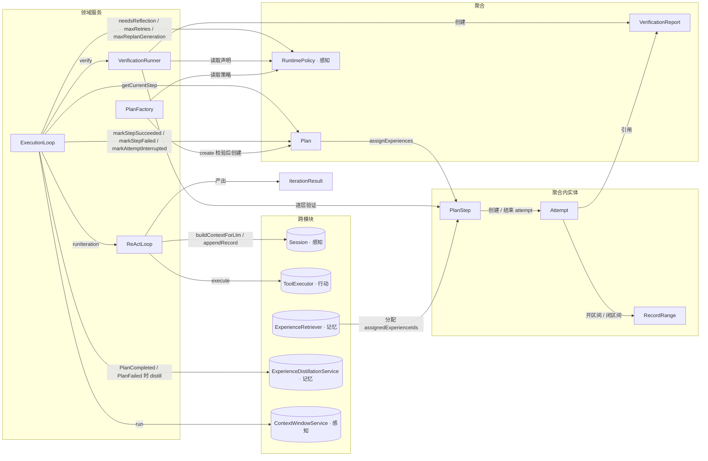
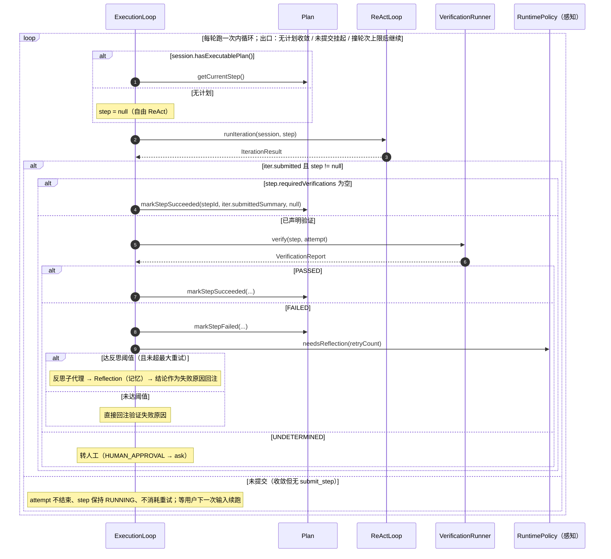
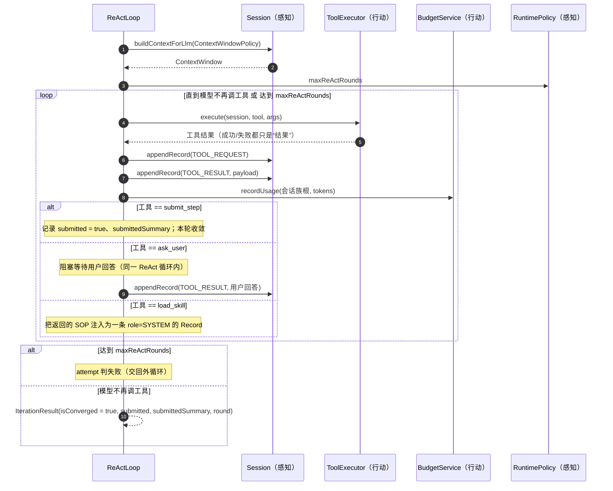
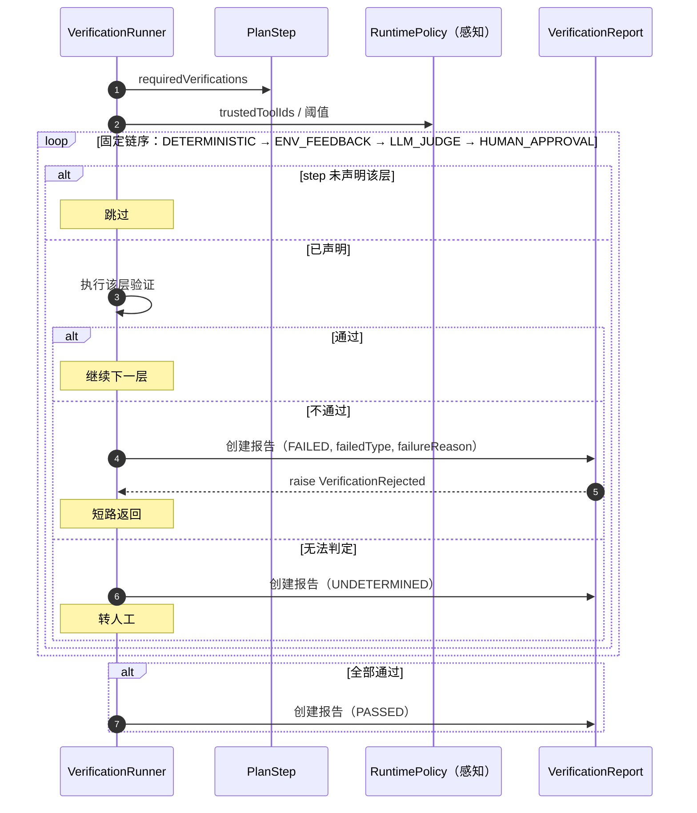
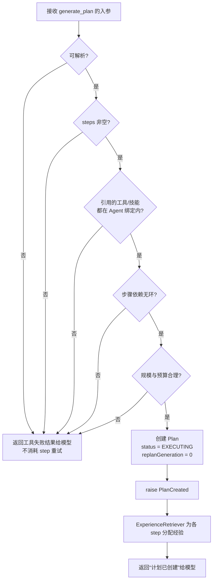

# 【规划】模块

> 规划模块回答三个问题：**想怎么做（Plan）→ 做到哪一步（PlanStep / Attempt）→ 算不算做成了（VerificationReport）**。
> 它是唯一有权推进计划状态机的模块；感知、记忆、行动三个模块只被它调用或引用。

## 模块边界

| 方向 | 内容 |
|---|---|
| 本模块聚合 | `Plan`、`VerificationReport` |
| 被本模块引用的外部聚合（仅 ID / 只读） | `Session`、`RuntimePolicy`（感知）、`Experience`（记忆）、`Reflection`（记忆） |
| 本模块调用的外部对象 | 应用层：`ContextWindowService`（感知）、`ToolExecutor`、`BudgetService`（行动）、`ExperienceRetriever` / `ExperienceDistillationService` / `ExperienceFeedbackService`（记忆） |
| 被外部引用的本模块对象 | `Plan`（被感知模块的会话持有引用）、`VerificationReport` / `Reflection`-ID（被 `Attempt` 引用） |
| 本模块对象所在的层 | **领域层**：`Plan`、`VerificationReport`、`PlanFactory`、`VerificationChain`；**应用层**：`ExecutionLoop`、`ReActLoop`、`VerificationRunner`（见《模块-应用层》） |

---

## 1. 模块总览图

```mermaid
classDiagram
    namespace 计划聚合 {
        class Plan {
            <<AggregateRoot>>
            +PlanId id
            +SessionId sessionId
            +String goal
            +PlanStatus status
            +int replanGeneration
            +List~PlanStep~ steps
            +getCurrentStep() PlanStep
            +assignExperiences(StepId, List~ExperienceId~)
            +markStepSucceeded(StepId, String, VerificationReportId)
            +markStepFailed(StepId, VerificationReportId)
            +markAttemptFailed(StepId, int)
            +retryStep(StepId) Attempt
            +markAttemptInterrupted(StepId, int)
            +recordReflection(StepId, int, ReflectionId)
            +recordSkillUsage(StepId, int, SkillId)
            +applyReplan(List~PlanStep~)
            +terminate(String)
        }
        class PlanStep {
            <<Entity>>
            +StepId id
            +int sequence
            +String description
            +Set~VerificationType~ requiredVerifications
            +StepStatus status
            +List~Attempt~ attempts
            +List~ExperienceId~ assignedExperienceIds
            +String finalOutput
            +VerificationReportId finalVerificationReportId
        }
        class Attempt {
            <<Entity>>
            +int attemptNo
            +RecordRange recordRange
            +List~SkillId~ usedSkillIds
            +VerificationReportId verificationReportId
            +ReflectionId reflectionId
            +AttemptOutcome outcome
        }
        class RecordRange {
            <<ValueObject>>
            +RecordId startRecordId
            +RecordId endRecordId
        }
        class PlanStatus {
            <<Enumeration>>
            EXECUTING
            REPLANNING
            COMPLETED
            FAILED
        }
        class StepStatus {
            <<Enumeration>>
            PENDING
            RUNNING
            VERIFYING
            SUCCEEDED
            FAILED
            SUPERSEDED
            CANCELLED
        }
        class AttemptOutcome {
            <<Enumeration>>
            SUCCEEDED
            FAILED
            INTERRUPTED
        }
    }

    namespace 验证 {
        class VerificationReport {
            <<AggregateRoot>>
            +VerificationReportId id
            +PlanId planId
            +StepId stepId
            +int attemptNo
            +VerificationOutcome outcome
            +VerificationType failedType
            +String failureReason
            +Date decidedAt
        }
        class VerificationOutcome {
            <<Enumeration>>
            PASSED
            FAILED
            UNDETERMINED
        }
        class VerificationType {
            <<Enumeration>>
            DETERMINISTIC
            ENV_FEEDBACK
            LLM_JUDGE
            HUMAN_APPROVAL
        }
    }

    namespace 感知模块_外部引用 {
        class RuntimePolicy {
            <<AggregateRoot>>
            +int maxRetries
            +int reflectionThreshold
            +int maxReplanGeneration
            +int maxReActRounds
            +List~ModelId~ modelFallbackChain
            +List~ToolId~ trustedToolIds
            +...（跨模块完整参数见「关于 RuntimePolicy」一节）
        }
    }

    namespace 领域服务 {
        class SessionRunner {
            <<ExtensionPoint>>
            +run(Session, ChunkSink, CancellationToken, RunContext) RunOutcome
        }
        class RunOutcome {
            <<Enumeration>>
            CONVERGED
            SUSPENDED
            ROUNDS_EXHAUSTED
        }
        class RunContext {
            <<ValueObject>>
            +Session session
            +ChunkSink sink
            +CancellationToken cancellation
            +ModelInvocationPort model
            +ToolInvoker tools
            +HumanInteractionPort human
            +ProgressPort progress
            +PlanRepository plans
            +ContextWindowService contextWindow
        }
        class ExecutionLoop {
            <<ApplicationService>>
            +run(Session, ChunkSink, CancellationToken, RunContext) RunOutcome
        }
        class ReActLoop {
            <<ApplicationService>>
            +runIteration(Session, PlanStep) IterationResult
        }
        class VerificationRunner {
            <<ApplicationService>>
            +verify(PlanStep, Attempt) VerificationReport
        }
        class VerificationChain {
            <<DomainService>>
            +orderedLayers(Set~VerificationType~) List~VerificationType~
            +passed(VerificationReportId, PlanId, StepId, int, long) VerificationReport
            +rejected(VerificationReportId, PlanId, StepId, int, VerificationOutcome, VerificationType, String, long) VerificationReport
        }
        class PlanFactory {
            <<DomainService>>
            +create(Session, Map) Plan
        }
        class IterationResult {
            <<ValueObject>>
            +boolean isConverged
            +boolean submitted
            +String submittedSummary
            +int round
            +List~SkillId~ usedSkillIds
        }
    }

    namespace 领域事件 {
        class PlanCreated
        class PlanCompleted
        class PlanFailed
        class StepFailed
        class VerificationRejected
    }

    Plan "1" *-- "1..*" PlanStep
    PlanStep "1" *-- "0..*" Attempt
    Attempt *-- RecordRange
    Plan --> PlanStatus
    PlanStep --> StepStatus
    Attempt --> AttemptOutcome
    PlanStep ..> VerificationType
    Attempt ..> VerificationReport : verificationReportId
    Attempt ..> Reflection : reflectionId（记忆模块）
    PlanStep ..> Experience : assignedExperienceIds（记忆模块）
    VerificationReport --> VerificationOutcome
    VerificationReport --> VerificationType

    ExecutionLoop ..> SessionRunner : 实现（默认编排）
    SessionRunner ..> RunContext : 入参
    SessionRunner ..> RunOutcome : 产出
    ExecutionLoop ..> Plan
    ExecutionLoop ..> ReActLoop
    ExecutionLoop ..> VerificationRunner
    ExecutionLoop ..> RuntimePolicy
    ReActLoop ..> IterationResult
    VerificationRunner ..> VerificationReport
    VerificationRunner ..> RuntimePolicy
    VerificationRunner ..> VerificationChain
    PlanFactory ..> Plan
    PlanFactory ..> RuntimePolicy
    Plan ..> PlanCreated : raises
    Plan ..> PlanCompleted : raises
    Plan ..> PlanFailed : raises
    Plan ..> StepFailed : raises
    VerificationReport ..> VerificationRejected : raises
```

---

## 2. 对象操作图

---

## 3. 聚合清单

| 聚合 | 简介 | 不变量 |
|---|---|---|
| `Plan` | 大模型通过 `generate_plan` 产出的一次可执行工作分解；严格串行推进，完成即固化 | ① `steps` 至少 1 个；② 同一时刻至多一个 `RUNNING` step（严格串行）；③ `SUCCEEDED` 的 step 不可再变更；④ Replan 只能替换未执行尾部；⑤ 单写者，无需乐观锁 |
| `VerificationReport` | 外循环对某次 `Attempt` 的判定结论，只追加、不可变 | ① 生成后不可修改；② 三态结论；③ 只保留失败层与失败原因 |

> **归属约定：聚合不变量不得依赖 `RuntimePolicy`。**
> 凡涉及阈值 / 上限 / 开关的判断（重试上限、重划上限、ReAct 轮次、窗口条数、信任清单等），一律由**外循环在调用聚合前后判定**；聚合只保证状态机自身的合法迁移。详见 7.1「由外循环保证的约束」。

### 3.1 `Plan`

| 项 | 内容 |
|---|---|
| 简介 | 一次任务的工作分解；由 `generate_plan` 工具触发 `PlanFactory` 创建；`PlanStep` 严格串行推进；每次重划产生新一代 |
| 不变量 | 见上表 5 条 |
| 关联 | `sessionId → Session`（感知）、`assignedExperienceIds → Experience`（记忆）、`VerificationReportId / ReflectionId`（本模块 / 记忆） |

### 3.2 `VerificationReport`

| 项 | 内容 |
|---|---|
| 简介 | 串行责任链按 step 声明过滤后的判定产物；四层：`DETERMINISTIC → ENV_FEEDBACK → LLM_JUDGE → HUMAN_APPROVAL`，短路 |
| 不变量 | 结论三态；只保留失败层与失败原因；不可变 |
| 关联 | 被 `Attempt.verificationReportId` 引用；被反思与经验沉淀读取 |

---

## 4. 领域服务清单

| 服务 | 层 | 简介 | 跨模块依赖 |
|---|---|---|---|
| `SessionRunner` | 扩展点 | 交付一轮运行的统一入口；**默认实现是 `ExecutionLoop`**，插件可实现自己的循环（L3，`experimental`） | `RunContext`（把端口与上下文交给实现方） |
| `ExecutionLoop` | 应用 | `SessionRunner` 的默认实现：do-while，每轮算上下文 → 取 step → 跑一次内循环 → 验证 → 按三条出口推进 | `ContextWindowService`、`ReActLoop`、`VerificationRunner`、经验三件套 |
| `ReActLoop` | 应用 | 单次 ReAct 迭代：组装上下文 → 让模型调工具 → 落记录 → 判定收敛与提交 | `ToolExecutor`、`BudgetService`、`HumanInteractionPort`、`SubagentLauncher` |
| `VerificationRunner` | 应用 | 执行 `VerificationChain` 给出的有序层，产出 `VerificationReport` | `VerificationChain`（领域）、`ModelInvocationPort`、`HumanInteractionPort` |
| `VerificationChain` | 领域 | 纯规则：`requiredVerifications` → 有序层列表；短路与三态合并 | 无 |
| `PlanFactory` | 领域 | 校验 `generate_plan` 入参并创建 `Plan` 聚合 | 无（阈值由应用层传入） |

---

## 5. 其他实体 / 值对象清单

| 对象 | 类型 | 简介 |
|---|---|---|
| `PlanStep` | Entity（`Plan` 内） | 计划中的一步：描述、**目标 / 结果期望 / 验证标准**（`goal` / `expectedOutcome` / `verificationCriteria`，供 LLM 裁判使用）、声明的验证类型集合、状态、尝试链、分配到的经验 |
| `Attempt` | Entity（`PlanStep` 内） | **一个 step 的一次完整执行周期**（可跨多段 ReAct，被多次用户输入切分，但不切分 attempt）；记录区间、期间开的子会话、**本次用到的技能**、报告与反思引用、结局 |
| `RecordRange` | VO | 指向 `Session.Record` 流水的一段连续区间（`startRecordId → endRecordId`），是"轨迹"的唯一载体 |
| `PlanStatus` | Enum | `EXECUTING / REPLANNING / COMPLETED / FAILED` |
| `StepStatus` | Enum | `PENDING / RUNNING / VERIFYING / SUCCEEDED / FAILED / SUPERSEDED / CANCELLED` |
| `AttemptOutcome` | Enum | `SUCCEEDED / FAILED / INTERRUPTED`（只有这三个是 attempt 的边界） |
| `VerificationOutcome` | Enum | `PASSED / FAILED / UNDETERMINED`（`UNDETERMINED` → 转人工） |
| `VerificationType` | Enum | `DETERMINISTIC / ENV_FEEDBACK / LLM_JUDGE / HUMAN_APPROVAL`，固定顺序即链序 |
| `RunOutcome` | Enum | 一轮运行的出口：`CONVERGED / SUSPENDED / ROUNDS_EXHAUSTED`（原本嵌在 `ExecutionLoop` 里，M42 提升为独立类型） |
| `RunContext` | VO | 交给 `SessionRunner` 的运行上下文：`Session`、`ChunkSink`、`CancellationToken` + 6 个端口/服务（模型、工具、人机、进度、计划仓储、上下文窗口） |
| `IterationResult` | VO | 内循环一次迭代的输出：是否收敛、是否提交、提交摘要、**内循环轮次 `round`**（**不是 attempt 序号**——attempt 由外循环自己跟踪）、**本次 load 过的技能**（内循环拿不到 `Plan`，靠它把技能使用交回外循环） |

---

## 6. 领域事件清单

| 事件 | raise by | 发生时机 | 订阅方 |
|---|---|---|---|
| `PlanCreated` | `Plan` | `PlanFactory` 校验通过并创建计划（`generate_plan` 成功） | **无功能性订阅方**：经验分配由 `ExecutionLoop` 显式调用 `ExperienceRetriever`；事件只供界面 / 审计 |
| `PlanCompleted` | `Plan` | 全部 step 达到 `SUCCEEDED` | **无功能性订阅方**：沉淀由 `ExecutionLoop` 显式调用 `ExperienceDistillationService` |
| `PlanFailed` | `Plan` | **外循环判定重划用尽**后调用 `terminate()`（或显式终止） | **无功能性订阅方**：沉淀由 `ExecutionLoop` 显式调用（终局失败也沉淀）；界面 / 审计 |
| `StepFailed` | `Plan` | `markStepFailed()` 状态转换成功 | **无功能性订阅方**：外循环读 `markStepFailed` 后的聚合状态做重试 / 反思 / 重划决策 |
| `VerificationRejected` | `VerificationReport` | 报告结论为 `FAILED` 或 `UNDETERMINED` | **无功能性订阅方**：外循环直接用 `VerificationRunner.verify()` 的返回值 |

> 说明：`Plan` 卷起的 `Attempt` 结束（`SUCCEEDED / FAILED / INTERRUPTED`）不单独发事件，统一由 `StepFailed` 与 `PlanCompleted/PlanFailed` 表达。
> 「订阅方」一律为 **无功能性订阅方**：领域事件只通知（见《模型图》§六 总口径），需要记忆模块做事时由 `ExecutionLoop` 显式调用，不经事件驱动。

---

## 7. 聚合生命周期与规则

### 7.1 `Plan`

| 诞生 | 变更 | 终结 | 重建 |
|---|---|---|---|
| **计划诞生**（`PlanFactory` 校验通过，`replanGeneration = 0`） | **步骤启动**、**步骤提交验收**、**步骤固化 / 判败 / 中断**、**步骤重试**、**计划重划**、**经验分配** | **计划完结**（`COMPLETED` / `FAILED`） | **会话续跑**（按 `planId` 加载；`RUNNING` step 的 attempt 继续） |

**规则清单**

1. **诞生**：`Plan` 只能由 `generate_plan` 工具触发创建，不由用户直接构造。校验项：可解析、`steps` 非空、引用的工具/技能都在 `AgentDefinition` 绑定内、步骤依赖无环、规模与预算不荒谬。校验失败 ⇒ 作为**工具失败结果**回灌模型，**不消耗 step 重试**。
2. **串行**：同一时刻至多一个 `RUNNING` step，`getCurrentStep()` 返回唯一当前步。
3. **验证声明**：`requiredVerifications` 由模型在生成计划时声明，**不强制**；为空 ⇒ 该 step **不验证、不产生验证报告**，`submit_step` 提交即完成。
4. **固化**：`SUCCEEDED` 后 `finalOutput / finalVerificationReportId / attempts` 不再变更。
5. **重划**：`applyReplan()` 只能替换**未执行**的尾部 step；被替换者置 `SUPERSEDED` 并**保留**（可审计），`replanGeneration + 1`。聚合只保证「尾部替换 + 代次递增」这次迁移合法；**「还能不能再重划、用尽后判失败」由外循环保证**。
6. **结局**：`COMPLETED` / `FAILED` 都是终态；两者都会触发经验沉淀；`FAILED` 后循环收敛退出。
7. **单写者**：执行严格串行 + 单一调度者，聚合不设乐观锁版本号。
8. **经验分配**：计划诞生时与每次重划后，由 `ExperienceRetriever` 为（新产生的）step 分配 `assignedExperienceIds`。
9. **环境故障不改状态**：模型不可用时外循环直接返回，`Plan` 保持 `EXECUTING`、step 保持 `RUNNING`、`Attempt` 不结束；既不判 `FAILED` 也不判 `INTERRUPTED`，不消耗重试名额，也不触发反思/重划（否则递归撞死）。

#### 由外循环保证的约束（不在聚合不变量内）

| 约束 | 由谁保证 | 实现方式 |
|---|---|---|
| 有效重试次数不超过 `maxRetries` | `ExecutionLoop` | 超限时不再新建 `Attempt`，改走「重划或 `terminate()`」 |
| 是否开启反思 | `ExecutionLoop` | 读 `reflectionThreshold`（`> maxRetries` 即永不反思），决定回注原始失败原因还是反思结论 |
| 重划次数不超过 `maxReplanGeneration` | `ExecutionLoop` | 超限时调用 `Plan.terminate(reason)`（聚合只执行终止，不判断该不该终止） |
| 单次迭代 ReAct 轮数不超过 `maxReActRounds` | `ReActLoop` | 超限时把本次 attempt 判为失败并返回外循环 |
| 验证链各层是否启用、信任清单是否放行 | `VerificationRunner` | 读 `requiredVerifications` 与 `trustedToolIds` |

> 原则：**配置变化不改写聚合的合法状态迁移，只改外循环选择哪条迁移。**

### 7.2 `VerificationReport`

| 诞生 | 变更 | 终结 | 重建 |
|---|---|---|---|
| **步骤提交验收**（该 step 至少声明一种验证类型时） | 无（不可变） | 随会话销毁而删除；`SUCCEEDED` step 的报告随计划固化而永久只读 | **会话续跑**（按 ID 读取，参与反思与沉淀） |

**四层的判定口径**

| 层 | 验什么 | 判定方式 |
|---|---|---|
| `DETERMINISTIC` | 非空、数据结构、边界与阈值 | 纯代码：提交摘要非空；摘要形似 JSON 时必须能解析；声明的 artifact 结构/数量按 step 声明的边界检查 |
| `ENV_FEEDBACK` | 外部系统的实际返回 | **预留钩子**：step 若声明"调用某系统 API 推送/变更"，调用后校验其返回；本期无此类 step，钩子未配置时返回 `UNDETERMINED`（不假装通过） |
| `LLM_JUDGE` | 自然语言类产出（报告、文章）或无法写死规则的结果 | 内置裁判代理，输入**三要素**：`goal`（原定目标）、`expectedOutcome`（结果期望）、`verificationCriteria`（验证标准）+ 执行结果摘要。**不得**把执行者的推理过程交给裁判（父子包庇：谁执行谁判 = 自证） |
| `HUMAN_APPROVAL` | 高危操作（转账、删库、发正式邮件）或模型无法判定的节点 | **预留钩子**：`ask_user`，同意 ⇒ `PASSED`；不同意 + 必填原因 ⇒ `FAILED` |

> **父子包庇**：裁判只拿到"目标 / 期望 / 标准 / 结果"，拿不到子步骤自述的推理链；且裁判用**独立代理**（`builtin.judge`）的提示词，不复用执行代理的身份。

**规则清单**

1. **触发**：只有 `submit_step` 提交后、且 `requiredVerifications` 非空时才生成。
2. **链序**：固定 `DETERMINISTIC → ENV_FEEDBACK → LLM_JUDGE → HUMAN_APPROVAL`，按 step 声明**过滤**后串行执行、短路。
3. **三态**：`PASSED` / `FAILED` / `UNDETERMINED`；`UNDETERMINED` ⇒ **转人工**（升级到人工层 / `ask_user`）。
4. **内容**：只保留失败层（`failedType`）与失败原因（`failureReason`）；不做逐层留痕、不保留期望 vs 实际。
5. **人工层**：返回 `同意 / 不同意 + 必填原因`；不同意 ⇒ 该 step 带着该原因**重试**；结果并入同一份报告。
6. **边界**：工具**自身**失败（超时 / 异常 / 半截）**不是**验证失败，它只是"一种工具结果"，回灌给模型继续 ReAct。
7. **不可变**：生成后任何角色不得修改。

### 7.3 关于 `RuntimePolicy`（归属【感知】模块）

本模块**不持有**该聚合，它的生命周期与规则见《模块-感知》。本模块只在调用侧读取「重试与反思」一组参数，且不写入任何聚合不变量（见 7.1「由外循环保证的约束」）。

---

## 8. 领域服务的具体操作

### 8.1 `ExecutionLoop.run(Session)`（应用层）

> **端到端用例（含提交点、事件、取消、端口交互）见《模块-应用层》8.1**；本节只画循环内部的**领域对象交互与三条出口**，不重复事务与端口细节。

> 经验检索与沉淀由 `ExecutionLoop` 在**计划诞生 / 计划完结**时**显式调用**（不经领域事件），详见《模块-应用层》第 7 节。

**关键分支**

| 条件 | 结果 |
|---|---|
| 无 Plan 且内循环收敛 | 本次交互结束，会话停在原处（会话没有状态，D22） |
| 内循环里 `generate_plan` 成功 | 本轮收敛后，下一次迭代 `hasExecutablePlan()` 为真，转入计划执行 |
| 计划 `COMPLETED` | 再跑一轮自由内循环，由模型产出**最终答复**（这就是"结论交付"）；完结时由 `PlanCompletionCurator` **一次判定**产出「经验? / 技能?」（用过技能 ⇒ 判改进；没用过 ⇒ 判沉淀） |
| 计划 `FAILED`（外循环判定重划用尽 → `terminate()`） | 循环收敛退出，触发沉淀 |
| **模型不可用**（`ModelInvoker` 抛出） | `run()` **立即返回**，不迁移任何聚合状态、不消耗重试、不触发反思/重划；step 保持 `RUNNING`、`Attempt` 不结束；仅提示用户（不自动重试） |
| 收敛但**未提交** | 本轮 `run()` 直接返回；`Attempt` **挂起**（不落终态）、不消耗重试；plan 仍 `EXECUTING`、step 仍 `RUNNING`；用户下次输入后取**同一步、同一 `Attempt`** 继续（`recordRange` 继续延伸） |
| 撞 `maxReActRounds`（未收敛） | 该 `Attempt` 判失败 → 重试 / 反思 / 重划 → **自动继续下一轮**，不需要用户介入 |
| **请求超限**（`ModelInvoker` 抛出） | 外循环调 `ContextWindowService` **强制折叠一次**后重试；**不消耗重试名额、不改聚合状态**；仍超限则同「模型不可用」返回并提示 |

### 8.2 `ReActLoop.runIteration(Session, PlanStep)`（应用层）

**职责**：跑一次 ReAct 迭代；**唯一出口是"模型不再调用工具"**。它不判断 step 是否完成，只识别模型是否调用了 `submit_step`。

### 8.3 `VerificationRunner.verify(PlanStep, Attempt)`（应用层）

> **链序与短路/三态合并的规则**由领域服务 `VerificationChain` 给出；`VerificationRunner` 只负责"按序真的执行"（确定性规则、外部反馈、LLM 裁判、人工审批）。

**职责**：按声明过滤后的固定链序执行验证，产出不可变报告。

### 8.4 `PlanFactory.create(Session, planArgs)`（领域）

**职责**：把大模型产出的计划草案变成合法的 `Plan` 聚合；**校验失败即工具失败**。

---

## 附录：生命周期节点词表（四份文档统一）

| 节点 | 含义 |
|---|---|
| **平台初始化** | 应用启动：载入 `RuntimePolicy`，播种内置 Agent / 内置工具 / 内置技能 |
| **策略调整** | 用户修改 `RuntimePolicy`，立即生效 |
| **会话开启** | 创建 `Session` + `Budget`（会话族根）+ 冻结提示词快照 + 生成标题 |
| **会话续跑** | 程序重启后 resume：加载 `Session` / `Plan` / `Budget`；半截工具调用视为失败 |
| **子代理派遣** | `spawn_subagents` 内部创建完整子会话 |
| **计划诞生** | `PlanFactory` 创建 `Plan` |
| **步骤启动** | 取当前 step，创建 `Attempt`（开区间） |
| **步骤提交验收** | `submit_step` → 触发验证 / 或免验证直接完成 |
| **步骤固化 / 判败 / 中断** | step 的三种结束：`SUCCEEDED` / `FAILED` / `INTERRUPTED` |
| **步骤重试** | 失败后新建 `Attempt`；达阈值则产生 `Reflection` |
| **计划重划** | `replanGeneration + 1`，未执行 step 置 `SUPERSEDED` 并重分配经验 |
| **计划完结** | `COMPLETED` / `FAILED`，触发经验沉淀 |
| **上下文折叠** | token 超阈值 → 生成 `SUMMARY` → 滑窗 |
| **模型降级** | 故障命中备用模型链 |
| **归档 / 会话销毁** | 归档（压成 zip 移走，应用不再认识）/ 物理删除（连带 `Record`/`Plan`/`Budget`，经验保留） |
