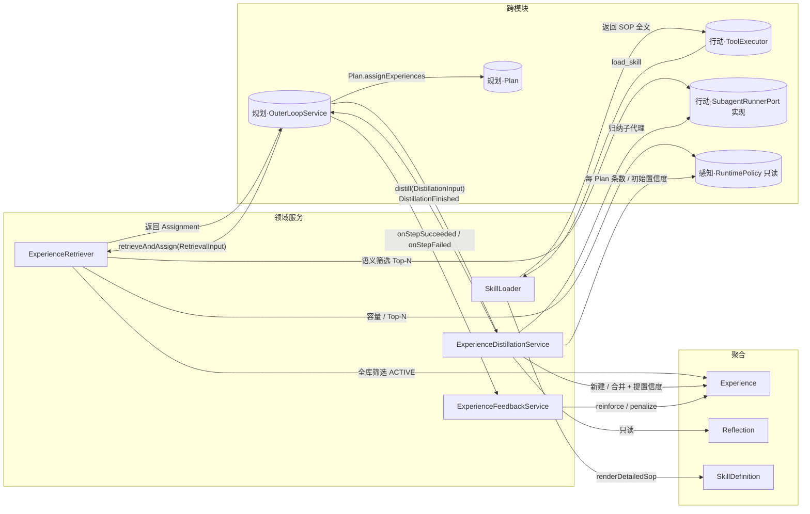
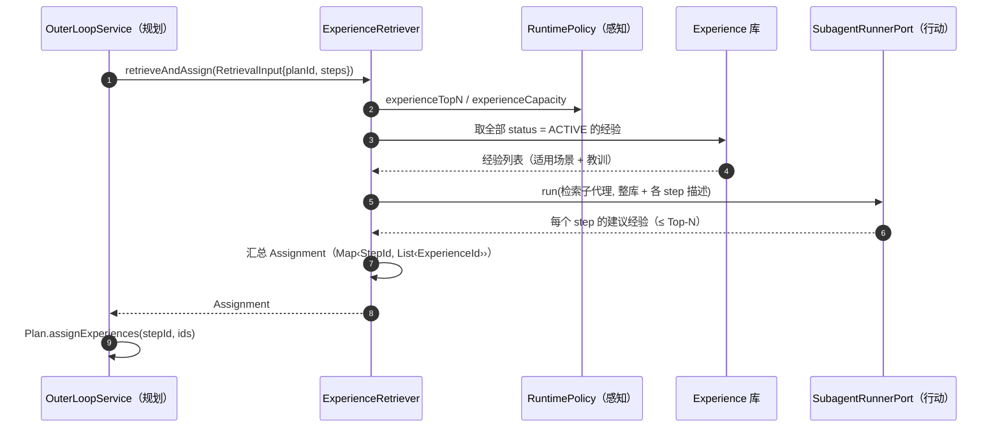
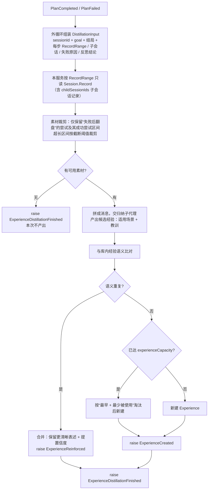
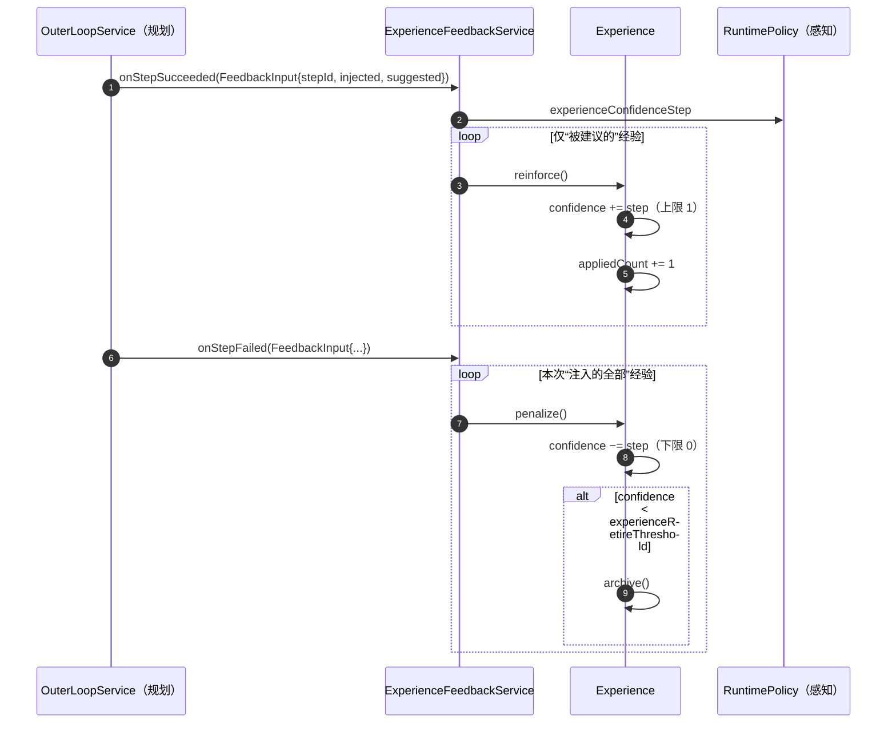
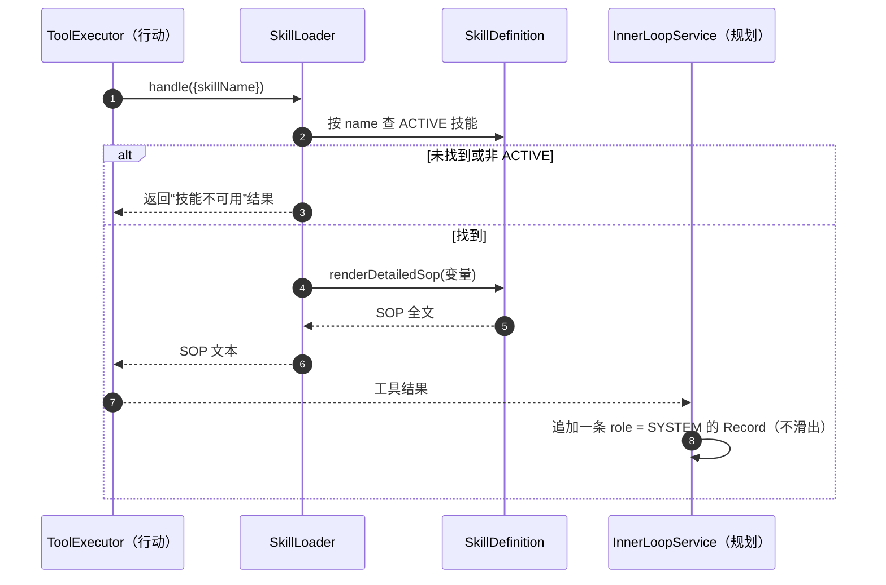

# 【记忆】模块

> 记忆模块回答一个问题：**学到的东西怎么留下来、下次怎么用上**。
> 它持有两类知识资产：**陈述性知识**（`Experience`：踩过的坑）与**程序性知识**（`SkillDefinition`：怎么做好一件事的 SOP），以及两者之间的**蒸馏中间态**（`Reflection`）。
> 它**不组装上下文**（感知）、**不执行动作**（行动）、**不推进计划**（规划）。

## 模块边界

| 方向 | 内容 |
|---|---|
| 本模块聚合 | `Experience`、`Reflection`、`SkillDefinition` |
| 本模块声明的端口（由外部实现） | `SubagentRunnerPort`（由【行动】实现：用指定内置 Agent 跑一次任务并回收结论） |
| 本模块实现的端口 | `InternalToolHandler`（【行动】声明：`load_skill` 的处理器 `SkillLoader`） |
| 被本模块引用的外部 ID（仅 ID） | `PlanId`、`StepId`（规划）、`RecordRange` / `SessionId`（感知） |
| 被外部引用的本模块对象 | `ExperienceId`（规划 `PlanStep.assignedExperienceIds`）、`ReflectionId`（规划 `Attempt.reflectionId`）、`SkillId`（行动 `AgentDefinition.skillIds`）、`RuntimePolicy` 中的经验参数（只读） |

> **依赖纪律**：记忆模块**不回写别人的聚合**。需要"把经验分配给 step"时，它只**返回分配结果**（`Map<StepId, List<ExperienceId>>`），由【规划】的 `Plan.assignExperiences()` 自己改状态；需要"读本 Plan 的执行事实"时，由调用方组装 `DistillationInput` 值对象传入，而不是让记忆去遍历 `Plan` 聚合；需要"读原始对话"时，按 `RecordRange` **只读** `Session.Record`（含子会话）—— 读操作不算依赖，且**绝不追写**。

---

## 1. 模块总览图

```mermaid
classDiagram
    namespace 经验聚合 {
        class Experience {
            <<AggregateRoot>>
            +ExperienceId id
            +String applicableScenario
            +LessonLearned lesson
            +ConfidenceScore confidence
            +ExperienceStatus status
            +int appliedCount
            +Date createdAt
            +reinforce()
            +penalize()
            +archive()
            +mergeWith(Experience other)
        }
        class LessonLearned {
            <<ValueObject>>
            +String instruction
            +String expectedOutcome
        }
        class ConfidenceScore {
            <<ValueObject>>
            +double value
        }
        class ExperienceStatus {
            <<Enumeration>>
            ACTIVE
            ARCHIVED
        }
    }

    namespace 反思 {
        class Reflection {
            <<AggregateRoot>>
            +ReflectionId id
            +PlanId planId
            +StepId stepId
            +int attemptNo
            +String conclusion
            +Date createdAt
        }
    }

    namespace 技能聚合 {
        class SkillDefinition {
            <<AggregateRoot>>
            +SkillId id
            +String name
            +String description
            +String triggerCondition
            +InstructionTemplate sopTemplate
            +SkillStatus status
            +activate()
            +updateSop(InstructionTemplate)
            +deprecate()
            +renderDetailedSop(Map) String
        }
        class InstructionTemplate {
            <<ValueObject>>
            +String rawMarkdown
            +List~String~ variables
            +render(Map) String
        }
        class SkillStatus {
            <<Enumeration>>
            DRAFT
            ACTIVE
            DEPRECATED
        }
    }

    namespace 领域服务 {
        class ExperienceRetriever {
            <<DomainService>>
            +retrieveAndAssign(RetrievalInput) Assignment
        }
        class ExperienceDistillationService {
            <<DomainService>>
            +distill(DistillationInput) void
        }
        class ExperienceFeedbackService {
            <<DomainService>>
            +onStepSucceeded(FeedbackInput) void
            +onStepFailed(FeedbackInput) void
        }
        class SkillLoader {
            <<DomainService>>
            +load(String skillName) String
        }
        class RetrievalInput {
            <<ValueObject>>
            +PlanId planId
            +List~StepBrief~ steps
        }
        class DistillationInput {
            <<ValueObject>>
            +PlanId planId
            +SessionId sessionId
            +String goal
            +PlanOutcome outcome
            +List~StepTrace~ stepTraces
        }
        class StepTrace {
            <<ValueObject>>
            +StepId stepId
            +String description
            +StepStatus outcome
            +RecordRange recordRange
            +List~SessionId~ childSessionIds
            +String failureReason
            +String reflectionConclusion
        }
        class FeedbackInput {
            <<ValueObject>>
            +StepId stepId
            +List~ExperienceId~ injectedExperienceIds
            +List~ExperienceId~ suggestedExperienceIds
        }
        class RecordRange {
            <<ValueObject>>
            +RecordId startRecordId
            +RecordId endRecordId
        }
    }

    namespace 端口 {
        class SubagentRunnerPort {
            <<Port>>
            +run(AgentId, String task) String
        }
        class InternalToolHandler {
            <<Port>>
            +supports(ToolId) boolean
            +handle(Map args) String
        }
    }

    namespace 领域事件 {
        class ExperienceCreated
        class ExperienceReinforced
        class ExperiencePenalized
        class ReflectionRecorded
    }

    namespace 应用事件 {
        class ExperienceDistillationFinished
    }

    Experience *-- LessonLearned
    Experience *-- ConfidenceScore
    Experience --> ExperienceStatus

    SkillDefinition *-- InstructionTemplate
    SkillDefinition --> SkillStatus

    ExperienceRetriever ..> Experience : 筛选 / 分配
    ExperienceRetriever ..> SubagentRunnerPort
    ExperienceDistillationService ..> Experience : 创建 / 合并
    ExperienceDistillationService ..> Reflection : 只读素材
    ExperienceDistillationService ..> SubagentRunnerPort
    ExperienceFeedbackService ..> Experience : reinforce / penalize
    SkillLoader ..> SkillDefinition
    SkillLoader ..> InternalToolHandler

    Experience ..> ExperienceCreated : raises
    Experience ..> ExperienceReinforced : raises
    Experience ..> ExperiencePenalized : raises
    Reflection ..> ReflectionRecorded : raises
```

---

## 2. 对象操作图

---

## 3. 聚合清单

| 聚合 | 简介 | 不变量 |
|---|---|---|
| `Experience` | 全局经验库的一条经验：适用场景 + 教训 + 置信度 + 使用统计。**只有一种经验：失败后翻盘的反思教训** | ① 置信度恒在 `[0,1]`；② 不绑定任何 Agent / 工具 / 技能；③ `ARCHIVED` 后不再参与检索；④ 容量不得超上限 |
| `Reflection` | 一次失败的反思结论，是"经验蒸馏"的**中间态**与"重试回注"的**素材** | ① 生成后不可变；② 一条 reflection 归属唯一 `(planId, stepId, attemptNo)` |
| `SkillDefinition` | 程序性知识：描述 + 触发条件 + SOP 模板；**纯提示词资产，不携带动工具** | ① 只有 `ACTIVE` 才进入会话快照；② SOP 不得引用未绑定的工具；③ 不含任何工具 ID 列表 |

### 3.1 `Experience`

| 项 | 内容 |
|---|---|
| 简介 | 沉淀于计划完结时；检索于计划诞生/重划时；**语义不绑定任何维度**，全局共享 |
| 关联 | 被 `PlanStep.assignedExperienceIds` 引用（规划） |

### 3.2 `Reflection`

| 项 | 内容 |
|---|---|
| 简介 | 重试达阈值后由反思子代理产出；**双消费者**：回注本 step 的下一次 attempt（作为失败原因）、作为经验沉淀素材 |
| 关联 | 被 `Attempt.reflectionId` 引用（规划） |

### 3.3 `SkillDefinition`

| 项 | 内容 |
|---|---|
| 简介 | 渐进披露：系统提示只挂 `name + description`；模型调 `load_skill` 才注入 SOP 全文（`role = SYSTEM` 的 Record） |
| 关联 | 被 `AgentDefinition.skillIds` 引用（行动）；被 `SkillLoader` 渲染 |

---

## 4. 领域服务清单

| 服务 | 简介 | 依赖 |
|---|---|---|
| `ExperienceRetriever` | **计划诞生 / 计划重划**时：取全库 `ACTIVE` 经验 → 交检索子代理做**语义筛选** → 返回每个 step 的 Top-N 经验 ID | `Experience`、`SubagentRunnerPort`、`RuntimePolicy` |
| `ExperienceDistillationService` | **计划完结**时：组装复盘简报 → 交归纳子代理 → 产出候选经验 → 与库内经验去重（合并 + 提置信度）或新建 | `Experience`、`Reflection`、`SubagentRunnerPort`、`RuntimePolicy` |
| `ExperienceFeedbackService` | step 结束时回写经验统计：成功 ⇒ 对"被建议的"经验 `reinforce`；失败 ⇒ 对"本次注入的全部"经验 `penalize` | `Experience` |
| `SkillLoader` | 实现 `InternalToolHandler`，处理 `load_skill(skillName)`：渲染 SOP 全文并返回给工具调用方（由内循环注入为 `SYSTEM` Record） | `SkillDefinition` |

---

## 5. 其他实体 / 值对象清单

| 对象 | 类型 | 简介 |
|---|---|---|
| `LessonLearned` | VO | 教训正文 `instruction` + 期望结果 `expectedOutcome` |
| `ConfidenceScore` | VO | `[0,1]` 的置信度；`reinforce / penalize` 由聚合按 `RuntimePolicy` 的步长演化 |
| `ExperienceStatus` | Enum | `ACTIVE / ARCHIVED` |
| `InstructionTemplate` | VO | SOP 原文与变量，`render()` 后得到注入文本 |
| `SkillStatus` | Enum | `DRAFT / ACTIVE / DEPRECATED` |
| `RetrievalInput` | VO | 检索入参：`planId` + 每个 step 的简要描述（**不传 `Plan` 聚合**） |
| `DistillationInput` | VO | 沉淀入参：`planId`、`sessionId`、`goal`、计划结局、每步的 `StepTrace`（描述 / 结局 / `RecordRange` / 子会话 ID / 失败原因 / 反思结论） |
| `RecordRange` | VO | 指向 `Session.Record` 流水的一段连续区间（`startRecordId → endRecordId`）；定义见《模块-规划》6.4.1，本章复用以保持自包含 |
| `StepTrace` | VO | 一个 step 的执行事实摘要，**带轨迹区间**供归纳子代理读取原始对话 |
| `FeedbackInput` | VO | 反馈入参：`stepId`、本次注入的经验集合、检索子代理建议的经验集合 |
| `SubagentRunnerPort` | Port | 用指定内置 Agent 跑一次任务并回收结论；由【行动】实现 |
| `InternalToolHandler` | Port | 内置工具处理器；`SkillLoader` 实现其中的 `load_skill` |

---

## 6. 领域事件清单

| 事件 | raise by | 发生时机 | 订阅方 |
|---|---|---|---|
| `ReflectionRecorded` | `Reflection` | 反思结论落库（重试达阈值后） | 规划·外循环（回注下一次 attempt）、沉淀候选收集 |
| `ExperienceCreated` | `Experience` | 归纳产出**新**经验 | 无（界面可展示） |
| `ExperienceReinforced` | `Experience` | `reinforce()` 成功（step 成功回写 / 语义重复合并提置信度） | 无（界面可展示） |
| `ExperiencePenalized` | `Experience` | `penalize()` 成功（step 失败惩罚本次注入的全部经验） | 无（界面可展示） |

> 应用事件 `ExperienceDistillationFinished`：一次沉淀流程跑完（可能产出 0 条，例如全库已有等价经验且合并后无变化）。它不属于任何聚合的状态转换。

**本模块订阅**：`PlanCreated` / `PlanFailed` / `PlanCompleted`（规划）——前者触发检索分配，后两者触发沉淀；`PolicyAdjusted`（感知）——刷新容量、Top-N、置信度步长等读取缓存。

---

## 7. 聚合生命周期与规则

### 7.1 `Experience`

| 诞生 | 变更 | 终结 | 重建 |
|---|---|---|---|
| **计划完结**（`PlanCompleted` / `PlanFailed` 后由归纳子代理产出） | **reinforce / penalize**（step 结束回写）、**合并**（语义重复时提置信度）、`archive`（置信度 < 阈值或容量淘汰） | `ARCHIVED`（不再参与检索，保留供审计） | 应用启动时载入 |

**规则清单**

1. **只有一类经验**：失败后翻盘的反思教训；**终局失败**（`PlanFailed`）的反思也沉淀，只是初始置信度低。
2. **沉淀时机**：只在**计划完结**时发生，不在失败瞬间、不在 step 结束时发生。
3. **每 Plan 条数上限**：`experiencePerPlan`（用户可调，默认 1）。
4. **去重**：与库内经验**语义重复** ⇒ **合并 + 提置信度**，不新建。
5. **置信度**：范围 `[0,1]`；初值 `experienceInitialConfidence`（0.5）；`reinforce +step`、`penalize −step`（`experienceConfidenceStep` = 0.1）；**低于 `experienceRetireThreshold`（0.2）淘汰**。
6. **容量与淘汰**：总量上限 `experienceCapacity`；超限时**优先淘汰"最早且最少被使用"**（`createdAt` 升序 + `appliedCount` 升序）。
7. **"被应用"的判定**：不靠"是否注入"猜测，而靠**检索子代理的标注建议**。
8. **回写不对称**（有意为之）：成功 ⇒ 只奖励"被建议的"；失败 ⇒ 惩罚"本次注入的全部"（宁可错杀，防止垃圾经验滞留）。
9. **事件**：新建 ⇒ `ExperienceCreated`；`reinforce()` 成功 ⇒ `ExperienceReinforced`；`penalize()` 成功 ⇒ `ExperiencePenalized`；语义重复的合并归入 `ExperienceReinforced`。
10. **不绑定维度**：不绑 Agent、不绑工具、不绑技能 —— 全局单一库，跨代理共用。
11. **命中检测**：检索走语义筛选，**不做关键词匹配**；经验只存"适用场景"自然语言 + 教训正文。

### 7.2 `Reflection`

| 诞生 | 变更 | 终结 | 重建 |
|---|---|---|---|
| **步骤重试**（有效重试次数达 `reflectionThreshold`） | 无（不可变） | 随会话销毁而删除（其价值已由 `Experience` 承接） | **会话续跑**时按 ID 读取 |

**规则清单**

1. **触发条件**：`reflectionThreshold ≤ maxRetries` 且**有效重试次数**达到阈值；`reflectionThreshold > maxRetries` ⇒ **永不反思**（直接回注验证失败原因）。
2. **产者**：反思子代理（`BUILT_IN` Agent，prompt 固定、工具集写死）。
3. **双消费者**：① 作为下一次 attempt 的**失败原因**回注（Reflexion）；② 作为**经验沉淀素材**。
4. **不可变**：生成后任何角色不得修改。
5. **归属唯一**：一条 reflection 对应唯一的 `(planId, stepId, attemptNo)`。
6. **不消耗重试名额**：反思本身不是一次 attempt。

### 7.3 `SkillDefinition`

| 诞生 | 变更 | 终结 | 重建 |
|---|---|---|---|
| **平台初始化**（内置技能）/ 用户创建 | `updateSop`、`activate` / `deprecate` | `DEPRECATED`（不再进入新会话快照） | 应用启动时载入 |

**规则清单**

1. **纯提示词资产**：只有描述、触发条件、SOP 模板；**不含工具依赖**（`toolIds` 已在 v2 删除）。
2. **渐进披露**：系统提示只挂 `name + description`；SOP 正文只能通过 `load_skill` 注入。
3. **注入形态**：SOP 注入为一条 `role = SYSTEM` 的 `Record`，此后不参与滑窗（除非 SYSTEM 占比超限被整体裁剪）。
4. **只有 `ACTIVE` 技能**进入新会话快照。
5. **一致性**：SOP 正文里提到的工具必须在 `AgentDefinition.toolIds` 内；否则由感知组装快照时告警（不阻断，模型看得到提示但调不动工具）。
6. **技能不自动激活**：`triggerCondition` 只是给模型看的判断依据，是否加载由模型调 `load_skill` 决定。

---

## 8. 领域服务的具体操作

### 8.1 `ExperienceRetriever.retrieveAndAssign(RetrievalInput)`

**职责**：计划诞生 / 每次重划后，为各 step 分配经验。**它只返回分配结果，不写 `Plan`**。

**要点**

1. **全库交子代理语义筛选**，不做关键词预筛（关键词在中文/领域术语上漏召严重）。
2. 只在**计划诞生**与**计划重划**两个时点发生；**无 Plan 的自由 ReAct 不检索**（经验按 step 分配）。
3. 检索子代理的标注建议同时是"**被应用**"的判定依据（供 8.3 回写）。

### 8.2 `ExperienceDistillationService.distill(DistillationInput)`

**职责**：计划完结时把"执行事实"蒸馏成一条经验。

**要点**

1. **素材口径**：`DistillationInput` 由外循环组装（记忆**不遍历 `Plan` 聚合**）；但它**带轨迹区间**，由本服务从 `Session.Record` **只读**取出原始对话（含子会话），拼成消息交给归纳子代理。
2. **读而不写**：读 `Session` 是只读操作，不得向会话追写任何记录；因此不需要新端口，也不破坏“不回写别人聚合”的纪律。
3. **素材裁剪**：原始轨迹可能极长，只保留“失败后翻盘”的 attempt 与其成功的后继区间；单个区间超过截断阈值时截短（否则归纳子代理会直接撞上下文上限）。
4. 每个 Plan **最多沉淀 `experiencePerPlan` 条**；产出 0 条是合法结果。
5. **终局失败也沉淀**：`PlanFailed` 同样触发，初始置信度按配置（偏低）。

### 8.3 `ExperienceFeedbackService`

**职责**：step 结束时把结果回写到经验统计（奖惩不对称）。

**要点**：失败惩罚**不做相关性归因**（有意为之：宁可错杀）；置信度跌到阈值以下即 `archive()`，不再参与检索。

### 8.4 `SkillLoader.load(skillName)`（实现 `InternalToolHandler`）

**要点**：`SkillLoader` 只负责"取定义 + 渲染"；**把它注入成 `SYSTEM` Record 是内循环的职责**（记忆模块不写别人的会话）。

---

## 附录：生命周期节点词表（四份文档统一）

| 节点 | 含义 |
|---|---|
| **平台初始化** | 应用启动：载入 `RuntimePolicy`，播种内置 Agent / 内置工具 / 内置技能 |
| **策略调整** | 用户修改 `RuntimePolicy`，立即生效 |
| **会话开启** | 创建 `Session` + `Budget`（会话族根）+ 冻结提示词快照 + 生成标题 |
| **会话续跑** | 程序重启后 resume：加载 `Session` / `Plan` / `Budget`；半截工具调用视为失败 |
| **子代理派遣** | `spawn_subagents` 内部创建完整子会话 |
| **计划诞生** | `PlanFactory` 创建 `Plan`（并触发经验分配） |
| **步骤启动** | 取当前 step，创建 `Attempt`（开区间） |
| **步骤提交验收** | `submit_step` → 触发验证 / 或免验证直接完成 |
| **步骤固化 / 判败 / 中断** | step 的三种结束：`SUCCEEDED` / `FAILED` / `INTERRUPTED` |
| **步骤重试** | 失败后新建 `Attempt`；达阈值则产生 `Reflection` |
| **计划重划** | `replanGeneration + 1`，未执行 step 置 `SUPERSEDED` 并重新分配经验 |
| **计划完结** | `COMPLETED` / `FAILED`，触发经验沉淀 |
| **上下文折叠** | token 超阈值 → 生成 `SUMMARY` → 滑窗 |
| **模型降级** | 故障命中备用模型链 |
| **会话封存 / 会话销毁** | 归档（不可 resume）/ 物理删除（连带 `Record`/`Plan`/`Budget`，经验保留） |
