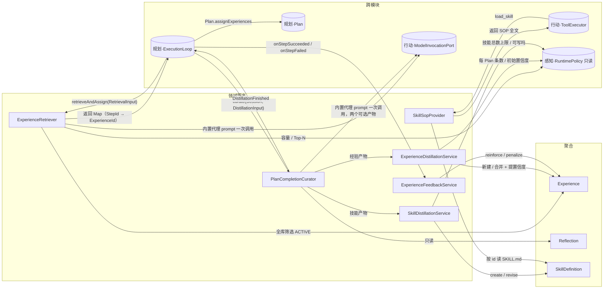
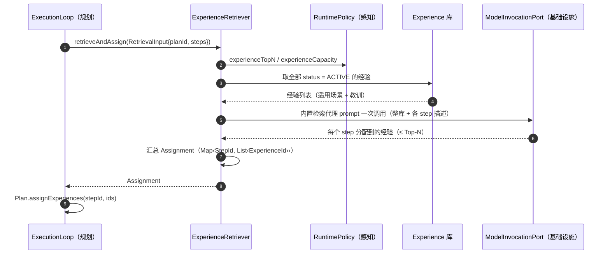
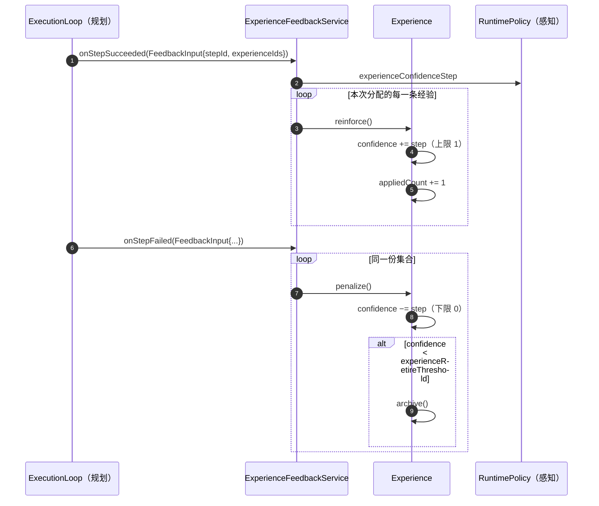
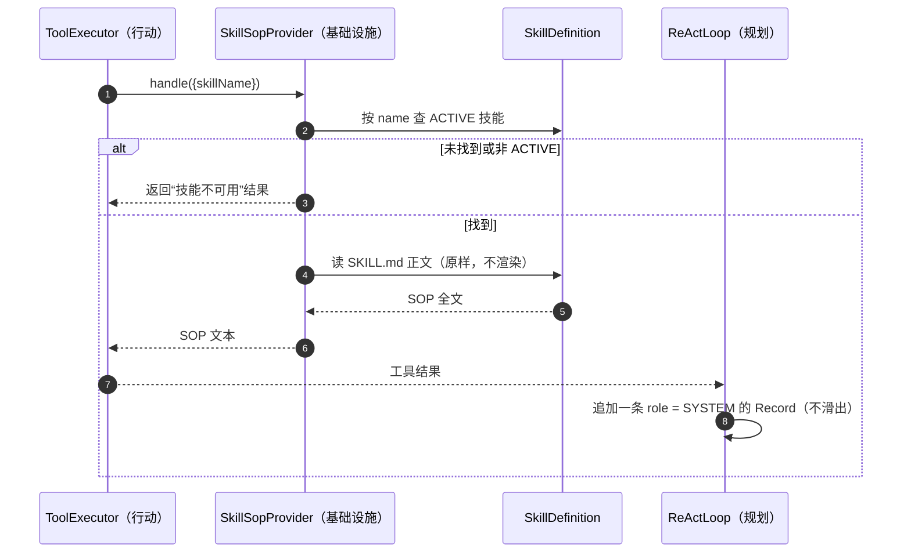
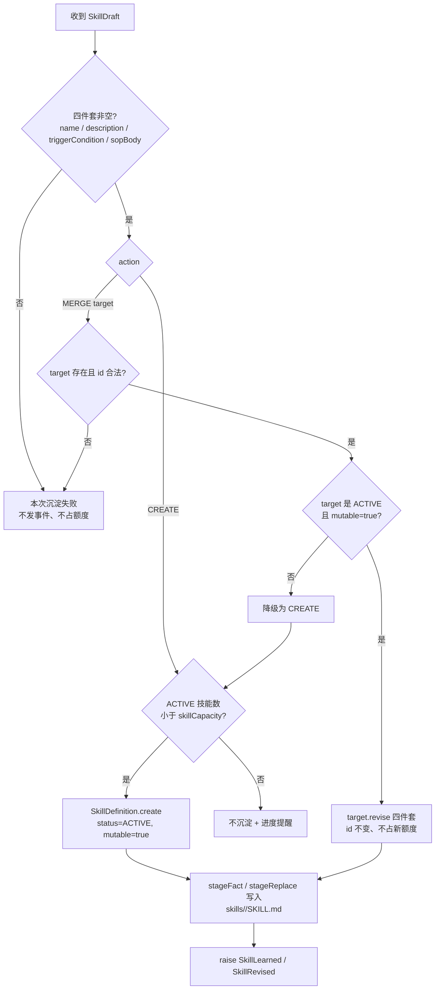
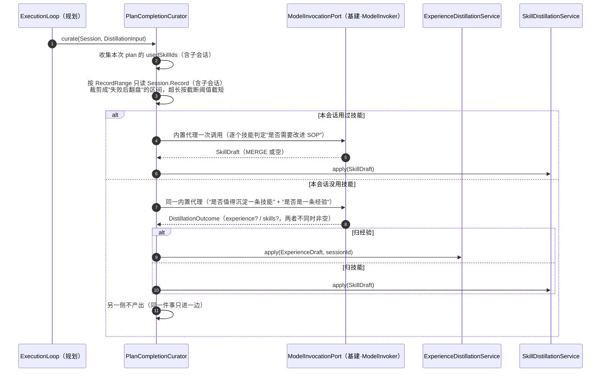

# 【记忆】模块

> 记忆模块回答一个问题：**学到的东西怎么留下来、下次怎么用上**。
> 它持有两类知识资产：**陈述性知识**（`Experience`：踩过的坑）与**程序性知识**（`SkillDefinition`：怎么做好一件事的 SOP），以及两者之间的**蒸馏中间态**（`Reflection`）。
> 它**不组装上下文**（感知）、**不执行动作**（行动）、**不推进计划**（规划）。

## 模块边界

| 方向 | 内容 |
|---|---|
| 本模块聚合 | `Experience`、`Reflection`、`SkillDefinition` |
| 本模块端口 | 在 **`application.memory.port`** 声明 **`SkillSopProvider`**（只声明接口，由基础设施 `FileSkillSopProvider` 实现）；本模块**不实现**任何端口。检索/归纳所需的内置代理能力由 `ModelInvocationPort` 提供（`builtin.retrieve` / `builtin.distill` 的 prompt，不建子会话） |
| 被本模块引用的外部 ID（仅 ID） | `PlanId`、`StepId`（规划）、`RecordRange` / `SessionId`（感知） |
| 被外部引用的本模块对象 | `ExperienceId`（规划 `PlanStep.assignedExperienceIds`）、`ReflectionId`（规划 `Attempt.reflectionId`）、`SkillId`（行动 `AgentDefinition.skillIds`）、`RuntimePolicy` 中的经验参数（只读） |
| 本模块对象所在的层 | **领域层**：`Experience`、`Reflection`、`SkillDefinition`（含其规则）；**应用层**：`ExperienceRetriever`、`ExperienceDistillationService`、`ExperienceFeedbackService`；**端口**：`SkillSopProvider`（接口在 `application.memory.port`，实现 `FileSkillSopProvider` 在基础设施） |

> **依赖纪律**：记忆模块**不回写别人的聚合**。需要"把经验分配给 step"时，它只**返回分配结果**（`Map<StepId, List<ExperienceId>>`），由【规划】的 `Plan.assignExperiences()` 自己改状态；需要"读本 Plan 的执行事实"时，由调用方组装 `DistillationInput` 值对象传入，而不是让记忆去遍历 `Plan` 聚合；需要"读原始对话"时，按 `RecordRange` **只读** `Session.Record`（含子会话）—— 读操作不算依赖，且**绝不追写**。

---

## 1. 模块总览图

```mermaid
classDiagram
    namespace 经验聚合 {
        class Experience {
            <<AggregateRoot>>
            +ExperienceId id
            +String applicableScenario
            +LessonLearned lesson
            +ConfidenceScore confidence
            +ExperienceStatus status
            +int appliedCount
            +Date createdAt
            +reinforce()
            +penalize()
            +archive()
            +mergeWith(Experience other)
        }
        class LessonLearned {
            <<ValueObject>>
            +String instruction
            +String expectedOutcome
        }
        class ConfidenceScore {
            <<ValueObject>>
            +double value
        }
        class ExperienceStatus {
            <<Enumeration>>
            ACTIVE
            ARCHIVED
        }
    }

    namespace 反思 {
        class Reflection {
            <<AggregateRoot>>
            +ReflectionId id
            +PlanId planId
            +StepId stepId
            +int attemptNo
            +String conclusion
            +Date createdAt
        }
    }

    namespace 技能聚合 {
        class SkillDefinition {
            <<AggregateRoot>>
            +SkillId id
            +String name
            +String description
            +String triggerCondition
            +InstructionTemplate sopTemplate
            +SkillStatus status
            +boolean mutable
            +create(SkillId, String, String, String, String) SkillDefinition
            +revise(String, String, String, String)
            +isActive() boolean
            +isMutable() boolean
        }
        class InstructionTemplate {
            <<ValueObject>>
            +String rawMarkdown
        }
        class SkillStatus {
            <<Enumeration>>
            DRAFT
            ACTIVE
            DEPRECATED
        }
    }

    namespace 领域服务 {
        class ExperienceRetriever {
            <<ApplicationService>>
            +retrieveAndAssign(RetrievalInput) Map~StepId, List~ExperienceId~~
        }
        class ExperienceDistillationService {
            <<ApplicationService>>
            +apply(ExperienceDraft, SessionId) void
        }
        class ExperienceFeedbackService {
            <<ApplicationService>>
            +onStepSucceeded(FeedbackInput) void
            +onStepFailed(FeedbackInput) void
        }
        class PlanCompletionCurator {
            <<ApplicationService>>
            +curate(Session, DistillationInput) DistillationOutcome
        }
        class SkillDistillationService {
            <<ApplicationService>>
            +apply(SkillDraft, SessionId) void
        }
        class SkillSopProvider {
            <<Port>>
            +sop(String skillId) String
        }
        class RetrievalInput {
            <<ValueObject>>
            +PlanId planId
            +List~StepBrief~ steps
        }
        class StepBrief {
            <<ValueObject>>
            +StepId stepId
            +String description
        }
        class DistillationInput {
            <<ValueObject>>
            +PlanId planId
            +SessionId sessionId
            +String goal
            +PlanStatus outcome
            +List~StepTrace~ stepTraces
        }
        class StepTrace {
            <<ValueObject>>
            +StepId stepId
            +String description
            +StepStatus outcome
            +RecordRange recordRange
            +List~SkillId~ usedSkillIds
            +String failureReason
            +String reflectionConclusion
        }
        class FeedbackInput {
            <<ValueObject>>
            +StepId stepId
            +List~ExperienceId~ experienceIds
        }
        class RecordRange {
            <<ValueObject>>
            +RecordId startRecordId
            +RecordId endRecordId
        }
    }

    namespace 领域事件 {
        class ExperienceCreated
        class ExperienceReinforced
        class ExperiencePenalized
        class ReflectionRecorded
    }

    namespace 应用事件 {
        class ExperienceDistillationFinished
    }

    Experience *-- LessonLearned
    Experience *-- ConfidenceScore
    Experience --> ExperienceStatus

    SkillDefinition *-- InstructionTemplate
    SkillDefinition --> SkillStatus

    ExperienceRetriever ..> Experience : 筛选 / 分配
    PlanCompletionCurator ..> Reflection : 只读素材
    ExperienceDistillationService ..> Experience : 创建 / 合并
    ExperienceFeedbackService ..> Experience : reinforce / penalize

    SkillSopProvider ..> SkillDefinition

    Experience ..> ExperienceCreated : raises
    Experience ..> ExperienceReinforced : raises
    Experience ..> ExperiencePenalized : raises
    Reflection ..> ReflectionRecorded : raises
```



---

## 2. 对象操作图



---

## 3. 聚合清单

| 聚合 | 简介 | 不变量 |
|---|---|---|
| `Experience` | 全局经验库的一条经验：适用场景 + 教训 + 置信度 + 使用统计。**只有一种经验：失败后翻盘的反思教训** | ① 置信度恒在 `[0,1]`；② 不绑定任何 Agent / 工具 / 技能；③ `ARCHIVED` 后不再参与检索；④ 容量不得超上限 |
| `Reflection` | 一次失败的反思结论，是"经验蒸馏"的**中间态**与"重试回注"的**素材** | ① 生成后不可变；② 一条 reflection 归属唯一 `(planId, stepId, attemptNo)` |
| `SkillDefinition` | 程序性知识：描述 + 触发条件 + SOP 正文；**纯提示词资产**。人写与机学同构，只有 `mutable` 区分"系统能不能改" | ① 只有 `ACTIVE` 才进入会话快照；② 不含任何工具 ID 列表；③ **`mutable = false` 时 `revise()` 必须失败**；④ `name / description / triggerCondition / 正文` 四者非空；⑤ `status` 只由 front-matter 决定，聚合不产生状态迁移 |

### 3.1 `Experience`

| 项 | 内容 |
|---|---|
| 简介 | 沉淀于计划完结时；检索于计划诞生/重划时；**语义不绑定任何维度**，全局共享 |
| 关联 | 被 `PlanStep.assignedExperienceIds` 引用（规划） |

### 3.2 `Reflection`

| 项 | 内容 |
|---|---|
| 简介 | 重试达阈值后由反思子代理产出；**双消费者**：回注本 step 的下一次 attempt（作为失败原因）、作为经验沉淀素材 |
| 关联 | 被 `Attempt.reflectionId` 引用（规划） |

### 3.3 `SkillDefinition`

| 项 | 内容 |
|---|---|
| 简介 | 渐进披露：会话快照只挂 `name + description + triggerCondition`；模型调 `load_skill` 才注入 SOP 全文（`role = SYSTEM` 的 Record）。**人写与机学同构**，唯一差别是 `mutable` |
| 关联 | 被 `AgentDefinition.skillIds` 引用（行动）；由基础设施 `SkillSopProvider` 读；被 `SkillDistillationService` 创建/改进（记忆） |

| 字段 | 语义 |
|---|---|
| `mutable` | **系统有没有权改写正文**。默认 `true`；人写技能在 front-matter 写 `mutable: false` 即可锁死；jar 内置恒 `false` |
| `status` | `DRAFT / ACTIVE / DEPRECATED`，**只由 front-matter 决定**（系统只读）。`DRAFT` = 人写草稿；`DEPRECATED` = 人手动下线（或直接删目录） |

---

## 4. 领域服务清单

| 服务 | 层 | 简介 | 依赖 |
|---|---|---|---|
| `ExperienceRetriever` | 应用 | **计划诞生 / 计划重划**时：取全库 `ACTIVE` 经验 → 调内置代理（`builtin.retrieve`）做**语义筛选** → 返回每个 step 的 Top-N 经验 ID | `Experience`、`ModelInvocationPort`、`RuntimePolicy`、`BudgetService` |
| `PlanCompletionCurator` | 应用 | **计划完结**时的唯一编排：调内置代理（`builtin.distill` 的 prompt）**一次**，产出「经验? + 技能?」，按"同一件事只进一边"互斥分派 | `ModelInvocationPort`、`ExperienceDistillationService`、`SkillDistillationService`、`RecordStore`、`BudgetService` |
| `ExperienceDistillationService` | 应用 | **只做写入**：接收经验产物 → 与库内经验去重（合并 + 提置信度）或新建；不碰模型、不读别人的流水 | `Experience`、`ExperienceRepository`、`CommitScope` |
| `SkillDistillationService` | 应用 | 接收技能产物：校验四件套 → 按 `CREATE / MERGE` 分支（含 `mutable`、`ACTIVE`、容量判定）→ `create` / `revise` → 写 `SKILL.md` | `SkillDefinition`、`CatalogRepository`、`RuntimePolicy` |
| `ExperienceFeedbackService` | 应用 | step 结束时回写经验统计：成功 ⇒ 对该 step **本次分配的经验** `reinforce`；失败 ⇒ 对**同一份集合** `penalize`（**规则在 `Experience` 聚合内**） | `Experience` |
| `SkillSopProvider` | 端口（基础设施实现） | 按 id 读 `skills/<id>/SKILL.md`、解析 front-matter 并渲染 SOP；供 `load_skill` 使用 | `SkillDefinition` |

---

## 5. 其他实体 / 值对象清单

| 对象 | 类型 | 简介 |
|---|---|---|
| `LessonLearned` | VO | 教训正文 `instruction` + 期望结果 `expectedOutcome` |
| `ConfidenceScore` | VO | `[0,1]` 的置信度；`reinforce / penalize` 由聚合按 `RuntimePolicy` 的步长演化 |
| `ExperienceStatus` | Enum | `ACTIVE / ARCHIVED` |
| `InstructionTemplate` | VO | SOP 原文（`rawMarkdown`）。**系统不解析、不渲染、不做变量替换**（`variables` 与 `render()` 已删除） |
| `SkillStatus` | Enum | `DRAFT / ACTIVE / DEPRECATED`；**只由 front-matter 决定**，系统不产生状态迁移 |
| `RetrievalInput` | VO | 检索入参：`planId` + 每个 step 的简要描述（**不传 `Plan` 聚合**） |
| `StepBrief` | VO | 检索入参的一步：`stepId` + `description`；内置检索代理靠它匹配经验（`builtin.retrieve`，不建子会话） |
| `DistillationInput` | VO | 沉淀入参：`planId`、`sessionId`、`goal`、计划结局、每步的 `StepTrace`（描述 / 结局 / `RecordRange` / 失败原因 / 反思结论） |
| `RecordRange` | VO | 指向 `Session.Record` 流水的一段连续区间（`startRecordId → endRecordId`）；定义见《模块-规划》§5 值对象清单，本章复用以保持自包含 |
| `StepTrace` | VO | 一个 step 的执行事实摘要：描述 / 结局 / 轨迹区间 / 子会话 / **本次用到的技能** / 失败原因 / 反思结论 |
| `FeedbackInput` | VO | 反馈入参：`stepId` + 本次分配（= 注入）的经验集合 `experienceIds`。**只有一个集合**：分配与注入同源，没有独立的"建议"（规则 ⑦） |
| `SkillSopProvider` | Port | 按 id 现读 `SKILL.md` 并返回正文；由基础设施实现（本模块只是它的消费方之一） |
| `ExperienceDraft` | VO | 经验产物：`applicableScenario`、`instruction`、`expectedOutcome`（内置代理说的，写入前由 `Experience` 规则再判定） |
| `SkillDraft` | VO | 技能产物：`action`（`CREATE` / `MERGE`）、`targetSkillId`、`name`、`description`、`triggerCondition`、`sopBody`（自由文本，五节骨架由 prompt 约定）。**MERGE 也要带全四件套**：目标不可变时要能降级 `CREATE`（§8.5），只有正文降不了；编排者用目标技能的现有三件套补齐，内置代理仍只能改正文 |
| `DistillationOutcome` | VO | 一次归纳的产物：`experience?` + `skills?`（0..N 条）。**经验与技能不能同时非空**（同一件事只进一边）；技能侧可以多条，因为本次用到过的技能各判各的 |

---

## 6. 领域事件清单

| 事件 | raise by | 发生时机 | 订阅方 |
|---|---|---|---|
| `ReflectionRecorded` | `Reflection` | 反思结论落库（重试达阈值后） | **无功能性订阅方**：回注由外循环读 `Reflection`；沉淀素材由 `DistillationInput` 组装时读 |
| `ExperienceCreated` | `Experience` | 归纳产出**新**经验 | 无（界面可展示） |
| `ExperienceReinforced` | `Experience` | `reinforce()` 成功（step 成功回写 / 语义重复合并提置信度） | 无（界面可展示） |
| `ExperiencePenalized` | `Experience` | `penalize()` 成功（step 失败惩罚本次分配的经验） | 无（界面可展示） |
| `SkillLearned` | `SkillDefinition` | `create(...)` 产出**新**技能 | 无（界面 / 审计可展示） |
| `SkillRevised` | `SkillDefinition` | `revise(...)` 改写已有可变技能 | 无（界面 / 审计可展示） |

> 应用事件 `ExperienceDistillationFinished`：一次沉淀流程跑完（可能产出 0 条，例如全库已有等价经验且合并后无变化）。它不属于任何聚合的状态转换。

**本模块不订阅任何领域事件**：检索与沉淀由 `ExecutionLoop` 显式调用；`PolicyAdjusted`（感知）只作为本地读取缓存的失效提示（容量、Top-N、置信度步长），不驱动任何动作。

---

## 7. 聚合生命周期与规则

### 7.1 `Experience`

| 诞生 | 变更 | 终结 | 重建 |
|---|---|---|---|
| **计划完结**（`PlanCompleted` / `PlanFailed` 后由内置代理 `builtin.distill` 产出） | **reinforce / penalize**（step 结束回写）、**合并**（语义重复时提置信度）、`archive`（置信度 < 阈值或容量淘汰） | `ARCHIVED`（不再参与检索，保留供审计） | 应用启动时载入 |

**规则清单**

1. **只有一类经验**：失败后翻盘的反思教训；**终局失败**（`PlanFailed`）的反思也沉淀（初值与其它经验相同，不另开起跑线）。
2. **沉淀时机**：只在**计划完结**时发生，不在失败瞬间、不在 step 结束时发生。
3. **每 Plan 条数上限**：`experiencePerPlan`（用户可调，默认 1）。
4. **去重**：与库内经验**语义重复** ⇒ **合并 + 提置信度**，不新建。
5. **置信度**：范围 `[0,1]`；初值统一为 `experienceInitialConfidence`（0.5，**不为终局失败单独设参数**——终局失败只是“沉淀得晚/少”，不另开起跑线）；`reinforce +step`、`penalize −step`（`experienceConfidenceStep` = 0.1）；**低于 `experienceRetireThreshold`（0.2）淘汰**。
6. **容量与淘汰**：总量上限 `experienceCapacity`；超限时**优先淘汰"最早且最少被使用"**（`createdAt` 升序 + `appliedCount` 升序）。
7. **"被应用"的判定**：检索为该 step 分配的经验**即视为被应用**——**分配就是注入**，两者是同一份集合，实现里没有独立的"标注"环节。
8. **回写范围**：成功 `reinforce` 与失败 `penalize` 作用于**同一份**"本次分配的经验集合"（`FeedbackInput.experienceIds`）。**不区分"建议"与"注入"**——原设想的"奖惩不对称"（成功只奖励被建议的、失败惩罚全部注入的）在现实现里不成立，如实记录于此。
9. **事件**：新建 ⇒ `ExperienceCreated`；`reinforce()` 成功 ⇒ `ExperienceReinforced`；`penalize()` 成功 ⇒ `ExperiencePenalized`；语义重复的合并归入 `ExperienceReinforced`。
10. **不绑定维度**：不绑 Agent、不绑工具、不绑技能 —— 全局单一库，跨代理共用。
11. **命中检测**：检索走语义筛选，**不做关键词匹配**；经验只存"适用场景"自然语言 + 教训正文。

### 7.2 `Reflection`

| 诞生 | 变更 | 终结 | 重建 |
|---|---|---|---|
| **步骤重试**（有效重试次数达 `reflectionThreshold`） | 无（不可变） | 随会话销毁而删除（其价值已由 `Experience` 承接） | **会话续跑**时按 ID 读取 |

**规则清单**

1. **触发条件**：`reflectionThreshold ≤ maxRetries` 且**有效重试次数**达到阈值；`reflectionThreshold > maxRetries` ⇒ **永不反思**（直接回注验证失败原因）。
2. **产者**：内置反思代理（`BUILT_IN` Agent，prompt 固定、工具集写死）——**与检索/沉淀/裁判同一形状**：一段文本进、一段结论出，直连 `ModelInvocationPort`，不建子会话（建会话要多付一次标题模型调用与一份流水，而反思没有任何并行或独立生命周期需求）。代理缺失或调用失败 ⇒ **本次不反思**：把错误文案存成反思结论比不反思更糟。
3. **双消费者**：① 作为下一次 attempt 的**失败原因**回注（Reflexion）；② 作为**经验沉淀素材**。
4. **不可变**：生成后任何角色不得修改。
5. **归属唯一**：一条 reflection 对应唯一的 `(planId, stepId, attemptNo)`。
6. **不消耗重试名额**：反思本身不是一次 attempt。

### 7.3 `SkillDefinition`

| 诞生 | 变更 | 终结 | 重建 |
|---|---|---|---|
| **平台初始化**（jar 内置，`mutable = false`）/ 用户手写（`skills/<id>/SKILL.md`）/ **计划完结沉淀**（`SkillDefinition.create`，`mutable = true`） | **仅 `revise()`**（要求 `mutable = true`）；`status` 只能改 front-matter | 用户删目录，或 front-matter 改 `status: deprecated`（不再进入新会话快照）；**系统从不删除** | 应用启动时载入（`CatalogRepository` 合并 jar 内置 + 磁盘） |

**规则清单**

1. **纯提示词资产**：只有描述、触发条件、SOP 正文；**不含工具依赖**（`toolIds` 已在 v2 删除）。正文是自由文本，**系统不解析、不渲染、不做变量替换**，`load_skill` 原样注入。
2. **两个来源、同一聚合**：人写（`skills/<id>/SKILL.md`，front-matter + 五节正文）与机学（同一文件形态，由系统写入）在模型上完全同构，**唯一差别是 `mutable`**。
3. **可变性由聚合守护**：`mutable = false` ⇒ `revise()` 抛不变量违反。人写技能默认 `mutable = true`（"人写的不一定更好"），想锁死就在 front-matter 写 `mutable: false`；jar 内置恒 `false`。
4. **无候选态、无自动淘汰**：机学技能写出即 `ACTIVE`、立即可用；淘汰 = 用户直接删 `skills/` 目录（应用不做删除/弃用操作）。
5. **无改进历史**：`revise()` 整篇覆盖，不留版本链；改动理由与依据是**本次任务输入**（结果 + 验证报告 + 现有正文），不依赖任何会话流水。
6. **渐进披露**：快照只挂 `name + description + triggerCondition`；SOP 正文只能通过 `load_skill` 注入。
7. **注入形态**：SOP 注入为一条 `role = SYSTEM` 的 `Record`，此后不参与滑窗（除非 SYSTEM 占比超限被整体裁剪）。
8. **只有 `ACTIVE` 技能**进入新会话快照；`DEPRECATED` 不占容量额度。
9. **一致性**：SOP 正文里提到的工具必须在 `AgentDefinition.toolIds` 内；否则由感知组装快照时告警（不阻断，模型看得到提示但调不动工具）。机学技能靠骨架约定（"适用"节必须写清何时用），**不做代码校验**。
10. **正文不是会话事实**：它不受 `Record` 的 append-only 约束，也不能被 `RecordRange` 当作证据；快照**冻结清单与三件套，不冻结正文**（正文每次 `load_skill` 现读，接受漂移，S3）。

---

## 8. 领域服务的具体操作

### 8.1 `ExperienceRetriever.retrieveAndAssign(RetrievalInput)`

**职责**：计划诞生 / 每次重划后，为各 step 分配经验。**它只返回分配结果，不写 `Plan`**。



**要点**

1. **全库交内置检索代理语义筛选**（`builtin.retrieve` 的 prompt + 空工具集，直接走 `ModelInvocationPort`；**不建子会话**——子会话的计划完结会回到沉淀服务，形成递归），不做关键词预筛（关键词在中文/领域术语上漏召严重）。
2. 只在**计划诞生**与**计划重划**两个时点发生；**无 Plan 的自由 ReAct 不检索**（经验按 step 分配）。
3. **分配结果就是**"**被应用**"的判定依据（供 8.3 回写）：`Plan.assignExperiences` 落下的那份集合，`injectExperiences` 原样注入，反馈也原样回写。

### 8.2 `ExperienceDistillationService.apply(ExperienceDraft, sessionId)`（应用层）

**职责**：**只做写入**——把编排者（§8.6）判定出来的经验产物落成聚合变更。素材、裁剪、内置代理调用都在编排者那边，本服务不碰模型、不读别人的流水。

```mermaid
flowchart TD
    A[收到 ExperienceDraft<br/>applicableScenario + instruction + expectedOutcome] --> B{与库内经验语义重复?}
    B -- 是 --> C[合并：保留更清晰表述 + 提置信度<br/>raise ExperienceReinforced]
    B -- 否 --> D{已达 experienceCapacity?}
    D -- 是 --> E[按"最早 + 最少被使用"淘汰后新建]
    D -- 否 --> F[新建 Experience<br/>raise ExperienceCreated]
    E --> G[提交 + 派发事件]
    F --> G
    C --> G
```

**要点**

1. **零 LLM 依赖**：本服务不持有 `ModelInvocationPort`，因此"经验规则"可以在没有任何假模型的单测里断言（这是把编排拆出去的收益）。
2. **读而不写别人的聚合**：它不读 `Session.Record`；轨迹由编排者按 `RecordRange` 只读取好。
3. **每 Plan 上限**：`experiencePerPlan` 仍是硬上限；编排者每个计划**只交一份产物**，因此天然满足。
4. **终局失败也沉淀**：`PlanFailed` 同样会走到这里，初值统一为 `experienceInitialConfidence`（**无单独参数**）；是否值得保留交给后续 `reinforce` / `penalize` 自然收敛。

### 8.3 `ExperienceFeedbackService`

**职责**：step 结束时把结果回写到经验统计；成功与失败作用于**同一份**集合，只是动作相反。



**要点**：失败惩罚**不做相关性归因**（有意为之：宁可错杀）；置信度跌到阈值以下即 `archive()`，不再参与检索。既然成功与失败覆盖同一集合，**一条经验在一次成功后再遇失败会把奖励抵消**——这是"分配即应用"的直接后果，接受。

### 8.4 `SkillSopProvider.sop(skillId)`（基础设施，被 `load_skill` 调用）



**要点**：`SkillSopProvider` 只负责"读文件"；**把它注入成 `SYSTEM` Record 是内循环的职责**（记忆模块不写别人的会话）。因为正文是**现读**的，同一会话前后两次 `load_skill` 可能拿到不同正文——这是 S3 明确接受的漂移（快照冻结的是清单与三件套）。

### 8.5 `SkillDistillationService.apply(SkillDraft, sessionId)`（应用层）

**职责**：把内置代理产出的技能草案落成聚合变更，并原子重写 `SKILL.md`。



**要点**

1. **两处失败刻意区分**：`target` 不存在/非法 ⇒ **整次作废**（内置代理幻觉，不奖励）；`target` 存在但不可变或非 `ACTIVE` ⇒ **降级 CREATE**（正常冲突：人写技能不许改，已下线技能不许借 MERGE 复活）。
2. **容量判定必须原子**：`skills/` 是全局资产，并行子会话会同时沉淀，容量"读—判—写"在 `CommitScope` 的**全局资产写段**内完成。
3. **写入的唯一路径**：技能正文只由本服务经聚合（`create` / `revise`）→ `CatalogRepository.saveSkill` 落盘；**内置代理只产出文本，不碰文件**（否则 `mutable` 失效）。
4. **零计数、零质量分、零阈值**：是否需要改进由内置代理看"本次结果 + 验证报告 + 现有正文"判断，系统不累计任何统计量。

### 8.6 `PlanCompletionCurator.curate(Session, DistillationInput)`（应用层）

**职责**：计划完结时的**唯一**归纳入口——**直接调内置代理（`builtin.distill` 的 prompt）一次**，产出"经验?"或"技能?"中的**至多一个**，再分派给 §8.2 / §8.5。

> 为什么不是 `SubagentLauncher`：那会建一个完整子会话，而子会话的计划完结又会回到本服务，形成"沉淀触发沉淀"的递归。内置代理在这里是"一段 prompt + 空工具集"，直接走 `ModelInvocationPort` 即可（与 `ExperienceRetriever`、裁判一致；**反思不同**，它走 `SubagentLauncher`——理由见 §7.2 规则 2）。



**要点**

1. **一次调用、一个判定**：经验与技能的互斥由**同一次判定**保证；分成两次判断，必然出现双写。
2. **素材归属**：按 `RecordRange` **只读** `Session.Record`、裁剪"失败后翻盘"区间、拼成消息——全在本服务；两个写入器都拿到成品，不再各自读轨迹。
   **只读 `content`，永不读 `reasoning`**：思维链是模型的原始推理过程，不可跨模型迁移、会把“被自己否决的路径”固化成经验、还可能带用户隐私；且体积大。`reasoning` 的唯一用途是请求回放（《模块-感知》7.1 规则 15）。
   **轨迹要结构化，不要原文拼接**：每一轮一行 `第 n 轮：工具名(参数摘要) → 成功/失败/截断`，助手文本截短；否则预算会被单条 4000 字的工具结果吃光。
3. **"用过技能"从哪来**：`StepTrace.usedSkillIds`（外循环组装 `DistillationInput` 时填好，含子会话）；本服务**不遍历 `Plan` 聚合**。
4. **谁有权学**：每个会话（含子代理会话）在计划完结时都会走本流程 —— 学习入口因此不是唯一的，容量上限（`skillCapacity`）与 `MERGE` 收敛是唯一的闸门。
5. **子会话的质量证据更弱**：子代理 plan 常无验证声明，其技能产物天然"证据不足"；本期不加额外门槛（接受此风险）。
6. **沉淀失败不阻塞**：本服务任何一步失败都只是"这次没学到"，不影响会话继续（`ExecutionLoop` 不因沉淀失败而改变计划状态）。
7. **轨迹区间的来源**：`StepTrace.recordRange` 由外循环在每段 `ReActLoop` 结束时写入（《模块-规划》7.1 规则 10）；区间为空 ⇒ 如实记为“无轨迹区间”，不自己猜范围、不读全量流水。

---

## 附录：生命周期节点词表（四份文档统一）

| 节点 | 含义 |
|---|---|
| **平台初始化** | 应用启动：载入 `RuntimePolicy`，播种内置 Agent / 内置工具 / 内置技能 |
| **策略调整** | 用户修改 `RuntimePolicy`，立即生效 |
| **会话开启** | 创建 `Session` + `Budget`（会话族根）+ 冻结提示词快照 + 生成标题 |
| **会话续跑** | 程序重启后 resume：加载 `Session` / `Plan` / `Budget`；半截工具调用视为失败 |
| **子代理派遣** | `spawn_subagents` 内部创建完整子会话 |
| **计划诞生** | `PlanFactory` 创建 `Plan`（并触发经验分配） |
| **步骤启动** | 取当前 step，创建 `Attempt`（开区间） |
| **步骤提交验收** | `submit_step` → 触发验证 / 或免验证直接完成 |
| **步骤固化 / 判败 / 中断** | step 的三种结束：`SUCCEEDED` / `FAILED` / `INTERRUPTED` |
| **步骤重试** | 失败后新建 `Attempt`；达阈值则产生 `Reflection` |
| **计划重划** | `replanGeneration + 1`，未执行 step 置 `SUPERSEDED` 并重新分配经验 |
| **计划完结** | `COMPLETED` / `FAILED`，触发经验沉淀；`COMPLETED` 且本次未用技能时另判技能沉淀 |
| **上下文折叠** | token 超阈值 → 生成 `SUMMARY` → 滑窗 |
| **模型降级** | 故障命中备用模型链 |
| **归档 / 会话销毁** | 归档（压成 zip 移走，应用不再认识）/ 物理删除（连带 `Record`/`Plan`/`Budget`，经验保留） |
