```mermaid
classDiagram

    %% ============ 会话上下文（一致性边界）============
    namespace 会话聚合 {
        class Session {
            <<AggregateRoot>>
            -SessionId id
            -SessionId parentSessionId
            -AgentId agentId
            -ModelId activeModelId
            -SessionStatus status
            -String title
            -Date createdDate
            +appendUserInput(String) Record
            +appendLlmResponse(String) Record
            +appendToolRequest(String) Record
            +appendToolResult(String, ToolResultPayload) Record
            +appendSystemInject(RecordRole, String) Record
            +appendSummary(String) Record
            +buildContextForLlm() List~Record~
            +switchModel(ModelId) void
            +archive() void
        }

        class Record {
            <<Entity>>
            -RecordId id
            -RecordRole role
            -String content
            -ToolResultPayload toolPayload
            -Date date
            -int sequence
        }

        class ToolResultPayload {
            <<ValueObject>>
            -boolean isTruncated
            -String resourceUri
        }

        class SystemPromptSnapshot {
            <<ValueObject>>
            -String renderedPrompt
            -List~ToolSchemaSnapshot~ toolList
            -List~SkillSummarySnapshot~ skillList
        }

        class ToolSchemaSnapshot {
            <<ValueObject>>
            -String name
            -String description
            -String parametersJsonSchema
            -String outputDescription
        }

        class SkillSummarySnapshot {
            <<ValueObject>>
            -String name
            -String description
        }

        class SessionStatus {
            <<Enumeration>>
            RUNNING
            RESUMABLE
            ARCHIVED
        }

        class RecordRole {
            <<Enumeration>>
            SYSTEM
            USER
            ASSISTANT
            TOOL_REQUEST
            TOOL_RESULT
            SUMMARY
        }
    }

    %% ============ 计划聚合（状态机 + 索引）============
    namespace 计划聚合 {
        class Plan {
            <<AggregateRoot>>
            +PlanId id
            +SessionId sessionId
            +String goal
            +PlanStatus status
            +int replanGeneration
            +List~PlanStep~ steps
            +getCurrentStep() PlanStep
            +markStepSucceeded(stepId, output, verificationReportId)
            +markStepFailed(stepId, verificationReportId)
            +markAttemptInterrupted(stepId, attemptNo)
            +applyReplan(List~PlanStep~ newSteps)
            +terminate(reason)
        }

        class PlanStep {
            <<Entity>>
            +StepId id
            +int sequence
            +String description
            +Set~VerificationType~ requiredVerifications
            +StepStatus status
            +List~Attempt~ attempts
            +String finalOutput
            +VerificationReportId finalVerificationReportId
        }

        class Attempt {
            <<Entity>>
            +int attemptNo
            +RecordRange recordRange
            +List~SessionId~ childSessionIds
            +VerificationReportId verificationReportId
            +ReflectionId reflectionId
            +AttemptOutcome outcome
        }

        class RecordRange {
            <<ValueObject>>
            +RecordId startRecordId
            +RecordId endRecordId
        }

        class PlanStatus {
            <<Enumeration>>
            EXECUTING
            REPLANNING
            COMPLETED
            FAILED
        }

        class StepStatus {
            <<Enumeration>>
            PENDING
            RUNNING
            VERIFYING
            SUCCEEDED
            FAILED
            SUPERSEDED
            CANCELLED
        }

        class AttemptOutcome {
            <<Enumeration>>
            SUCCEEDED
            FAILED
            INTERRUPTED
        }
    }

    %% ============ 验证 ============
    namespace 验证 {
        class VerificationReport {
            <<AggregateRoot>>
            +VerificationReportId id
            +PlanId planId
            +StepId stepId
            +int attemptNo
            +VerificationOutcome outcome
            +VerificationType failedType
            +String failureReason
            +Date decidedAt
        }

        class VerificationOutcome {
            <<Enumeration>>
            PASSED
            FAILED
            UNDETERMINED
        }

        class VerificationType {
            <<Enumeration>>
            DETERMINISTIC
            ENV_FEEDBACK
            LLM_JUDGE
            HUMAN_APPROVAL
        }
    }

    %% ============ 反思 ============
    namespace 反思 {
        class Reflection {
            <<AggregateRoot>>
            +ReflectionId id
            +PlanId planId
            +StepId stepId
            +int attemptNo
            +String conclusion
            +Date createdAt
        }
    }

    %% ============ 经验 ============
    namespace 经验聚合 {
        class Experience {
            <<AggregateRoot>>
            +ExperienceId id
            +String applicableScenario
            +LessonLearned lesson
            +ConfidenceScore confidence
            +ExperienceStatus status
            +int appliedCount
            +reinforce()
            +penalize()
            +archive()
        }

        class LessonLearned {
            <<ValueObject>>
            +String instruction
            +String expectedOutcome
        }

        class ConfidenceScore {
            <<ValueObject>>
            +double value
        }

        class ExperienceStatus {
            <<Enumeration>>
            ACTIVE
            ARCHIVED
        }
    }

    %% ============ 预算（会话族 token 台账）============
    namespace 预算 {
        class Budget {
            <<AggregateRoot>>
            +BudgetId id
            +SessionId sessionFamilyRootId
            +long consumedTokens
            +boolean warned
            +recordUsage(long tokens)
            +shouldWarn(RuntimePolicy policy) boolean
        }
    }

    %% ============ 代理 ============
    namespace 代理聚合 {
        class AgentDefinition {
            <<AggregateRoot>>
            +AgentId id
            +String name
            +AgentSource source
            +PromptTemplate basePrompt
            +AgentStatus status
            +List~ToolId~ toolIds
            +List~SkillId~ skillIds
            +listBoundToolIds() List~ToolId~
            +listBoundSkillIds() List~SkillId~
            +bindTool(ToolId)
            +unbindTool(ToolId)
            +bindSkill(SkillId)
            +updatePrompt(PromptTemplate)
            +activate()
            +deprecate()
        }

        class PromptTemplate {
            <<ValueObject>>
            +String templateText
            +List~String~ variables
            +render(Map~String,Object~) String
        }

        class AgentSource {
            <<Enumeration>>
            USER_DEFINED
            BUILT_IN
        }

        class AgentStatus {
            <<Enumeration>>
            DRAFT
            ACTIVE
            DEPRECATED
        }
    }

    %% ============ 模型 ============
    namespace 模型聚合 {
        class Provider {
            <<AggregateRoot>>
            +ProviderId id
            +String name
            +String apiEndpoint
            +ApiCredential credential
            +ProviderStatus status
            +updateCredential(ApiCredential)
            +activate()
            +deprecate()
        }

        class Model {
            <<AggregateRoot>>
            +ModelId id
            +ProviderId providerId
            +String modelName
            +ModelStatus status
            +ContextLimit contextLimit
            +List~ModelCapability~ capabilities
            +hasCapability(ModelCapability) boolean
            +activate()
            +deprecate()
        }

        class ApiCredential {
            <<ValueObject>>
            +String apiKeyRef
        }

        class ContextLimit {
            <<ValueObject>>
            +int maxInputTokens
            +int maxOutputTokens
        }

        class ModelCapability {
            <<ValueObject>>
            +String capabilityName
        }

        class ProviderStatus {
            <<Enumeration>>
            ACTIVE
            DEPRECATED
        }

        class ModelStatus {
            <<Enumeration>>
            ACTIVE
            DEPRECATED
        }
    }

    %% ============ 工具 ============
    namespace 工具聚合 {
        class ToolDefinition {
            <<AggregateRoot>>
            +ToolId id
            +String name
            +String description
            +ToolSchema inputSchema
            +ToolSchema outputSchema
            +ToolSource source
            +SideEffectLevel sideEffect
            +int timeoutMillis
            +ToolStatus status
            +updateMetadata(String, ToolSchema)
            +activate()
            +deprecate()
            +validateArgs(Map~String,Object~)
        }

        class ToolSchema {
            <<ValueObject>>
            +String jsonSchemaString
        }

        class ToolSource {
            <<ValueObject>>
            +SourceType type
            +String endpointOrIdentifier
        }

        class SourceType {
            <<Enumeration>>
            INTERNAL
            NATIVE
            REST
            MCP
        }

        class SideEffectLevel {
            <<Enumeration>>
            READ_ONLY
            REPEATABLE
            IRREVERSIBLE
        }

        class ToolStatus {
            <<Enumeration>>
            DRAFT
            ACTIVE
            DEPRECATED
        }
    }

    %% ============ 技能（纯提示词资产）============
    namespace 技能聚合 {
        class SkillDefinition {
            <<AggregateRoot>>
            +SkillId id
            +String name
            +String description
            +String triggerCondition
            +InstructionTemplate sopTemplate
            +SkillStatus status
            +activate()
            +updateSop(InstructionTemplate)
            +deprecate()
            +renderDetailedSop(Map~String,Object~) String
        }

        class InstructionTemplate {
            <<ValueObject>>
            +String rawMarkdown
            +List~String~ variables
            +render(Map~String,Object~) String
        }

        class SkillStatus {
            <<Enumeration>>
            DRAFT
            ACTIVE
            DEPRECATED
        }
    }

    %% ============ 策略配置（单例聚合）============
    namespace 策略配置 {
        class RuntimePolicy {
            <<AggregateRoot>>
            +int maxRetries
            +int reflectionThreshold
            +int maxReplanGeneration
            +int maxReActRounds
            +int summarizationTokenThreshold
            +int contextWindowRecordCount
            +double systemRecordRatioLimit
            +int toolResultTruncateLength
            +int experienceCapacity
            +int experienceTopN
            +int experiencePerPlan
            +double experienceInitialConfidence
            +double experienceConfidenceStep
            +double experienceRetireThreshold
            +double budgetWarnRatio
            +List~ModelId~ modelFallbackChain
            +List~ToolId~ trustedToolIds
            +isToolTrusted(ToolId) boolean
            +needsReflection(int retryCount) boolean
            +adjust(...)
        }
    }

    %% ============ 领域服务 ============
    namespace 领域服务 {
        class SessionFactory {
            <<DomainService>>
            +start(AgentId, ModelId, String firstInput) Session
            +startSubSession(SessionId parentId, AgentId, ModelId, String task) Session
        }

        class InnerLoopService {
            <<DomainService>>
            +runAttempt(Session, Plan, PlanStep) Attempt
        }

        class OuterLoopService {
            <<DomainService>>
            +advance(Session, Plan) void
        }

        class VerificationService {
            <<DomainService>>
            +verify(PlanStep, Attempt) VerificationReport
        }

        class SystemPromptAssembler {
            <<DomainService>>
            +assemble(AgentDefinition) SystemPromptSnapshot
        }

        class BudgetService {
            <<DomainService>>
            +recordUsage(SessionId sessionFamilyRootId, long tokens)
        }
    }

    %% ============ 领域事件 ============
    %% 领域事件：由聚合根在状态转换成功后登记（registerEvent），
    %% 由应用层在事务提交后发布；聚合不接触事件总线。
    %% 订阅方只依赖 ID 与事件内容，不得反向调用聚合。
    namespace 领域事件 {
        class PlanCreated
        class PlanCompleted
        class PlanFailed
        class StepFailed
        class VerificationRejected
        class ReflectionRecorded
        class ExperienceCreated
        class BudgetWarning
        class SessionCancelled
        class ModelSwitched
        class ToolDefinitionUpdatedEvent
    }

    %% ============ 应用事件（不进领域模型，仅列出以示区分）============
    namespace 应用事件 {
        class ExperienceDistillationFinished
    }

    %% ---------- 会话内部 ----------
    Session "1" *-- "0..*" Record : append-only
    Session "1" *-- "1" SystemPromptSnapshot : 创建时冻结
    Record *-- ToolResultPayload
    SystemPromptSnapshot *-- ToolSchemaSnapshot
    SystemPromptSnapshot *-- SkillSummarySnapshot
    Session --> SessionStatus
    Record --> RecordRole
    Session "0..1" --> "0..*" Session : parentSessionId

    %% ---------- 跨聚合 ID 引用 ----------
    Session ..> AgentDefinition : agentId
    Session ..> Model : activeModelId
    Session "1" --> "0..*" Plan : sessionId
    Plan ..> AgentDefinition : (无)
    Budget ..> Session : sessionFamilyRootId

    %% ---------- 计划内部 ----------
    Plan "1" *-- "1..*" PlanStep : 组合
    PlanStep "1" *-- "0..*" Attempt : 组合（有界：≤maxRetries+1）
    Attempt *-- RecordRange
    Plan --> PlanStatus
    PlanStep --> StepStatus
    Attempt --> AttemptOutcome
    Attempt ..> VerificationReport : verificationReportId
    Attempt ..> Reflection : reflectionId
    Attempt ..> Session : childSessionIds
    PlanStep ..> VerificationType : requiredVerifications

    %% ---------- 代理 / 工具 / 技能 ----------
    AgentDefinition *-- PromptTemplate
    AgentDefinition --> AgentSource
    AgentDefinition --> AgentStatus
    AgentDefinition ..> ToolDefinition : toolIds
    AgentDefinition ..> SkillDefinition : skillIds
    SkillDefinition *-- InstructionTemplate
    SkillDefinition --> SkillStatus
    ToolDefinition *-- ToolSchema
    ToolDefinition *-- ToolSource
    ToolDefinition --> SideEffectLevel
    ToolDefinition --> ToolStatus
    ToolSource --> SourceType

    %% ---------- 模型 ----------
    Model ..> Provider : providerId
    Provider *-- ApiCredential
    Provider --> ProviderStatus
    Model *-- ContextLimit
    Model *-- ModelCapability : 0..*
    Model --> ModelStatus

    %% ---------- 验证 / 反思 ----------
    VerificationReport --> VerificationOutcome
    VerificationReport --> VerificationType

    %% ---------- 经验 ----------
    Experience *-- LessonLearned
    Experience *-- ConfidenceScore
    Experience --> ExperienceStatus

    %% ---------- 服务协作 ----------
    SessionFactory ..> Session
    InnerLoopService ..> Session
    InnerLoopService ..> Plan
    InnerLoopService ..> BudgetService
    OuterLoopService ..> VerificationService
    OuterLoopService ..> Reflection
    OuterLoopService ..> Plan
    VerificationService ..> VerificationReport
    SystemPromptAssembler ..> SystemPromptSnapshot

    %% ---------- 领域事件：由聚合根 raise ----------
    Plan ..> PlanCreated : raises
    Plan ..> PlanCompleted : raises
    Plan ..> PlanFailed : raises
    Plan ..> StepFailed : raises
    VerificationReport ..> VerificationRejected : raises
    Reflection ..> ReflectionRecorded : raises
    Experience ..> ExperienceCreated : raises
    Budget ..> BudgetWarning : raises
    Session ..> SessionCancelled : raises
    Session ..> ModelSwitched : raises
    ToolDefinition ..> ToolDefinitionUpdatedEvent : raises
```

## 变更对照表

### 一、删除（11）

| 删除项 | 原因 |
|---|---|
| `StepResult` | `isSuccess` 与验证报告冲突；`tokenCost` 归 `Budget`；`output` 即 `PlanStep.finalOutput` |
| `PricingPolicy` + `updatePricing()` | 预算按 token、不换算金额，无消费者 |
| `AgentSnapshotData` + `generateRawSnapshot()` | 贫血中转 DTO；只冻 ID 不构成快照；改两个只读查询 |
| `Context`（作为持久对象） | 标 VO 却可变，且与 `Session-->Record` 重复；改为 `buildContextForLlm()` 的动态投影 |
| `SkillDefinition.toolIds` / `bindTool` / `unbindTool` | 工具可用性只由 `AgentDefinition` 决定；技能是纯提示词资产 |
| `PlanStep.dependsOn` | 执行严格串行，DAG 退化为链，与 `sequence` 重复 |
| `Experience.agentId` | 经验库全局唯一、不绑定任何维度 |
| `ExperienceCategory` + `SUCCESS_PATTERN`/`OPTIMIZATION_HINT` | 只沉淀一种经验（失败翻盘的反思），单值枚举无意义 |
| `ExperienceStatus.PENDING_VALIDATION` | 新经验直接 `ACTIVE` + 低置信度 |
| `TriggerContext`（`keywords` / `matches()`） | 检索改为整库交子代理语义筛选，塌缩为 `applicableScenario` 字符串 |
| `RuntimePolicy` 的「子代理递归层数上限」 | 子代理不能再开子代理，深度恒为 1 |

### 二、语义修正（8）

| 项 | 修正 |
|---|---|
| `Record` | VO → **Entity**（有身份、只追加） |
| `Record.role` | `String` → `RecordRole` 枚举 |
| `retryCount` | 删除字段；有效重试次数 = `attempts` 中 `outcome = FAILED` 的个数（`INTERRUPTED` 不计） |
| `Plan.getNextPendingStep()` | → `getCurrentStep()`（串行，单数合理） |
| `Plan.version` | → `replanGeneration`（Replan 代次）；**不引入乐观锁版本号** |
| `ToolExecutionResult` | 删除该类；载荷并入 `Record.toolPayload: ToolResultPayload`（**无 isSuccess**：工具失败只是"一种返回"） |
| 状态动词 | 统一 `submit / activate / deprecate`（`ToolDefinition.deactivate` 修正） |
| 验证链人工层 | 不再是三选一控制流；返回 `同意 / 不同意 + 必填原因`，不同意 = 带原因重试该 step |

### 三、关系修正（4）

| 项 | 修正 |
|---|---|
| 跨聚合引用 | 一律 ID：`AgentDefinition → ToolId/SkillId`、`Session → agentId / activeModelId`、`Attempt → childSessionIds`、`Model → providerId` |
| 组合线滥用 | `ModelId/ModelStatus/ExperienceId/…/ToolId` 等标识与枚举只作属性，不画 `*--` |
| `Plan --> Experience` | 改为事件路径：`PlanCompleted` → 归纳（内置子代理）→ `ExperienceCreated` |
| 事件体系 | 补齐最小事件集（`PlanCreated/PlanCompleted/PlanFailed/StepFailed/VerificationRejected/ReflectionRecorded/ExperienceCreated/BudgetWarning/SessionCancelled/ModelSwitched`），并区分「谁 raise / 谁 publish / 谁 subscribe」 |

### 四、新增（12）

`Attempt`（瘦实体，索引卡）、`RecordRange`、`VerificationReport`（独立聚合）、`Reflection`（独立聚合）、`Budget`（会话族 token 台账）、`RuntimePolicy`（单例聚合）、`Provider` + `ApiCredential`（凭据进模型，1 Provider → 多 Model）、`SideEffectLevel`、`ToolSource.INTERNAL`、`VerificationOutcome`（三态）、`SessionStatus` / `PlanStatus` / `StepStatus` / `AttemptOutcome`、领域服务五个（`SessionFactory` / `InnerLoopService` / `OuterLoopService` / `VerificationService` / `SystemPromptAssembler`）。

## 关键领域规则（写进模型注释/文档用）

1. **执行无 Run 聚合**：内循环（ReAct）+ 外循环（Plan-and-Execute）是两个领域服务；一致性边界在 `Session`，`Plan` 通过 `sessionId` 被引用。
2. **一切都是工具**：`generate_plan` / `spawn_subagent` / `ask_user` / 经验检索都是 `INTERNAL` 工具，内循环唯一动作 = 调工具。工具**串行执行、各自独立成败**，无并发。
3. **计划合法性校验 = `generate_plan` 的入参校验**；失败作为工具失败结果回灌 LLM，不算 step 重试。
4. **attempt 链冻结**：轨迹靠 `RecordRange` 指向会话流水，判定靠 `VerificationReport`，学习素材靠 `Reflection`；被区间引用的 Record **永不删除/改写**。
5. **唯一硬闸 = `maxReActRounds`**；超限即 attempt 失败。预算只预警（80%，会话族一次），不做硬中断、不做额度预留。
6. **验证 = 串行责任链 × step 声明过滤**；报告只保留「失败原因 + 失败层 + 三态结论」；`UNDETERMINED` → 转人工。
7. **配置 vs 快照**：工具/技能定义、系统提示词在会话创建时**内容冻结**；`RuntimePolicy` **不冻结、立即生效**。
8. **重启恢复**：`INTERRUPTED` attempt 不消耗重试；断在"已执行未验证"从验证续跑；半截工具调用视为**失败**。
9. **领域事件三段式**：聚合根在状态转换成功后 `registerEvent` 登记 → 应用层事务提交后发布 → 订阅方只依赖 ID 与事件内容。**聚合不接触事件总线**；事件**不用于**跨聚合的同步协作（如"消耗 token 后立刻预警"必须走同步命令 `BudgetService.recordUsage`，`BudgetWarning` 只是该次调用的产物通知）。

## 领域事件的产生与订阅

| 事件 | raise by | 触发时机 | 订阅方 |
|---|---|---|---|
| `PlanCreated` | `Plan` | `generate_plan` 校验通过并创建 Plan | 无（仅统计） |
| `PlanCompleted` | `Plan` | 全部 step 成功 | 归纳子代理（经验沉淀） |
| `PlanFailed` | `Plan` | Replan 代次用尽 | 经验沉淀（终局失败也沉淀）、界面 |
| `StepFailed` | `Plan` | `markStepFailed` 状态转换 | 外循环（retry / 反思 / Replan 决策） |
| `VerificationRejected` | `VerificationReport` | 报告结论为 FAILED / UNDETERMINED | 外循环 |
| `ReflectionRecorded` | `Reflection` | 反思子代理产出结论后落库 | 外循环（回注下一次 attempt）、沉淀候选 |
| `ExperienceCreated` | `Experience` | 归纳子代理产出经验 | 无 |
| `BudgetWarning` | `Budget` | `recordUsage` 首次越过阈值（`warned` 置真） | 内循环 → `ask_user` 询问是否继续 |
| `SessionCancelled` | `Session` | 用户取消会话 | 子会话级联取消 |
| `ModelSwitched` | `Session` | 模型故障、降级策略命中 | 审计 / 界面 |
| `ToolDefinitionUpdatedEvent` | `ToolDefinition` | 元数据或 schema 更新 | **运行中会话不订阅**（内容快照已冻结） |

> 说明：`ExperienceDistillationFinished` 属于**应用事件**（"沉淀这段流程跑完了"），不属于任何聚合的状态转换，因此不进领域模型，仅单列以示区分。

## 仍需你确认的 4 处（我在建模时做了选择）

1. **`PlanStatus` 未建 `WAITING_USER`**：因为 `ask_user` 是阻塞同步等待，程序只是卡住，不产生可持久化状态。
2. **经验注入的 `role`**：我按"与技能 SOP 注入同族"归入 `RecordRole.SYSTEM`（未被滑出窗口）。
3. **子代理发起/回收的记录形态**：我按"`spawn_subagent` 这个工具的 `TOOL_REQUEST`/`TOOL_RESULT`"表达，没有单列 `SUBAGENT_*` 记录种类。
4. **`Provider` 与 `Model` 拆成两个聚合**（`Model --> providerId`），而不是把 `Model` 作为 `Provider` 的内部实体——因为 `Model` 被 `Session` 跨聚合引用且有自己的状态机。
