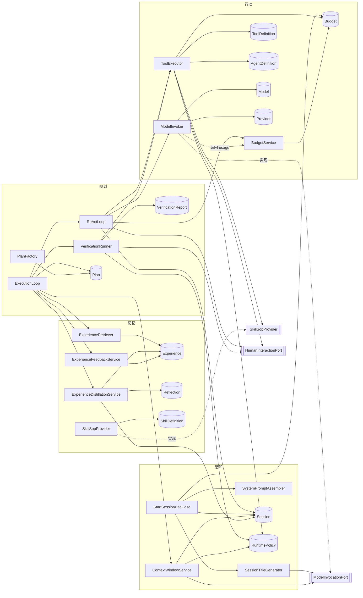
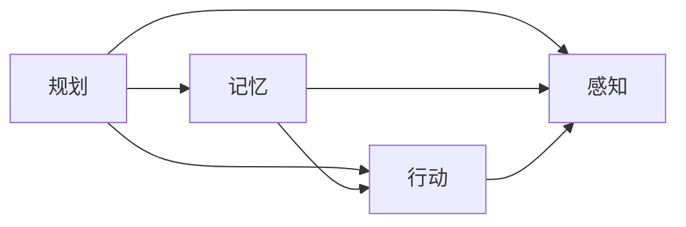
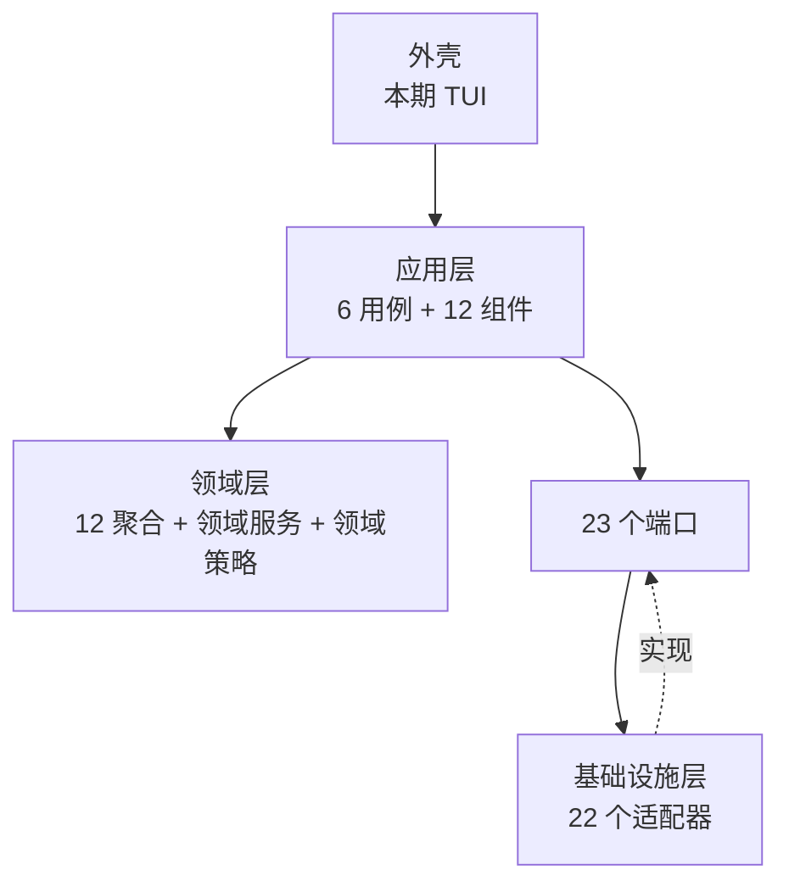

# Jellyfish Agent 领域模型

> 组织方式按**模块分组**，与 `模块-感知.md`、`模块-行动.md`、`模块-规划.md`、`模块-记忆.md` 一一对应。

---

## 一、领域模型总图（按模块）

```mermaid
classDiagram
    namespace 感知模块 {
        class Session {
            <<AggregateRoot>>
            -SessionId id
            -SessionId parentSessionId
            -AgentId agentId
            -ModelId activeModelId
            -String title
            -Date createdDate
            -List~Record~ records
            -SystemPromptSnapshot systemPromptSnapshot
            +appendRecord(RecordRole, String, ToolResultPayload) Record
            +buildContextForLlm(ContextWindowPolicy) ContextWindow
            +markSummarized(String summary)
            +switchModel(ModelId)
            +cancel()
        }
        class Record {
            <<Entity>>
            -RecordId id
            -RecordRole role
            -String content
            -ToolResultPayload toolPayload
            -int sequence
            -Date date
        }
        class ToolResultPayload {
            <<ValueObject>>
            -boolean isTruncated
            -String resourceUri
        }
        class SystemPromptSnapshot {
            <<ValueObject>>
            -String renderedPrompt
            -List~ToolSchemaSnapshot~ toolList
            -List~SkillSummarySnapshot~ skillList
        }
        class ToolSchemaSnapshot {
            <<ValueObject>>
            -String name
            -String description
            -String parametersJsonSchema
            -String outputDescription
        }
        class SkillSummarySnapshot {
            <<ValueObject>>
            -String name
            -String description
        }
        class ContextWindow {
            <<ValueObject>>
            -List~Record~ records
            -ContextUsage usage
        }
        class ContextUsage {
            <<ValueObject>>
            -int usedTokens
            -int inputCeiling
            -int systemTokens
            -int summaryTokens
            -int windowRecordCount
        }
        class ContextWindowPolicy {
            <<ValueObject>>
            -int recordCount
            -double systemRatioLimit
        }
        class RuntimePolicy {
            <<AggregateRoot>>
            +int maxRetries
            +int reflectionThreshold
            +int maxReplanGeneration
            +int maxReActRounds
            +int summarizationTokenThreshold
            +int inputSafetyMargin
            +int contextWindowRecordCount
            +double systemRecordRatioLimit
            +int toolResultTruncateLength
            +int subagentExecutionTimeoutMillis
            +int experienceCapacity
            +int experienceTopN
            +int experiencePerPlan
            +double experienceInitialConfidence
            +double experienceConfidenceStep
            +double experienceRetireThreshold
            +double budgetWarnRatio
            +long budgetLimitTokens
            +int skillCapacity
            +List~ModelId~ modelFallbackChain
            +List~ToolId~ trustedToolIds
            +isToolTrusted(ToolId) boolean
            +needsReflection(int) boolean
            +adjust(...)
        }
        class RecordRole {
            <<Enumeration>>
            SYSTEM
            USER
            ASSISTANT
            TOOL_REQUEST
            TOOL_RESULT
            SUMMARY
        }
        class AgentSnapshotInput {
            <<ValueObject>>
            -AgentId agentId
            -PromptTemplate basePrompt
            -Map promptVariables
            -List~ToolSchemaSnapshot~ activeTools
            -List~SkillSummarySnapshot~ activeSkills
            -List~String~ sopReferencedToolNames
        }
        class StartSessionUseCase {
            <<ApplicationService>>
            +start(AgentId, ModelId, String) Session
            +startSubSession(SessionId, AgentId, ModelId, String) Session
        }
        class SessionTitleGenerator {
            <<DomainService>>
            +generate(Session) String
        }
        class SystemPromptAssembler {
            <<DomainService>>
            +assemble(AgentSnapshotInput) SystemPromptSnapshot
        }
        class ContextWindowService {
            <<DomainService>>
            +ensureWithinLimit(Session) void
            +forceCollapse(Session) void
        }
    }

    namespace 行动模块 {
        class ToolDefinition {
            <<AggregateRoot>>
            -ToolId id
            -String name
            -String description
            -ToolSchema inputSchema
            -ToolSchema outputSchema
            -ToolSource source
            -SideEffectLevel sideEffect
            -int timeoutMillis
            -ToolStatus status
            +updateMetadata(String, ToolSchema)
            +activate()
            +deprecate()
            +validateArgs(Map)
        }
        class ToolSchema {
            <<ValueObject>>
            -String jsonSchemaString
        }
        class ToolSource {
            <<ValueObject>>
            -SourceType type
            -String endpointOrIdentifier
        }
        class SourceType {
            <<Enumeration>>
            INTERNAL
            NATIVE
            REST
            MCP
            PLUGIN
        }
        class SideEffectLevel {
            <<Enumeration>>
            READ_ONLY
            REPEATABLE
            IRREVERSIBLE
        }
        class ToolStatus {
            <<Enumeration>>
            DRAFT
            ACTIVE
            DEPRECATED
        }
        class PluginManifest {
            <<AggregateRoot>>
            -PluginId id
            -String version
            -int apiVersion
            -boolean trusted
            -Date grantedAt
            -Set~ToolId~ toolIds
            -Set~String~ declaredCapabilities
            -Set~String~ grantedCapabilities
            +create(PluginId, String, int, Set~ToolId~, Set~String~, boolean, Date) PluginManifest
            +grant(String)
            +revoke(String)
            +isTrusted() boolean
        }
        class Provider {
            <<AggregateRoot>>
            -ProviderId id
            -String name
            -String apiEndpoint
            -ChatProtocol protocol
            -ApiCredential credential
            -ProviderStatus status
            +updateCredential(ApiCredential)
            +activate()
            +deprecate()
        }
        class Model {
            <<AggregateRoot>>
            -ModelId id
            -ProviderId providerId
            -String modelName
            -ModelStatus status
            -ContextLimit contextLimit
            -List~ModelCapability~ capabilities
            +hasCapability(ModelCapability) boolean
            +activate()
            +deprecate()
        }
        class ApiCredential {
            <<ValueObject>>
            -String apiKeyRef
        }
        class ContextLimit {
            <<ValueObject>>
            -int maxInputTokens
            -int maxOutputTokens
        }
        class ModelCapability {
            <<ValueObject>>
            -String capabilityName
        }
        class ProviderStatus {
            <<Enumeration>>
            ACTIVE
            DEPRECATED
        }
        class ChatProtocol {
            <<Enumeration>>
            OPENAI_CHAT
            ANTHROPIC_MESSAGES
            GEMINI
        }
        class ModelStatus {
            <<Enumeration>>
            ACTIVE
            DEPRECATED
        }
        class AgentDefinition {
            <<AggregateRoot>>
            -AgentId id
            -String name
            -AgentSource source
            -PromptTemplate basePrompt
            -AgentStatus status
            -List~ToolId~ toolIds
            -List~SkillId~ skillIds
            +listBoundToolIds() List~ToolId~
            +listBoundSkillIds() List~SkillId~
            +bindTool(ToolId)
            +unbindTool(ToolId)
            +bindSkill(SkillId)
            +updatePrompt(PromptTemplate)
            +activate()
            +deprecate()
        }
        class PromptTemplate {
            <<ValueObject>>
            -String templateText
            -List~String~ variables
            +render(Map) String
        }
        class AgentSource {
            <<Enumeration>>
            USER_DEFINED
            BUILT_IN
        }
        class AgentStatus {
            <<Enumeration>>
            DRAFT
            ACTIVE
            DEPRECATED
        }
        class Budget {
            <<AggregateRoot>>
            -BudgetId id
            -SessionId sessionFamilyRootId
            -long consumedTokens
            -boolean warned
            +recordUsage(long tokens, RuntimePolicy policy)
            +shouldWarn(RuntimePolicy) boolean
        }
        class ToolExecOutcome {
            <<ValueObject>>
            -String content
            -boolean isTruncated
            -String resourceUri
        }
        class ModelInvocationRequest {
            <<ValueObject>>
            -ModelId targetModelId
            -String systemPrompt
            -List~ChatMessage~ messages
            -List~ToolSchemaSnapshot~ tools
            -int estimatedPromptTokens
            -ModelCapability requiredCapability
        }
        class ModelInvocationResult {
            <<ValueObject>>
            -String text
            -List~ToolCall~ toolCalls
            -ModelUsage usage
            -ModelId servedModelId
        }
        class ChatMessage {
            <<ValueObject>>
            -RecordRole role
            -String content
            -List~ToolCall~ toolCalls
            -String toolCallId
        }
        class ToolCall {
            <<ValueObject>>
            -String callId
            -String name
            -String argumentsJson
        }
        class ModelUsage {
            <<ValueObject>>
            -long inputTokens
            -long outputTokens
        }
        class ToolExecutor {
            <<DomainService>>
            +execute(Session, ToolDefinition, Map) ToolExecOutcome
        }
        class ModelInvoker {
            <<DomainService>>
            +invoke(ModelInvocationRequest) ModelInvocationResult
        }
        class BudgetService {
            <<DomainService>>
            +recordUsage(SessionId, long)
            +settleFromSubSession(SessionId, long)
        }
    }

    namespace 规划模块 {
        class Plan {
            <<AggregateRoot>>
            -PlanId id
            -SessionId sessionId
            -String goal
            -PlanStatus status
            -int replanGeneration
            -List~PlanStep~ steps
            +getCurrentStep() PlanStep
            +assignExperiences(StepId, List~ExperienceId~)
            +markStepSucceeded(StepId, String, VerificationReportId)
            +markStepFailed(StepId, VerificationReportId)
            +markAttemptInterrupted(StepId, int)
            +recordReflection(StepId, int, ReflectionId)
            +recordSkillUsage(StepId, int, SkillId)
            +applyReplan(List~PlanStep~)
            +terminate(String)
        }
        class PlanStep {
            <<Entity>>
            -StepId id
            -int sequence
            -String description
            -String goal
            -String expectedOutcome
            -String verificationCriteria
            -Set~VerificationType~ requiredVerifications
            -StepStatus status
            -List~Attempt~ attempts
            -List~ExperienceId~ assignedExperienceIds
            -String finalOutput
            -VerificationReportId finalVerificationReportId
        }
        class Attempt {
            <<Entity>>
            -int attemptNo
            -RecordRange recordRange
            -List~SessionId~ childSessionIds
            -List~SkillId~ usedSkillIds
            -VerificationReportId verificationReportId
            -ReflectionId reflectionId
            -AttemptOutcome outcome
        }
        class RecordRange {
            <<ValueObject>>
            -RecordId startRecordId
            -RecordId endRecordId
        }
        class VerificationReport {
            <<AggregateRoot>>
            -VerificationReportId id
            -PlanId planId
            -StepId stepId
            -int attemptNo
            -VerificationOutcome outcome
            -VerificationType failedType
            -String failureReason
            -Date decidedAt
        }
        class PlanStatus {
            <<Enumeration>>
            EXECUTING
            REPLANNING
            COMPLETED
            FAILED
        }
        class StepStatus {
            <<Enumeration>>
            PENDING
            RUNNING
            VERIFYING
            SUCCEEDED
            FAILED
            SUPERSEDED
            CANCELLED
        }
        class AttemptOutcome {
            <<Enumeration>>
            SUCCEEDED
            FAILED
            INTERRUPTED
        }
        class VerificationOutcome {
            <<Enumeration>>
            PASSED
            FAILED
            UNDETERMINED
        }
        class VerificationType {
            <<Enumeration>>
            DETERMINISTIC
            ENV_FEEDBACK
            LLM_JUDGE
            HUMAN_APPROVAL
        }
        class IterationResult {
            <<ValueObject>>
            -boolean isConverged
            -boolean submitted
            -String submittedSummary
            -int round
            -List~SkillId~ usedSkillIds
        }
        class SessionRunner {
            <<ExtensionPoint>>
            +run(Session, ChunkSink, CancellationToken, RunContext) RunOutcome
        }
        class RunOutcome {
            <<Enumeration>>
            CONVERGED
            SUSPENDED
            ROUNDS_EXHAUSTED
        }
        class RunContext {
            <<ValueObject>>
            -Session session
            -ChunkSink sink
            -CancellationToken cancellation
            -ModelInvocationPort model
            -ToolInvoker tools
            -HumanInteractionPort human
            -ProgressPort progress
            -PlanRepository plans
            -ContextWindowService contextWindow
        }
        class ExecutionLoop {
            <<ApplicationService>>
            +run(Session, ChunkSink, CancellationToken, RunContext) RunOutcome
        }
        class ReActLoop {
            <<ApplicationService>>
            +runIteration(Session, PlanStep) IterationResult
        }
        class VerificationRunner {
            <<ApplicationService>>
            +verify(PlanStep, Attempt) VerificationReport
        }
        class PlanFactory {
            <<DomainService>>
            +create(Session, Map) Plan
        }
    }

    namespace 记忆模块 {
        class Experience {
            <<AggregateRoot>>
            -ExperienceId id
            -String applicableScenario
            -LessonLearned lesson
            -ConfidenceScore confidence
            -ExperienceStatus status
            -int appliedCount
            -Date createdAt
            +reinforce()
            +penalize()
            +archive()
            +mergeWith(Experience)
        }
        class LessonLearned {
            <<ValueObject>>
            -String instruction
            -String expectedOutcome
        }
        class ConfidenceScore {
            <<ValueObject>>
            -double value
        }
        class ExperienceStatus {
            <<Enumeration>>
            ACTIVE
            ARCHIVED
        }
        class Reflection {
            <<AggregateRoot>>
            -ReflectionId id
            -PlanId planId
            -StepId stepId
            -int attemptNo
            -String conclusion
            -Date createdAt
        }
        class SkillDefinition {
            <<AggregateRoot>>
            -SkillId id
            -String name
            -String description
            -String triggerCondition
            -InstructionTemplate sopTemplate
            -SkillStatus status
            -boolean mutable
            +create(SkillId, String, String, String, String) SkillDefinition
            +revise(String, String, String, String)
            +isActive() boolean
            +isMutable() boolean
        }
        class InstructionTemplate {
            <<ValueObject>>
            -String rawMarkdown
        }
        class SkillStatus {
            <<Enumeration>>
            DRAFT
            ACTIVE
            DEPRECATED
        }
        class RetrievalInput {
            <<ValueObject>>
            -PlanId planId
            -List~StepBrief~ steps
        }
        class StepBrief {
            <<ValueObject>>
            -StepId stepId
            -String description
        }
        class DistillationInput {
            <<ValueObject>>
            -PlanId planId
            -SessionId sessionId
            -String goal
            -PlanStatus outcome
            -List~StepTrace~ stepTraces
        }
        class StepTrace {
            <<ValueObject>>
            -StepId stepId
            -String description
            -StepStatus outcome
            -RecordRange recordRange
            -List~SessionId~ childSessionIds
            -List~SkillId~ usedSkillIds
            -String failureReason
            -String reflectionConclusion
        }
        class FeedbackInput {
            <<ValueObject>>
            -StepId stepId
            -List~ExperienceId~ injectedExperienceIds
            -List~ExperienceId~ suggestedExperienceIds
        }
        class ExperienceRetriever {
            <<ApplicationService>>
            +retrieveAndAssign(RetrievalInput) Map
        }
        class PlanCompletionCurator {
            <<ApplicationService>>
            +curate(Session, DistillationInput) DistillationOutcome
        }
        class ExperienceDistillationService {
            <<ApplicationService>>
            +apply(ExperienceDraft, SessionId)
        }
        class SkillDistillationService {
            <<ApplicationService>>
            +apply(SkillDraft, SessionId)
        }
        class ExperienceFeedbackService {
            <<ApplicationService>>
            +onStepSucceeded(FeedbackInput)
            +onStepFailed(FeedbackInput)
        }
        class SkillSopProvider {
            <<Port>>
            +sop(String skillId) String
        }
    }

    namespace 端口 {
        class ModelInvocationPort {
            <<Port>>
            +invoke(ModelInvocationRequest) ModelInvocationResult
            +describe(ModelId) ModelProfile
        }
        class ModelProfile {
            <<ValueObject>>
            -int maxInputTokens
            -int maxOutputTokens
        }
        class ExternalToolPort {
            <<Port>>
            +invoke(ToolDefinition, Map) String
        }
        class HumanInteractionPort {
            <<Port>>
            +ask(Question) Answer
        }
        class PluginRepository {
            <<Port>>
            +list() List~PluginManifest~
            +load(PluginId) PluginManifest
            +save(PluginManifest)
        }
        class PluginRuntimePort {
            <<Port>>
            +discover() List~PluginDescriptor~
            +toolsOf(PluginId) List~ToolDefinition~
            +start(PluginId)
            +stop(PluginId)
            +unload(PluginId)
            +extension(PluginId, String) Object
            +conflictsOf(PluginId) List~String~
        }
        class PluginDescriptor {
            <<ValueObject>>
            -PluginId id
            -String version
            -int apiVersion
            -boolean loaded
        }
        class ToolInvoker {
            <<ExtensionPoint>>
            +execute(Session, String, Map, RecordId) ToolExecOutcome
        }
    }

    namespace 领域事件 {
        class PlanCreated
        class PlanCompleted
        class PlanFailed
        class StepFailed
        class VerificationRejected
        class ReflectionRecorded
        class ExperienceCreated
        class ExperienceReinforced
        class SkillLearned
        class SkillRevised
        class ExperiencePenalized
        class BudgetWarning
        class SummarizationCompleted
        class SessionCancelled
        class ModelSwitched
        class PolicyAdjusted
        class ToolDefinitionUpdatedEvent
    }

    namespace 应用事件 {
        class SummarizationStarted
        class ExperienceDistillationFinished
    }

    %% ---------- 感知内部 ----------
    Session "1" *-- "0..*" Record : append-only
    Session "1" *-- "1" SystemPromptSnapshot : 会话开启时冻结
    Record *-- ToolResultPayload
    SystemPromptSnapshot *-- ToolSchemaSnapshot
    SystemPromptSnapshot *-- SkillSummarySnapshot
    Record --> RecordRole
    Session ..> ContextWindow : buildContextForLlm 推导
    ContextWindow *-- ContextUsage
    ContextWindow ..> ContextWindowPolicy
    SystemPromptAssembler ..> AgentSnapshotInput : 入参
    SystemPromptAssembler ..> SystemPromptSnapshot : 产出

    %% ---------- 跨模块 ID 引用 ----------
    Session "0..1" --> "0..*" Session : parentSessionId
    Session ..> AgentDefinition : agentId
    Session ..> Model : activeModelId
    Plan ..> Session : sessionId
    Budget ..> Session : sessionFamilyRootId
    Model ..> Provider : providerId
    AgentDefinition ..> ToolDefinition : toolIds
    AgentDefinition ..> SkillDefinition : skillIds
    Attempt ..> Session : childSessionIds
    Attempt ..> Reflection : reflectionId
    Attempt ..> VerificationReport : verificationReportId
    PlanStep ..> Experience : assignedExperienceIds

    %% ---------- 规划内部 ----------
    ExecutionLoop ..> SessionRunner : 实现（默认编排）
    SessionRunner ..> RunContext : 入参
    SessionRunner ..> RunOutcome : 产出
    Plan "1" *-- "1..*" PlanStep
    PlanStep "1" *-- "0..*" Attempt
    Attempt *-- RecordRange
    Plan --> PlanStatus
    PlanStep --> StepStatus
    Attempt --> AttemptOutcome
    PlanStep ..> VerificationType
    VerificationReport --> VerificationOutcome
    VerificationReport --> VerificationType

    %% ---------- 行动内部 ----------
    PluginManifest --> ToolDefinition : toolIds（只记归属，不改工具定义）
    PluginRuntimePort ..> PluginDescriptor : 产出
    ToolExecutor ..> ToolInvoker : 实现
    ToolDefinition *-- ToolSchema
    ToolDefinition *-- ToolSource
    ToolDefinition --> SideEffectLevel
    ToolDefinition --> ToolStatus
    ToolSource --> SourceType
    Provider *-- ApiCredential
    Provider --> ProviderStatus
    Provider --> ChatProtocol
    Model *-- ContextLimit
    Model *-- ModelCapability
    Model --> ModelStatus
    AgentDefinition *-- PromptTemplate
    AgentDefinition --> AgentSource
    AgentDefinition --> AgentStatus

    ModelInvocationRequest *-- ChatMessage
    ModelInvocationResult *-- ToolCall
    ModelInvocationResult *-- ModelUsage
    ChatMessage *-- ToolCall
    ChatMessage ..> RecordRole : role（复用流水角色）

    %% ---------- 记忆内部 ----------
    Experience *-- LessonLearned
    Experience *-- ConfidenceScore
    Experience --> ExperienceStatus
    SkillDefinition *-- InstructionTemplate
    SkillDefinition --> SkillStatus
    DistillationInput *-- StepTrace

    %% ---------- 事件 raise ----------
    Plan ..> PlanCreated : raises
    Plan ..> PlanCompleted : raises
    Plan ..> PlanFailed : raises
    Plan ..> StepFailed : raises
    VerificationReport ..> VerificationRejected : raises
    Reflection ..> ReflectionRecorded : raises
    Experience ..> ExperienceCreated : raises
    Experience ..> ExperienceReinforced : raises
    Experience ..> ExperiencePenalized : raises
    SkillDefinition ..> SkillLearned : raises
    SkillDefinition ..> SkillRevised : raises
    Budget ..> BudgetWarning : raises
    Session ..> SummarizationCompleted : raises
    Session ..> SessionCancelled : raises
    Session ..> ModelSwitched : raises
    RuntimePolicy ..> PolicyAdjusted : raises
    ToolDefinition ..> ToolDefinitionUpdatedEvent : raises
```

---

## 二、服务与端口协作图



---

## 三、模块与分层归属表

| 归属 | 定位 | 聚合 | 服务 / 组件 | 端口 |
|---|---|---|---|---|
| **感知** | 模型此刻能看到什么：上下文流水 + 快照 + 窗口折叠 + 运行环境策略 | `Session`、`RuntimePolicy` | `SystemPromptAssembler`（领域）；`StartSessionUseCase`、`ContextWindowService`、`SessionTitleGenerator`（应用） | 声明 `ModelInvocationPort` |
| **行动** | 能做什么 / 用什么做 / 花多少钱：工具、模型、代理、预算、**插件** | `ToolDefinition`、`Provider`、`Model`、`AgentDefinition`、`Budget`、**`PluginManifest`** | `ToolExecutor`、`BudgetService`（应用）；`ModelInvoker`、`SkillSopProvider`（基础设施） | `ExternalToolPort`、`PluginRepository`、`PluginRuntimePort` |
| **规划** | 想怎么做 / 做到哪 / 算不算做成 | `Plan`、`VerificationReport` | `PlanFactory`、`VerificationChain`（领域）；`ExecutionLoop`、`ReActLoop`、`VerificationRunner`（应用） | — |
| **记忆** | 学到的东西如何留存与复用（经验 + 技能自动沉淀） | `Experience`、`Reflection`、`SkillDefinition` | `ExperienceRetriever`、`PlanCompletionCurator`、`ExperienceDistillationService`、`SkillDistillationService`、`ExperienceFeedbackService`（应用） | 声明 `SkillSopProvider`（由基础设施 `FileSkillSopProvider` 实现）；内置代理走 `ModelInvocationPort` |
| **应用层** | 用例编排、事务与提交顺序、端口契约、并发 | —（只编排，不持有聚合） | 7 个用例 + 15 个组件（见《模块-应用层》） | 定义并被基础设施实现 |
| **基础设施层** | 端口背后：文件、模型、时钟、插件 | — | 22 个适配器（见《模块-基础设施层》） | 实现 21 个端口（`HumanInteractionPort` / `ProgressPort` 由外壳实现，见 D19） |

**依赖方向（单向，无环）**



三条纪律保证它成立：

1. **需要别人的内容时，由调用方取好传入**（值对象入参：`ContextWindowPolicy`、`AgentSnapshotInput`、`DistillationInput`、`RetrievalInput`、`FeedbackInput`、`ModelInvocationRequest`）；
2. **需要别人的动作时，走端口**（`ModelInvocationPort`、`ExternalToolPort`、`SkillSopProvider`、`HumanInteractionPort`）；
3. **只读别人的聚合不算依赖**（记忆按 `RecordRange` 只读 `Session.Record`；绝不追写）。

---

## 四、聚合清单与不变量

| 聚合 | 一句话 | 不变量（**均不依赖 `RuntimePolicy`**） |
|---|---|---|
| `Session` | 会话上下文事实流 | ① `Record` 只追加，被引用区间永不删改；② 快照创建即冻结；③ Agent 不可切换；④ 父取消级联子；⑤ **没有状态**：存在即可用（D22） |
| `RuntimePolicy` | 运行环境策略单例 | ① 全局唯一；② 不进会话快照；③ 只有用户可改 |
| `ToolDefinition` | 一个可调用的动作定义 | ① 入参须过 `inputSchema`；② `INTERNAL` 必须指向已注册处理器 |
| `Provider` | 供应商与凭据持有者 | ① 凭据只存于此；② 一 Provider 多 Model |
| `Model` | 具体模型与能力 | ① 仅 `ACTIVE` 可调用；② 无价格概念 |
| `AgentDefinition` | 代理身份与能力边界 | ① 内置代理 prompt 不可改；② 会话内 Agent 不可切换 |
| `Budget` | 会话族 token 台账 | ① 一族一账；② 只累加，不预留不分配；③ `warned` 只置真一次 |
| `PluginManifest` | 一个插件的授权意图（唯一落盘的东西） | ① `id` 必须等于 jar 内 `Plugin-Id`；② `grantedCapabilities ⊆ declaredCapabilities`；③ 同一端口至多一个启用者（跨插件由应用层校验）；④ `apiVersion` 不符即不能安装/启用 |
| `Plan` | 一次工作分解 | ① `steps` 非空；② 同时至多一个 `RUNNING` step；③ `SUCCEEDED` 不可变；④ Replan 只替换未执行尾部；⑤ 单写者无需乐观锁 |
| `VerificationReport` | 一次判定的结论 | ① 不可变；② 三态；③ 只留失败层与失败原因 |
| `Experience` | 一条经验 | ① 置信度 `[0,1]`；② 不绑定任何维度；③ `ARCHIVED` 不参与检索；④ 不超容量 |
| `Reflection` | 一次反思结论 | ① 不可变；② 唯一归属 `(planId, stepId, attemptNo)` |
| `SkillDefinition` | 程序性知识（SOP）：人写与机学同构，`mutable` 区分系统能否改 | ① 仅 `ACTIVE` 进快照；② 不含工具依赖；③ **`mutable = false` ⇒ `revise()` 必须失败**；④ 四件套非空；⑤ `status` 只由 front-matter 决定 |

---

## 五、核心规则

### 5.1 驱动：外循环 = do-while（应用层 `ExecutionLoop`）

```
ExecutionLoop.run(session):
    loop:
        ContextWindowService.ensureWithinLimit(session)       // 阻塞；算窗口、必要时折叠
        step = session.hasExecutablePlan() ? plan.getCurrentStep() : null
        iter = ReActLoop.runIteration(session, step)    // 内循环只在"模型不再调工具"时返回

        if !iter.isConverged:                                  // 撞 maxReActRounds
            plan.markAttemptFailed(step, attempt.attemptNo)      // 判当前 attempt；iter.round 是内循环轮次
            advanceAfterFailure(step)                          // 重试 / 反思 / 重划
            continue                                           // 不需要用户介入，继续下一轮

        if step == null: return                                // 无计划且收敛：本轮交互完成
        if !iter.submitted: return                             // 模型在等用户：本轮结束，Attempt 挂起

        // 已提交
        if step.requiredVerifications.isEmpty():
            plan.markStepSucceeded(step, iter.submittedSummary, null)   // 不验证即完成
        else:
            report = VerificationRunner.verify(step, iter.attempt)
            advance(step, report)                              // 通过 → 推进；失败 → 重试/反思/重划
```

- **工具只有一类**：`generate_plan`、`submit_step`、`ask_user`、`spawn_subagents`、`load_skill` 都是普通 `INTERNAL` 工具；
- `generate_plan` 成功后**不打断内循环**，模型确认后自然收敛，下一轮迭代转入计划执行；
- 计划 `COMPLETED` 后会再跑一轮**自由内循环**，由模型产出最终答复（结论交付）；
- **三条出口**：未收敛（撞轮次上限）⇒ 判失败后**继续**；无计划且收敛 ⇒ **结束**；有计划、收敛但**未提交** ⇒ **挂起**（Attempt 不落终态，等用户输入）；
- 经验检索的触发点是**计划诞生 / 计划重划**，不是每轮迭代。

### 5.2 `Attempt` = 一个 step 的一次完整执行周期

| 结束方式 | outcome | 消耗重试 |
|---|---|---|
| `submit_step` → 验证通过 | `SUCCEEDED` | — |
| 验证失败 / 执行失败 | `FAILED` | ✅ |
| 中断（Ctrl-C / 进程退出） | `INTERRUPTED` | ❌ |
| 收敛但未提交 | **不结束**，用户输入后续跑 | ❌ |

`recordRange` 始终连续（用户输入、注入、摘要都是 `Record`）；`retryCount` = `FAILED` 数；`maxReActRounds` 按"自上次用户输入以来的连续轮数"计。

### 5.3 上下文

- 窗口 = **推导**（不落库）：`SYSTEM 记录` + `最新 SUMMARY` + `最近 n 条非 SYSTEM、非 SUMMARY`；`systemTokens/usedTokens > systemRatioLimit` ⇒ 只留系统提示词；
- 有效上限 = `min(summarizationTokenThreshold, maxInputTokens − inputSafetyMargin(默认 10000))`；
- `ContextLimit` 语义：`maxInputTokens` 与 `maxOutputTokens` **相互独立**；共享窗口的供应商由配置者自行扣除；
- 用量随请求下行：`ContextUsage.usedTokens → ModelInvocationRequest.estimatedPromptTokens`，**执行器不回查 `Session`**。

### 5.4 验证

- 固定链序 `DETERMINISTIC → ENV_FEEDBACK → LLM_JUDGE → HUMAN_APPROVAL`，按 step 声明过滤、短路；
- 报告只留失败层 + 失败原因；三态 `PASSED / FAILED / UNDETERMINED`，`UNDETERMINED` ⇒ 转人工；
- `requiredVerifications` 为空 ⇒ 不验证、不产生报告（模型自证）；
- 两个审批位置：执行前**放行审批**（非只读且未命中信任清单）、执行后**结果验收**；人工层返回"同意 / 不同意 + 必填原因"。

### 5.5 经验

| 环节 | 触发 | 规则 |
|---|---|---|
| 反思 | 有效重试次数 ≥ `reflectionThreshold` | `reflectionThreshold > maxRetries` ⇒ 永不反思；结论双用途（回注 + 沉淀素材） |
| 沉淀 | `PlanCompleted` / `PlanFailed` | 归纳子代理；读 `RecordRange` 原始轨迹；每 Plan ≤ `experiencePerPlan` 条；语义重复 ⇒ 合并 + 提置信度 |
| 检索 | 计划诞生 / 计划重划 | 全库交检索子代理语义筛选，每 step Top-N |
| 反馈 | step 结束 | 成功 ⇒ 仅对"被建议的" `reinforce`；失败 ⇒ 对"注入的全部" `penalize` |
| 置信度 | — | `[0,1]`，初值 0.5，±0.1，`< 0.2` 淘汰；容量超限淘汰"最早 + 最少使用" |

### 5.6 预算与异常

| 情形 | 语义 | 结果 |
|---|---|---|
| `BudgetWarning` | 首次越过 `budgetWarnRatio`（默认 80%） | 内循环 `ask_user` 询问是否继续；一族只报一次；**不中断** |
| **模型不可用** | 环境故障，**不是状态迁移** | `run()` 立即返回；`Plan` 保持 `EXECUTING`、step 保持 `RUNNING`、`Attempt` 不结束；不耗重试、不触发反思/重划；只提示 |
| **请求超限** | 业务预算问题 | `ModelInvoker` 抛错；外循环 `ContextWindowService.forceCollapse()` 后重试一次；不耗重试；仍超限 ⇒ 按模型不可用处理 |
| 工具自身失败 | **不是领域状态** | 作为"一种工具结果"回灌模型，ReAct 继续 |

### 5.7 分层实现约定（应用层 / 基础设施层）

| 约定 | 内容 |
|---|---|
| **提交顺序** | 一次状态转移内固定「不可变事实 → 追加流水 → 替换聚合」；由 `CommitScope` 强制，应用层只 stage |
| **事件只通知** | 领域事件在提交后同步派发，**不得驱动任何 IO 长任务**；检索/沉淀由 `ExecutionLoop` 显式调用 |
| **持久化形态** | 文件系统 + 单写者；`RecordRange` 基于 `seq`（不基于文件位置），流水超 32 MiB 滚动 |

详见《模块-应用层》第 7 节与《模块-基础设施层》第 5 节。

### 5.8 技能自动沉淀（M37）

| 环节 | 触发 | 规则 |
|---|---|---|
| 判定 | 计划完结（`COMPLETED` / `FAILED` 都会判定） | **一次子代理调用、一个判定**：本次 plan 用过技能 ⇒ 逐个判"是否改进"；没用过 ⇒ 判"是否沉淀一条新技能"并同时判"是否是一条经验"。经验与技能**互斥**，同一件事只进一边 |
| 沉淀 | 没用过技能 | 至多 1 条，取最通用的流程；四件套（`name / description / triggerCondition / 正文`）非空；`ACTIVE` 技能总数达 `skillCapacity` ⇒ 不沉淀 + 提醒 |
| 改进 | 用过技能 | 只看**本次结果**（验证报告 + 轨迹 + 现有正文），零计数零阈值；产物为 `MERGE(target)`，`target` 必须 `ACTIVE` 且 `mutable` |
| 去重 | 沉淀/改进 | 子代理输出 `CREATE` 或 `MERGE(target)`；`target` 不存在 ⇒ 整次作废；`target` 不可变或已下线 ⇒ 降级 `CREATE` |
| 落地 | — | 只经聚合（`create` / `revise`）→ `CatalogRepository.saveSkill` 原子重写 `skills/<id>/SKILL.md`；子代理只产出文本，不碰文件 |
| 生效 | — | 写出即 `ACTIVE`、立即可用；但**只进新会话的清单**（会话快照冻结清单与三件套）。**正文不冻结**：`load_skill` 现读，接受漂移（S3） |
| 淘汰 | — | **无自动淘汰**：用户直接删 `skills/` 目录，或 front-matter 改 `status: deprecated` |

### 5.9 插件与扩展点（M42）

| 环节 | 规则 |
|---|---|
| **形态** | 插件 = 一组工具声明（jar 内 `META-INF/jellyfish/tools/*.json`）+ 若干端口实现 + 一份 `plugin.json`。进程内代码，PF4J 3.16.0（JDK 8 可用） |
| **落盘只存意图** | `plugins/<id>/plugin.json` 只存"已安装 / 信任 / 勾选了哪些能力"；**"已加载/加载失败"是进程内事实，不落盘**（与 D22 同构）。卸载 = 删目录 |
| **工具** | `source.type = PLUGIN` 只作来源标记；执行**仍然走同一个处理器注册表**（`InternalToolHandler`），不新增处理器接口、不新增受限上下文 |
| **信任** | 安装时一次同意（`trusted` + `grantedAt`）⇒ 该插件的工具**免放行审批**（I3 的"信任清单"语义不变，只是信任来源多一种） |
| **可替换面** | 6 个端口（`HumanInteractionPort`、`ProgressPort`、`Clock`、`TokenCounter`、`ExternalToolPort`、`ModelInvocationPort`）+ **1 个编排扩展点 `SessionRunner`**（`ExecutionLoop` 是默认实现）。内层组件不单独开放 |
| **生效时机** | **声明**（工具清单、schema、技能清单）随会话快照冻结；**实现**（端口背后的代码、编排）实时生效 ⇒ 端口路由不能缓存 `final` 引用（丙） |
| **冲突** | 同一端口至多一个启用者；第二次启用被拒绝（提示与谁冲突）；运行期失败**不回退**默认实现（如实冒泡） |
| **启停** | 装/启/停/卸可动态；**同 id 升级要求重启**（ClassLoader 泄漏） |
| **版本** | `apiVersion` 不符或重复打包宿主已提供的依赖 ⇒ 拒绝安装；`Plugin-Requires` 做宿主版本校验 |
| **让渡** | 进程内无沙箱、无强杀、D09 只对默认实现成立、会话内行为不保证可复现（C1）、`RuntimePolicy` 不再唯一来源（C2） |

---

## 六、领域事件

> **总口径：领域事件一律只通知。** 不得驱动任何 IO，也不得作为跨模块协作的触发手段；需要别的模块做事时，由应用层显式调用（`ExecutionLoop` 调检索 / 沉淀 / 反馈，`ManageSessionUseCase` 做级联取消）。事件表的「订阅方」列因此只列界面 / 审计这类无副作用消费。

| 事件 | raise by | 触发时机 | 订阅方 |
|---|---|---|---|
| `PlanCreated` | `Plan` | `PlanFactory` 校验通过并创建 | **无功能性订阅方**：经验分配由 `ExecutionLoop` 显式调用；事件只供界面/审计 |
| `PlanCompleted` | `Plan` | 全部 step `SUCCEEDED` | **无功能性订阅方**：沉淀由 `ExecutionLoop` 显式调用；事件只供界面/审计 |
| `PlanFailed` | `Plan` | 外循环判定重划用尽并 `terminate()` | **无功能性订阅方**：沉淀由 `ExecutionLoop` 显式调用；界面 / 审计 |
| `StepFailed` | `Plan` | `markStepFailed()` | **无功能性订阅方**：外循环读 `markStepFailed` 后的聚合状态 |
| `VerificationRejected` | `VerificationReport` | 结论 `FAILED` / `UNDETERMINED` | **无功能性订阅方**：外循环直接用 `VerificationRunner.verify()` 的返回值 |
| `ReflectionRecorded` | `Reflection` | 反思结论落库 | **无功能性订阅方**：回注由外循环读 `Reflection`；沉淀由 `DistillationInput` 组装时读 |
| `ExperienceCreated` | `Experience` | 归纳产出新经验 | 无（界面可展示） |
| `ExperienceReinforced` | `Experience` | `reinforce()` 成功 / 语义重复合并 | 无 |
| `ExperiencePenalized` | `Experience` | `penalize()` 成功 | 无 |
| `SkillLearned` | `SkillDefinition` | `create(...)` 产出新技能 | 无（界面 / 审计） |
| `SkillRevised` | `SkillDefinition` | `revise(...)` 改写可变技能 | 无（界面 / 审计） |
| `BudgetWarning` | `Budget` | 首次越过阈值 | 内循环 → `ask_user`（**同一调用栈内的即时通知，等价于 `recordUsage` 的返回值，不是异步订阅**） |
| `SummarizationCompleted` | `Session` | `markSummarized()` 完成 | 界面 / 审计 |
| `SessionCancelled` | `Session` | 用户取消 | **无功能性订阅方**：级联取消由 `ManageSessionUseCase` 在同一事务内逐个 replace |
| `ModelSwitched` | `Session` | 降级命中备用链 | 审计 / 界面 |
| `PolicyAdjusted` | `RuntimePolicy` | 用户修改策略成功 | 只失效本地读取缓存（**缓存必须可失效**），不驱动任何动作 |
| `ToolDefinitionUpdatedEvent` | `ToolDefinition` | 元数据或 schema 更新 | **运行中会话不订阅**（快照已冻结） |

**应用事件**：`SummarizationStarted`（压缩开始，无状态转换）、`ExperienceDistillationFinished`（沉淀流程跑完）。

---

## 七、与模块文档的对应

| 文档 | 覆盖内容 |
|---|---|
| `模块-感知.md` | 会话、上下文流水、快照、窗口与折叠、运行环境策略 |
| `模块-行动.md` | 工具与执行、模型与供应商、代理身份、预算台账 |
| `模块-规划.md` | 计划、尝试、验证、驱动循环 |
| `模块-记忆.md` | 反思、经验、技能、检索与沉淀 |
| `模块-应用层.md` | 7 个用例、15 个应用组件、23 个端口契约、事务与提交顺序、并发模型、错误与恢复 |
| `模块-基础设施层.md` | 目录布局与文件形态、原子写与 fsync、启动清理、单写者锁、迁移、适配器实现要点 |

---

## 八、分层视图与端口全景



**23 个端口按用途分四组**

| 组 | 端口 |
|---|---|
| 持久化 | `CommitScope`、`SessionRepository`、`RecordStore`、`PlanRepository`、`VerificationReportRepository`、`ReflectionRepository`、`ExperienceRepository`、`BudgetRepository`、`PolicyRepository`、`CatalogRepository`、`ArtifactStore`、**`PluginRepository`** |
| 模型与外部 | `ModelInvocationPort`（`invoke` / `invokeStreaming`）、`ExternalToolPort`、`SkillSopProvider`、**`PluginRuntimePort`** |
| 人机与进度 | `HumanInteractionPort`、`ProgressPort`（**实现方：外壳**，见 D19）、`DomainEventPublisher` |
| 时间与生命周期 | `Clock`、`TokenCounter`、`InstanceLock`、`SchemaMigrator` |

> 口径：**应用层只认端口，基础设施只实现端口，领域层谁都不认。**
> 相对早期设计的两处收缩：取消 `SubagentRunnerPort`（检索/归纳已在应用层，直接调内置代理 prompt，不建子会话）、`InternalToolHandler` 收窄为 `SkillSopProvider`。
